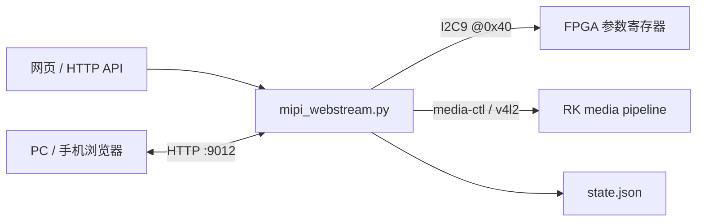

# MLK-AFC03 异构视频链路完整工程说明

**IMX415 →（MIPI CSI-2 x4）→ FPGA（ISP / DDR 缓存）→（MIPI CSI-2 x4）→ RK3576 → HDMI / 网页 / AI**

本工程基于米联客官方 `AFC03_IMX415_MIPI_RK(0531)` 例程整理、参数化并扩展，
目标是把 **MLK-AFC03（RK3576J + 安路 PH1A90SEG324）** 板内
「FPGA 采集 → MIPI 内部互联 → RK 显示 / 推流 / NPU 分析」整条链路做成可复现的工程。

- 快速命令集：[`QUICKSTART.md`](QUICKSTART.md)
- 相对官方例程的改动：[`MODIFICATIONS.md`](MODIFICATIONS.md)
- 网页推流/API：[`rk/web/README.md`](rk/web/README.md)
- RK 端部署/排错：[`rk/deploy/README.md`](rk/deploy/README.md)
- AI 模型与规则：[`rk/ai/README.md`](rk/ai/README.md)

---

## 目录

1. [系统概览](#1-系统概览)
2. [已实现功能](#2-已实现功能)
3. [系统架构](#3-系统架构)
4. [硬件与接线](#4-硬件与接线)
5. [软件环境](#5-软件环境)
6. [目录结构](#6-目录结构)
7. [部署步骤](#7-部署步骤)
8. [日常运行](#8-日常运行)
9. [FPGA 端设计](#9-fpga-端设计)
10. [RK 端驱动与设备树](#10-rk-端驱动与设备树)
11. [摄像头参数与寄存器](#11-摄像头参数与寄存器)
12. [FPGA 预处理](#12-fpga-预处理)
13. [输出格式与模式切换](#13-输出格式与模式切换)
14. [网页控制台与 HTTP API](#14-网页控制台与-http-api)
15. [AI 人体检测 / 姿态 / 危险动作](#15-ai-人体检测--姿态--危险动作)
16. [云台控制](#16-云台控制)
17. [无线局域网访问](#17-无线局域网访问)
18. [性能实测](#18-性能实测)
19. [已知限制与注意事项](#19-已知限制与注意事项)
20. [常见问题排查](#20-常见问题排查)
21. [文档索引](#21-文档索引)
22. [发布包说明](#22-发布包说明)

---

## 1. 系统概览

| 项 | 内容 |
|---|---|
| 板卡 | 米联客 MLK-AFC03 异构开发板 |
| 主控 | RK3576J（4×A72 + 4×A53，6 TOPS NPU） |
| FPGA | 安路 Anlogic PH1A90SEG324 |
| 摄像头 | Sony IMX415（4-lane MIPI CSI-2） |
| FPGA→RK | 板内 MIPI CSI-2 **4 lane**，接 RK 的 `csi2_dphy3 / mipi3_csi2` |
| 显示 | HDMI 2.1 |
| 网络 | 千兆以太网 `end0` + USB WiFi（AIC8800） |
| 云台 | QGimbal，USB CDC-ACM `/dev/ttyACM0` |
| 核心链路 | 1080P@60 / 4K@25，YUV422-8bit（CSI-2 DT=0x1E） |

工程提供三条并行输出：

1. **HDMI 本地显示**：`v4l2src → kmssink`，实测 53.7 fps。
2. **网页 MJPEG**：`http://<板子IP>:9012/`，1080P 实测 59.6 fps，带完整调参控制台。
3. **RK3576 NPU AI**：人体检测 → 17 关节姿态 → 危险动作，标注直接叠加在推流画面上。

---

## 2. 已实现功能

| # | 功能 | 状态 | 入口 |
|---|---|---|---|
| 1 | FPGA→MIPI→RK 链路自检 | ✅ | `rk/deploy/rk_mipi_selftest.sh` |
| 2 | HDMI 全屏显示 | ✅ 53.7 fps | `rk/deploy/test_hdmi.sh` / `hdmi_view.sh` |
| 3 | 网页 MJPEG 推流 | ✅ 1080P@59.6 fps | `rk/web/start_webstream.sh`（:9012） |
| 4 | 软件画面调参 | ✅ | 网页「画面」页签 / `/api/params` |
| 5 | IMX415 曝光/增益/EV/白平衡/ROI | ✅ | 网页「摄像头」页签 / `/api/fpga` |
| 6 | FPGA 预处理（初级 5 项 + 高级 9 项） | ✅ | 网页「预处理」页签 / `/api/fpga` |
| 7 | 输出格式 1080P@60 / 4K@25 / 4K@30 | ✅（4K30 超带宽） | `/api/mode`（改 `mode.env` + 重启） |
| 8 | AI 人体检测 + 姿态 + 危险动作 | ✅ | `AI=1 start_webstream.sh` |
| 9 | 参数持久化（`state.json`） | ✅ | 服务端自动保存 |
| 10 | 云台键盘控制 / 回零 / 设零点 | ✅ | `rk/gimbal/gimbal_keyctrl.py` |
| 11 | 有线 / 无线局域网访问 | ✅ | 页头「局域网」芯片 / `/api/net` |
| 12 | 诊断、颜色校验、性能基准 | ✅ | `rk/deploy/`、`rk/web/`、`tools/` |

不支持：**720P@90**（FPGA RTL 未实现）；**4K@30** 带宽占用 99.5%，实测无法稳定出图。

---

## 3. 系统架构

### 3.1 视频数据通路

```mermaid
flowchart LR
    CAM["IMX415<br/>MIPI CSI-2 4lane"] -->|CSI RX| DPHYRX["FPGA D-PHY RX"]
    DPHYRX --> UNPACK["CSI-2 解包<br/>RAW10 还原"]
    UNPACK --> CROP["图像裁剪"]
    CROP --> ISP["米联客 ISP<br/>BLC / AWB / Demosaic / Gamma"]
    ISP --> YUV["RGB888 → YUV422<br/>BT.709 limited"]
    YUV --> DBUF["ui_dbuf + FDMA<br/>三帧缓存"]
    DBUF <--> DDR["DDR3"]
    DBUF --> VTC["VTC 1080P60 读时序"]
    VTC --> PACK["csi2_pack_yuv422_stream"]
    PACK --> FRAME["csi2_frame_tx<br/>DT=0x1E"]
    FRAME --> DPHYTX["FPGA D-PHY TX 4lane"]
    DPHYTX -->|板内 MIPI| RKDPHY["RK3576 csi2_dphy3<br/>mipi3_csi2"]
    RKDPHY --> DRV["milianke_mipi<br/>虚拟摄像头驱动"]
    DRV --> CIFISP["rkcif → rkisp → rkvpss"]
    CIFISP --> V22["/dev/video22"]
    V22 --> HDMI["HDMI 2.1 / kmssink"]
    V22 --> WEB["MJPEG :9012"]
    V22 --> AI["RKNN NPU 标注"]
```



### 3.2 控制通路



- FPGA 通过 **I2C9 地址 0x40** 作为从设备接收参数（底板已连好，无需飞线）。
- 分辨率切换不是运行时重开设备，而是写 `/root/rk/deploy/mode.env` 后**整板重启**，
  由 systemd 按新模式拉起（见第 13 节）。

---

## 4. 硬件与接线

### 4.1 必需硬件

1. MLK-AFC03 开发板（RK3576J + PH1A90SEG324）
2. IMX415 摄像头模组（4-lane）
3. HDMI 显示器
4. FPGA JTAG 下载器
5. 12V 电源
6. 按硬件手册装好 **RK3576J ↔ PH1A90SEG324 MIPI 内部互联跳线帽**

### 4.2 关键连接

| 信号 | 说明 |
|---|---|
| FPGA MIPI RX | IMX415 → FPGA |
| FPGA MIPI TX | FPGA → RK `csi2_dphy3` |
| `I_dsi_en` | RK GPIO1_D0 高有效，RK 开流时才拉高 |
| RK I2C9 SDA/SCL | RK ↔ FPGA 参数通道，FPGA 从地址 **0x40** |
| HDMI OUT | RK3576 HDMI 2.1 |
| USB WiFi | AIC8800，接口名 `wlx8c7ab3f8171b` |
| USB 云台 | QGimbal CDC-ACM，`/dev/ttyACM0` |

### 4.3 上电顺序

```text
1) 烧写 FPGA bit（JTAG 或 Flash 固化）
2) RK3576 上电（FPGA 电源由 RK 侧最后一级使能）
3) RK 打开采集（gst / 网页 / AI）
   → milianke_mipi s_stream(1) → 拉高 mipi-en
   → FPGA I_dsi_en 变高 → D-PHY TX 开始发数
```

> 只烧了 FPGA bit、RK 没开流时 FPGA 不发数据，这是设计行为，不是故障。

---

## 5. 软件环境

| 组件 | 版本 / 位置 |
|---|---|
| 安路 TD | 6.2.200067，`boot_mode = mspix4` |
| RK 内核 | 6.1.99 aarch64（Debian） |
| `milianke_mipi` 驱动 | 内核内置（`=y`），随 `boot.img` 生效 |
| RKNN Runtime | 2.3.0（`librknnrt`），NPU driver 0.9.8 |
| 系统 Python | `/usr/bin/python3` 3.11.2，有 `gi`/GStreamer，无 `cv2` |
| OpenCV Python | `/opt/miniforge3/envs/mlk-ov/bin/python` 3.8.20，`cv2 5.0.0` + `numpy 1.24.4` |
| 网页服务 | Python 标准库 `ThreadingHTTPServer`，默认端口 9012 |

`start_webstream.sh` 会自动选择**能 import cv2** 的解释器；不要手动混用两套环境。

---

## 6. 目录结构

```text
08_csi2rk_mipi_imx415/
├── README.md                       本文件（完整说明）
├── QUICKSTART.md                   快速命令集（功能清单 + 全部命令）
├── QUICKSTART.txt                  极简入口
├── MODIFICATIONS.md                相对官方例程的改动清单（历史基线）
├── docs/                           教程、芯片/硬件手册、专项设计文档
│   ├── 米联客2026版异构AFC03教程-MIPI篇.pdf
│   ├── MLK-AFH03-AFC03硬件使用手册.pdf/.txt
│   ├── IMX415-AAQR-G_E_Datasheet_E19505D2X.pdf
│   ├── IMX415_4K_MODE.md           4K 模式寄存器差表
│   ├── IMX415_4K_RATE_TIER.md      4K 速率档分析
│   ├── JPEG_ENCODER_DESIGN.md      FPGA JPEG 编码器设计（规划）
│   ├── PREPROC_V45_PLAN.md         V45 预处理方案
│   ├── VM_KERNEL_BUILD.md          虚拟机内核编译步骤
│   └── 网页上位机指令手册(1).md     HTTP API 手册
├── fpga/                           FPGA TD 工程
│   ├── fpga_prj.al                 工程文件（顶层 system_top）
│   ├── fpga_prj_compress.bit       ★ 烧录用压缩 bit
│   ├── fpga_prj.bit                未压缩 bit
│   ├── readme.txt                  官方说明
│   ├── uisrc/01_rtl/               顶层、CSI-2 组包/解包、YUV 转换
│   ├── uisrc/02_sim/               仿真 testbench
│   ├── uisrc/03_ip/                ISP / dbuf / FDMA / D-PHY / VTC 等
│   ├── uisrc/04_pin/               引脚约束、时序约束
│   ├── uisrc/05_boot/              
│   ├── uisrc/06_doc/               
│   ├── al_ip/                      IP 配置
│   └── sim/                        独立仿真
├── rk/                             RK3576 端
│   ├── boot.img                    ★ 内核 + DTB + 驱动（1080P 基线）
│   ├── boot.4k25.img               4K25 内核档备份
│   ├── driver/                     milianke_mipi.c + 编译脚本
│   ├── dts/rockchip/               设备树（关键：rk03/csi-imx415-2.dtsi）
│   ├── web/                        网页推流 + 调参 + AI 叠加
│   ├── deploy/                     部署、自检、诊断、模式切换脚本
│   ├── ai/                         RKNN 模型、转换脚本、板上推理
│   └── gimbal/                     云台键盘控制与测试
├── tools/                          PC/VM 侧分析、基准、内核构建辅助脚本
└── fpga_reference_src.zip          官方原始例程备份（不随发布包分发）
```

---

## 7. 部署步骤

### 7.1 首次刷机

1. 用 RKDevTool 烧写米联客 RK3576 Debian 固件。
2. 升级 boot 分区（内核 + DTB + `milianke_mipi`）：

```bash
scp rk/boot.img afc03:/root/boot.img
ssh afc03 "/root/rk/deploy/flash_boot.sh /root/boot.img --yes"
```

3. 断电，装好 MIPI 内部互联跳线帽。
4. JTAG 烧写 `fpga/fpga_prj_compress.bit`（TD 6.2，选 `mspix4`）。

### 7.2 部署运行时代码

```bash
scp -r rk/web rk/deploy rk/ai afc03:/root/rk/
ssh afc03 "chmod +x /root/rk/web/*.sh /root/rk/deploy/*.sh /root/rk/ai/board/*.sh"

# 云台脚本（可选）
scp rk/gimbal/gimbal_keyctrl.py rk/gimbal/gimbal_cmd.py afc03:/root/
ssh afc03 "chmod +x /root/gimbal_*.py"
```

### 7.3 开机自启（可选，工程已配置）

板上已启用 `mipi-webstream.service`：

```bash
ssh afc03 "systemctl status mipi-webstream --no-pager"
ssh afc03 "systemctl restart mipi-webstream"
```

服务流程：`boot_start.sh` → FPGA 复位 → media pipeline 配置 → 按 `mode.env` 拉起推流 + AI。

---

## 8. 日常运行

```bash
# 链路自检
ssh afc03 "cd /root/rk/deploy && ./rk_mipi_selftest.sh"

# HDMI 出图
ssh afc03 "cd /root/rk/deploy && ./test_hdmi.sh"

# 网页推流（1080P60）
ssh afc03 "cd /root/rk/web && ./start_webstream.sh"

# 网页推流 + AI
ssh afc03 "cd /root/rk/web && AI=1 AI_SRC=ai ./start_webstream.sh"

# 重启网页服务
ssh afc03 "cd /root/rk/deploy && ./restart_web.sh"

# 停止
ssh afc03 "pkill -f 'mipi_web[s]tream'"
ssh afc03 "pkill -f 'gst-launch'"
```

观看地址：

- 有线：`http://192.168.137.100:9012/`
- 无线：`http://192.168.1.136:9012/`（以 `/api/net` 实际返回为准）
- VLC：`http://<板子IP>:9012/stream`
- 本地页面：双击 `rk/web/mipi_viewer.html`，地址框填 `<板子IP>:9012`

---

## 9. FPGA 端设计

### 9.1 顶层与参数

`fpga/uisrc/01_rtl/system_top.v` 顶部集中定义：

| 参数 | 默认值 | 说明 |
|---|---|---|
| `H_ACTIVE` / `V_ACTIVE` | 1920 / 1080 | 有效像素 |
| `W_BEATS_PER_LINE` | `H_ACTIVE/4` | dbuf 写侧 64bit/beat |
| `R_BEATS_PER_LINE` | `H_ACTIVE/2` | dbuf 读侧 32bit/beat |
| `H_SA/H_BP/H_FP` | 44 / 148 / 88 | VTC 行消隐 |
| `V_SA/V_BP/V_FP` | 5 / 36 / 4 | VTC 场消隐 |

1080P60 行场：`2200 × 1125`。4K 模式使用独立 VTC 配置（见 `docs/IMX415_4K_MODE.md`）。

### 9.2 数据格式

- FPGA 输出：**BT.709 + limited range（16~235）** 的 YUV422-8bit。
- CSI-2 数据类型：`DT = 0x1E`（YUV422-8bit）。
- 写侧 64bit/beat，读侧 32bit/beat；跨时钟域由 `csi2_pack_yuv422_stream` 处理。

### 9.3 4K 斜向撕裂修复（V43）

`csi2_pack_yuv422_stream.v` 历史上每行多发 1~2 个 32bit word，4K 下累计成 +2 px/行斜坡。
两个根因均已修复：

1. 写侧把「读请求」当成「读到数据」→ 改为 `a_rd_en & ~a_empty`。
2. 读侧 `m_tvalid = line_active` 与 FIFO 空满无关 → 改为 4 深输出队列 + `rd_inflight`。

验证：`fpga/sim/tb_gen.v` 参数化回归，4 组配置均 `errors=0`。

### 9.4 无摄像头自检

`system_top_tx_tpg.v` + `fpga_pin_tx_tpg.adc` + `timing_tx_tpg.sdc` 可在不接 IMX415 时
用内部测试图案验证 FPGA→MIPI→RK→HDMI 整条链路。

---

## 10. RK 端驱动与设备树

### 10.1 拓扑

```text
m02_back_FPGA-MIPI 9-001a   /dev/v4l-subdev4  pad0 Source   ← milianke_mipi
  → rockchip-csi2-dphy3     /dev/v4l-subdev3  pad0 Sink / pad1 Source
  → rockchip-mipi-csi2      /dev/v4l-subdev2  pad0 Sink
  → stream_cif_mipi_id0     /dev/video22      pad0 Sink
```

- 关键 DTS：`rk/dts/rockchip/rk03/csi-imx415-2.dtsi`
- 节点：`i2c9/fpga@1a`，`compatible = "milianke,fpga-virtual"`
- `mipi-en-gpios = <&gpio1 RK_PD0 GPIO_ACTIVE_HIGH>`

### 10.2 色彩空间修正

FPGA 输出 BT.709 limited，但驱动曾声明 `V4L2_COLORSPACE_SRGB`（隐含 full range），
导致画面发灰发绿。`milianke_mipi.c` 已改为：

```c
colorspace   = V4L2_COLORSPACE_REC709;
ycbcr_enc    = V4L2_YCBCR_ENC_709;
quantization = V4L2_QUANTIZATION_LIM_RANGE;
xfer_func    = V4L2_XFER_FUNC_709;
```

驱动内置，需随 `boot.img` 生效。

### 10.3 模式表

| idx | 分辨率 | fps | link_freq | hblank |
|---|---|---|---|---|
| 0 | 1920×1080 | 60 | 500 MHz | 45 |
| 1 | 3840×2160 | 25 | 500 MHz | 704 |
| 2 | 3840×2160 | 30 | 500 MHz | 227 |

> RK 的 `mode_index` 与 FPGA 的 `RES_MODE(0xE0)` 是两套独立配置，切换时必须同时改。

### 10.4 采集节点

- 使用 `/dev/video22`（rkcif，Multiplanar）
- 实测 NV16 1920×1080 @59.6 fps
- OpenCV 需 `CAP_PROP_CONVERT_RGB=0` 取原始 YUV，再按 BT.709/limited 手工转换
- `/dev/video33`、`/dev/video51`（rkisp_mainpath）会 `select() timeout`，不可用

---

## 11. 摄像头参数与寄存器

网页「摄像头」页签使用**物理量**，后端换算成 IMX415 / FPGA 寄存器值。

| 物理量 | API 字段 | 范围 | 寄存器口径 |
|---|---|---|---|
| 曝光 | `cam_exp_ms` | 0.05~16 ms（1080p） | `CAM_EXP` 0xC0~0xC2（20bit，SHR0） |
| 增益 | `cam_gain_db` | 0~30 dB，0.3 dB/step | `CAM_GAIN` 0xC3，0~100 |
| EV | `ev` | -3~+3 | `EV_BIAS` 0xC4，8 = 0EV |
| 白平衡 R/B | `wb_r_pct` / `wb_b_pct` | 50~200% | `WB_R/WB_B` 0xC5/0xC6，128 = 1.0× |
| ROI | `roi_pct` | 25~100% | `ROI_PCT` 0xC8，100 = 全画幅 |

状态/触发寄存器：

| 地址 | 名称 | 说明 |
|---|---|---|
| 0xC7 | `FPS_DIV` | 帧率分频（当前实现有限） |
| 0xC9 | `CAM_TRIG` | 写任意值触发一次全量下发 |
| 0xD0 | `CAM_WR_CNT` | 参数写成功计数 |
| 0xD2 | `CAM_BUSY` | 参数写入忙 |
| 0xD3 | `CAM_ID` | 0xA5 = 参数区存在 |
| 0xE0 | `RES_MODE` | 0=1080p60，1=4K30，2=4K25 |
| 0xB8~0xBB | 帧计数 | 只读 |
| 0xBC | 心跳 | 只读 |
| 0xA9/0xAA | 版本号 | 以板上回读为准 |

命令行：

```bash
ssh afc03 "curl -s http://127.0.0.1:9012/api/fpga"
ssh afc03 "curl -s -X POST http://127.0.0.1:9012/api/fpga \
  -H 'Content-Type: application/json' \
  -d '{\"cam_exp_ms\":8,\"cam_gain_db\":9,\"ev\":1,\"wb_r_pct\":120,\"wb_b_pct\":90,\"roi_pct\":80}'"
```

---

## 12. FPGA 预处理

### 12.1 初级（多选位图 `BASIC_EN` 0xF0）

| bit | 功能 | 强度寄存器 |
|---|---|---|
| 0 | 灰度 | `0xF1`（0=601，1=709） |
| 1 | 高斯 | `0xF2` |
| 2 | 直方图均衡 | `0xF3` |
| 3 | 对比度 | `0xF4` |
| 4 | 反色 | — |

固定串联顺序：高斯 → 直方图均衡 → 灰度 → 对比度 → 反色。

### 12.2 高级（单选 `ADV_MODE` 0xB1）

| 值 | 功能 | 相关寄存器 |
|---|---|---|
| 0 | 关 | — |
| 1 | Sobel | `0xB2` |
| 2 | 阈值 | `0xB3` |
| 3 | 形态学 | `0xB3`/`0xB4`/`0xB5` |
| 4 | 中值 | — |
| 5 | 拉普拉斯 | `0xB6` |
| 6 | 浮雕 | `0xF5`/`0xF6` |
| 7 | Prewitt | `0xB7` |
| 8 | 锐化 | `0xF7` |

总开关：`PP_EN` 0xB0。

> 打开任意预处理会自动把 AI 画面源切回「原图」；切到 AI 标注会自动关闭 `PP_EN`。

---

## 13. 输出格式与模式切换

| 模式 | 分辨率 | 载荷 | 状态 |
|---|---|---|---|
| `1080p` | 1920×1080@60 | 49.8% | 默认，最稳 |
| `4k25` | 3840×2160@25 | 82.9% | 可用 |
| `4k30` | 3840×2160@30 | 99.5% | 超带宽，实测不可用 |
| `720p90` | 1280×720@90 | 33.2% | RTL 未实现 |

**当前切换流程（V45.14）**：

1. 网页 `POST /api/mode` 或 `switch_res_mode.sh`
2. 写 `/root/rk/deploy/mode.env`（宽、高、`RES_MODE`）
3. **整板重启**，systemd 按新配置拉起
4. 前端显示全屏「服务正在重启」遮罩，约 70~90 秒后自动恢复

> 不要在运行中反复重开 `/dev/video22`：CSI2 链路状态可能被破坏
> （dmesg 持续 `MIPI_CSI2 ERR2 ... ecc`），只能重启恢复。

---

## 14. 网页控制台与 HTTP API

服务：`rk/web/mipi_webstream.py`，默认 `0.0.0.0:9012`。

### 14.1 页面能力

- 实时 MJPEG 画面 + 视频帧率 / 网络 RTT / 传输延时
- 「画面」页签：亮度、对比度、饱和度、色相、伽马、镜像、翻转、旋转、缩放、JPEG 质量、帧率
- 「摄像头」页签：曝光 / 增益 / EV / 白平衡 / ROI / 输出格式
- 「预处理」页签：初级多选 + 高级单选
- 「AI 标注」页签：模型档位、AI 帧率、阈值、灵敏度、骨架/标签/角标、警戒区
- 顶栏：原图 / AI 标注切换、抓拍、局域网地址芯片

### 14.2 API 一览

| 方法 | 路径 | 说明 |
|---|---|---|
| GET | `/` | 内置控制台页面 |
| GET | `/stream` | MJPEG 流 |
| GET | `/snapshot.jpg` | 当前帧 JPEG |
| GET/POST | `/api/params` | 软件画面参数 |
| GET/POST | `/api/fpga` | FPGA 寄存器 / 摄像头物理量 / 预处理 |
| GET | `/api/status` | 后端、设备、分辨率、fps、客户端数 |
| GET/POST | `/api/ai` | AI 状态与调参 |
| GET | `/api/modes` | 输出格式表（`impl` / `ok` / 带宽） |
| POST | `/api/mode` | 切换输出格式 `{"id":"4k25"}` |
| GET | `/api/controls` | V4L2 硬件可控参数 |
| POST | `/api/ctrl` | 设置 V4L2 参数 |
| GET | `/api/ping` | 控制通道 RTT |
| GET | `/api/net` | 本机局域网 IPv4 列表（页面「局域网」芯片） |
| GET | `/api/sys` | CPU/GPU/NPU/RAM/DDR/MIPI 带宽/传输延时 |
| GET/POST | `/api/jpeg` | 硬件 JPEG 状态/开关 |

所有响应带 `Access-Control-Allow-Origin: *`，支持 `file://` 打开本地页面。

---

## 15. AI 人体检测 / 姿态 / 危险动作

### 15.1 流水线

```text
一级：yolov8n（person）  → 人体框
二级：yolov8n-pose      → 17 关键点（ROI）
      ↓
跟踪 ID + EMA 平滑 + 规则状态机
      ↓
框 / 骨架 / 动作标签 / 警戒区 → 叠加到 MJPEG 帧
```

- 推理与视频帧率解耦：视频仍 60fps，YOLO 默认 25~30fps。
- 标注直接画在推流帧上，没有第二路流、没有二次编解码。
- 模型：`rk/ai/models/`（缺失只报错，不影响推流）。
- 运行时依赖 `rknn-toolkit-lite2`（`rk/ai/dist/` 内有 aarch64 wheel）。

### 15.2 可识别动作

| 标签 | 中文 | 级别 |
|---|---|---|
| `fall` | 跌倒 | 报警 |
| `lying` | 倒地不起 | 报警 |
| `climb` | 攀爬翻越 | 报警 |
| `fight` | 肢体冲突 | 报警 |
| `intrude` | 越界闯入 | 提醒 |
| `run` | 奔跑 | 提醒 |
| `handup` | 举手求救 | 提醒 |
| `squat` | 下蹲 | 记录 |

### 15.3 实测

- 视频 59.6 fps 不降；YOLO 25~30 fps（`spread_pose` 模式）
- 一级检测约 20~25 ms，二级姿态约 30 ms（640 输入）
- 单进程 CPU 约 270%（相比「9012 + 9013 双服务」下降约 35%）
- 小尺寸模型（det 512 / pose 384/320）因 INT8 量化问题不可用，详见 `rk/ai/README.md`

---

## 16. 云台控制

板上脚本：`/root/gimbal_keyctrl.py`，源码在 `rk/gimbal/`。

| 按键 | 功能 |
|---|---|
| ← / → 或 a / d | Yaw 左/右 |
| ↑ / ↓ 或 w / s | Pitch 上/下 |
| 空格 | 停止（保持使能） |
| 双击空格 | 回零 |
| Ctrl+空格 | 设置零点（默认 5 秒内二次确认） |
| e | 切换 ramp / step 加减速 |
| q / Ctrl+C | 退出并失能 |

```bash
ssh -t afc03 "/root/gimbal_keyctrl.py --port /dev/ttyACM0"
ssh afc03 "/root/gimbal_cmd.py --port /dev/ttyACM0 'status'"
```

注意：

- 串口独占，先关闭其它串口客户端。
- Pitch 软限位在固件内（`limit.pitch.deg`），超出后固件拒绝运动指令。
- 改配置必须先 `disable`，否则返回 `failed: disable first`。

---

## 17. 无线局域网访问

板载 AIC8800 USB WiFi 由 **NetworkManager** 管理：

- 连接：SSID `509`（5GHz，ch161）
- 地址：`192.168.1.136/24`（DHCP，以实际为准）
- 省电：已关闭（`802-11-wireless.powersave=2`）
- 页面「局域网」芯片优先显示 `wl*` 网卡地址，点一下复制

```bash
ssh afc03 "nmcli -t dev status | grep wlx"           # wifi:connected:509
ssh afc03 "ip -4 -o addr show wlx8c7ab3f8171b"
ssh afc03 "nmcli con up 509"                         # 掉线重连
```

> ⚠ 不要再用 `/etc/wpa_supplicant.conf` 手工启动 `wpa_supplicant` / `dhclient`。
> 这会和 NetworkManager 抢同一张网卡，表现为「WiFi 已关联（associated）但没有 IP」，
> 手机/平板完全无法访问 9012。`/usr/lib/firmware/load_drv.sh` 现在只负责加载内核模块。

实测：同 WiFi 的 PC 拉 `/stream` 约 **2.7~3.1 MB/s（~25 Mbps）**，1080P60 正常。
控制通道偶发 100~500 ms 时延尖峰（AP / 客户端省电调度），不影响带宽。

---

## 18. 性能实测

| 项目 | 结果 | 备注 |
|---|---|---|
| HDMI 显示 | **53.7 fps** | `hdmi_view.sh`，自动缩放到屏幕原生分辨率 |
| 网页 MJPEG 1080P | **59.5~59.6 fps** | 延时约 28 ms |
| 网页 MJPEG 4K25 | **25.0 fps** | 延时约 27.7 ms |
| YUV→BGR 转换 | 53.7 → 29.8 ms | int16 LUT + `cv2.LUT` |
| `cv2.resize` | `INTER_AREA` 51 ms → `INTER_LINEAR` 2.9 ms（4K→1728） | 必须用 LINEAR |
| AI YOLO | 25~30 fps | 视频帧率不降 |
| 单进程 CPU（推流+AI） | ~270% | 双服务方案约 367%+49% |
| 无线 MJPEG | ~25 Mbps | 5GHz，866 Mbps 协商 |
| MIPI 带宽 | 4 lane × 1000 Mbps = 500 MB/s | 1080p60 占 49.8%，4K25 占 82.9% |

历史帧率优化（同画质 9.3 → 22.1 fps）的两个关键教训：

1. numpy 花式索引查表 `lut[u8]` 极慢，必须用 `cv2.LUT`。
2. 限帧不能写成 `sleep(dt - 0.004)`，应按处理后的剩余时间补足。

---

## 19. 已知限制与注意事项

1. **4K@30 不可用**：链路载荷 99.5%，实测无法稳定出图。
2. **720P@90 未实现**：缺少 720p 裁剪与 90fps VTC 时序。
3. **切分辨率要重启**：70~90 秒；频繁运行中重开设备会破坏 CSI2 链路。
4. **MJPEG 带宽高**：1080P60 约 25 Mbps，适合局域网，不适合公网/弱网。
5. **颜色必须按 BT.709 limited 处理**：驱动已声明，OpenCV 路径仍需手工转换。
6. **小尺寸 AI 模型不可用**：INT8 量化导致漏检/无骨架，线上只用 640 套。
7. **WiFi 偶发时延尖峰**：不影响吞吐，若要求硬实时建议有线。
8. **FPGA JPEG 编码器**：设计文档已就绪，当前推流仍用 CPU JPEG。

---

## 20. 常见问题排查

| 现象 | 排查顺序 |
|---|---|
| 找不到 `/dev/video*` | `boot.img` 是否刷入 → MIPI 跳线帽 → `dmesg \| grep milianke` |
| 节点存在但抓不到帧 | FPGA bit 是否烧写 → RK 是否开流（`I_dsi_en`）→ `rk_mipi_selftest.sh` |
| HDMI 黑屏 | `cat /sys/class/drm/card*-HDMI-A-1/status` → `modetest -c` → connector-id |
| 画面发灰发绿 | 驱动色彩空间是否生效 → OpenCV 是否走手工 BT.709 转换 |
| 画面过曝 | 不是颜色问题，降低 `cam_exp_ms` / `cam_gain_db` |
| 网页打不开 | 服务是否监听 `0.0.0.0:9012` → 防火墙 → 用的 IP 是否同一网段 |
| 手机打不开 | 看 `nmcli` 是否 `connected:509`、是否有 `192.168.1.x` |
| 帧率低 | 是否误用 `INTER_AREA` → 是否跑在小核 → 是否开了 AI/预处理 |
| 切模式后黑屏 | 断电重启；不要连续切；看 `dmesg` 是否 CSI2 ECC 刷屏 |
| 磁盘满导致卡死 | `df -h /`；历史日志限流配置见 Git 仓库中的 `docs/ARCHIVE_2026-10-18_V45.md` |

---

## 21. 文档索引

| 文档 | 内容 |
|---|---|
| [`QUICKSTART.md`](QUICKSTART.md) | 快速命令集（最常用） |
| [`MODIFICATIONS.md`](MODIFICATIONS.md) | 相对官方例程的改动清单（历史基线） |
| [`rk/web/README.md`](rk/web/README.md) | 网页推流、采集后端、HTTP API、颜色根因、帧率优化 |
| [`rk/deploy/README.md`](rk/deploy/README.md) | RK 刷机、部署、上电顺序、驱动参数 |
| [`rk/deploy/PERFORMANCE.md`](rk/deploy/PERFORMANCE.md) | 帧率能力实测报告 |
| [`rk/ai/README.md`](rk/ai/README.md) | 模型选型、转换、量化踩坑、动作规则 |
| [`docs/IMX415_4K_MODE.md`](docs/IMX415_4K_MODE.md) | 4K 模式寄存器差表 |
| [`docs/IMX415_4K_RATE_TIER.md`](docs/IMX415_4K_RATE_TIER.md) | 4K 速率档分析 |
| [`docs/JPEG_ENCODER_DESIGN.md`](docs/JPEG_ENCODER_DESIGN.md) | FPGA JPEG 编码器设计 |
| [`docs/VM_KERNEL_BUILD.md`](docs/VM_KERNEL_BUILD.md) | 虚拟机内核编译 |
| [`docs/网页上位机指令手册(1).md`](docs/网页上位机指令手册(1).md) | HTTP API 手册 |

---

## 22. 发布包说明

本发布包只包含**工程本体、运行时代码、部署产物、说明文档**，不包含与交付无关的测试过程文档和构建垃圾。

**包含**

- `fpga/`：TD 工程、RTL、IP、约束、bit、仿真
- `rk/`：`boot.img`、`boot.4k25.img`、驱动、DTS、web、deploy、AI 模型、云台脚本
- `docs/`：教程、硬件/芯片手册、专项设计文档
- `tools/`：PC/VM 侧分析与构建辅助脚本
- 根目录：`README.md`、`QUICKSTART.md`、`QUICKSTART.txt`、`MODIFICATIONS.md`

**不包含（有意排除）**

- `.git/`（版本历史）
- `fpga/log/`、`fpga/*.bak*`（构建日志与备份 bit）
- `fpga_reference_src.zip`（官方原始例程备份，60 MB，单独保留）
- `docs/WORKLOG_*.md`、`docs/ARCHIVE_*.md`、`docs/AFC03双路IMX415竞赛方案 (1).md`
  （历史工作记录/无关方案）
- `rk/snap/`（测试参考截图）
- `__pycache__/`、`*.pyc`、`tools/*.png`、`tools/_*.txt`（生成物）

> 如果需要在另一台机器上复现完整历史，请使用 Git 仓库（tag `release-2026-10-19`）。

---

## 版本

- 工程状态：V45 系列（`feature/v45-preproc`）
- 发布标签：`release-2026-10-19`
- 最近验证：2026-10-19，1080P60 / 4K25 双向切换、无线局域网推流、AI 标注均通过
