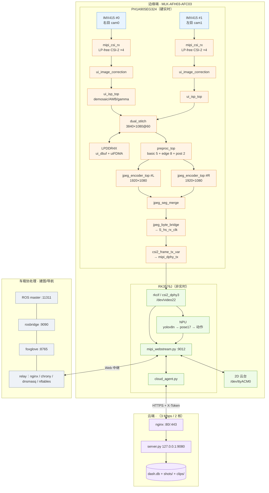

# 云端智联定点巡航安防预警系统

- **异构平台**：安路 PH1A90SEG324（国产 FPGA）+ 瑞芯微 RK3576J
- **作品方向**：基于 FPGA 的图像采集压缩与智能预处理加速系统设计
- **核心指标**：1080p@60FPS 双目采集 · 硬件预处理 · 硬件 JPEG 压缩 · NPU 分级安防
- **分支**：`feature/dual-front-stitch` ｜ **FPGA 配置版本（CFG_VER）**：`0x470D`

---

## 摘要

本系统面向园区/厂区的移动式智能巡检与分级安防，采用**分层异构**架构：安路 PH1A90SEG324 承担全部**硬实时**图像通路（双目同步、拼接、预处理、JPEG 压缩），RK3576J 承担**非实时**智能与业务（NPU 推理、网页推流、云端交互），车载协处理单元负责建图/导航，STM32 管控底盘。

设计要点有二。其一，**像素域单时钟收敛所有带宽**：像素时钟 70 MHz × 4 px/clk = 280 Mpx/s，相对 248.8 Mpx/s 需求余量 12.6%，行缓冲与拼接全部在该域完成。其二，**把一张 3840×1080 的 JPEG 拆给两个并行引擎**：以 DRI（Define Restart Interval）把每个 MCU 半行做成独立熵编码段，两段在字节流层面直接背对背拼接，147.5 MHz 下 2 × 16,200 MCU × 150 clk = 16.48 ms，即 60.6 fps。

压缩后的码流经单条 CSI-2 ×4 lane 送入 RK，**RK 侧不接收原始视频流**；网页直接透传 JPEG，把 3 Mbps 的公网链路全部留给真正需要的内容。

> **当前状态**：FPGA 功能链路打通并通过字节级等价验证；**编码器在 147.5 MHz 的时序尚未收敛**（Setup WNS −8.013 ns）。这是本项目阻塞 60 fps 的唯一问题，见 [§10](#10-已知问题与路线图)。

---

## 1. 系统总览



**三层职责边界**（越界即架构腐化）

| 层 | 只承担 | 明确不承担 |
|---|---|---|
| FPGA | 采集、拼接、预处理、JPEG、CSI-2 打包；全部逐像素运算 | 任何非定长 / 非实时逻辑 |
| RK3576 | 取流、字节透传、NPU 推理、HTTP/API、云上行与指令下行 | **任何逐像素处理**（不接收原始视频流） |
| 云端 | 状态汇总、报警落库、远程调参、看板 | 图像处理（3 Mbps 带宽不允许） |

---

## 2. 硬件平台与拓扑

| 项目 | 规格 |
|---|---|
| FPGA | 安路 PH1A90SEG324 —— LUT6 64,320 / FF 128,640 / ERAM20K 272 / DSP 240 / PLL 12 |
| SoC | RK3576J（2 GB LPDDR4X + 32 GB eMMC） |
| 板卡 | MLK-AFH03-AFC03（异构核心板 + 底板） |
| 传感器 | 2 × Sony IMX415（原生 3840×2160；1080p 模式 VMAX=2283 / HMAX=542 / 行周期 7.3 µs） |
| FPGA DDR | DDR3，`DRAM_BYTE_NUM=2`、`DRAM_SIZE="2G"`、`APP_ADDR_WIDTH=27`、`DQ_WIDTH=16` |
| FPGA ⇄ IMX415 | CSI-2 ×4 lane（LP-free 子卡，SCCB 由 FPGA 内部 I²C 主控） |
| FPGA ⇄ RK3576 | CSI-2 ×4 lane，`csi2_dphy3` → `mipi3_csi2`，DT = `0x1E`，连续时钟，4 data lane |

### 2.1 控制口（易错点）

| 通道 | 事实 |
|---|---|
| **参数通道** | `/dev/i2c-9`（`i2c@2ae80000`，pinctrl `i2c9m1_xfer`），**器件地址 `0x40`**（`i2c_slave.v` / `cfg_ctrl_top.v` 的 `DEV_ADDR = 7'h40`），引脚 `IO_cfg_scl=L18` / `IO_cfg_sda=M18` |
| **DTS `fpga@1a`** | **仅为 V4L2 虚拟占位节点，不存在物理 I²C 设备**（`jpeg_cmd_1wire.v` 注释明示） |
| IMX415 SCCB | FPGA 内部 `ui_cfg_imx415` / `ui_i2c` 主控；cam0 引脚 `O_cam_scl=B14 / IO_cam_sda=A14`，cam1 `O_cam_scl_1=N10 / IO_cam_sda_1=N11` |
| 单线参数通道 | `jpeg_cmd_1wire.v` 复用 `I_dsi_en` 一根线做 8N1 串口（4800 baud，4 字节帧 `SYNC=0x55｜ADDR｜DATA｜CHK(ADDR^DATA^0x5A)`） |

### 2.2 时钟树（FPGA 内部）

| 时钟 | 频率 | 来源 | 用途 |
|---|---|---|---|
| `sys_clk` | 25 MHz | `I_sysclk_25m`（T16） | PLL 参考、配置常开域 |
| `ddr_clk` | 100 MHz | `I_ddr_clk`（T13，LVDS18） | DDR 控制器 |
| `S_pclkx1` | 147.5 MHz | `X_ui_pll.clkc[1]` | DDR 读侧、**JPEG 编码域** |
| `S_clk_70m` | 70 MHz | `X_ui_pll.clkc[3]` | **像素域**（`S_st_clk` / `S_hs_rx_clk`），4 px/clk |
| `S_clk_24m` | 24 MHz | `X_ui_pll.clkc[0]` | 传感器主时钟 |
| `S_dsi_*` | 25 / 75 / 150 / 300 / 300@90° / 10 MHz | `u_ui_pll_dsi.clkc[0..5]` | MIPI D-PHY TX |

---

## 3. FPGA 子系统

### 3.1 RTL 模块总览（`fpga/uisrc/01_rtl/`，40 个文件）

| 目录 | 文件 | module | 职责 |
|---|---|---|---|
| 顶层 | `system_top.v` | `system_top` | 全链路顶层：时钟、几何参数、各子系统连线、配置寄存器解码 |
| 顶层 | `system_top_tx_tpg.v` | `system_top_tx_tpg` | **TX 隔离测试顶层**：TPG → `csi2_frame_tx` → D-PHY，不含 RX/ISP/DDR，用于分离 TX 侧与 RX 侧故障 |
| 链路 | `csi2_frame_tx.v` | `csi2_frame_tx` / `csi2_frame_tx_var` | Layer-1 CSI-2 帧发送，格式无关；`DT=0x1E`、`GAP_LINE=200`、`GAP_FRAME=4000`；`_var` 为变长包版本 |
| 链路 | `csi2_pack_yuv422_stream.v` | 同名 | `ui_dbuf.R` → async FIFO(33b×4096) → YUV 5 级流水 → 输出 FIFO(34b×4096) → 4 深 skid → AXIS |
| 链路 | `csi2_test_src.v` | 同名 | 链路自测源：第 k 字节 == `k & 0xFF`，逐字节可校验；`LINE_BYTES=3840` / `FRAME_WORDS=1,036,800` |
| 链路 | `yuv422_tpg_axis.v` | 同名 | 独立 YUV422 AXIS 测试图案（彩条/灰阶/棋盘/坐标戳），字节序 `Y0 U0 Y1 V0` |
| 双目 | `dual/sensor_sync_start.v` | `sensor_sync_start` | 双传感器同步启动：同时拉低两颗 RSTn → 释放 → 等窗 → 两张初始化表**同拍**重跑；触发 `0xDB[1]`；`HOLD_CYCLES=500_000`（20 ms @25 MHz） |
| 双目 | 同上 | `dual_frame_sched` | 逐帧交替调度（cam1 走环形行缓冲，读侧恒按 cam0 节拍、滞后 2 行） |
| 双目 | 同上 | **`dual_stitch`** | 左右拼接（现役）：`HGRP=480`、`V_ACTIVE=1080`、`FIFO_AW=11`（2048 word ≈ 4.2 行）、`SWAP=0`（左 cam1 / 右 cam0）、`STARVE_MAX=2400` |
| 双目 | `dual/dual_stitch.v`、`dual_frame_sched.v` | **无 module** | 仅占位注释（TD 会把新文件当黑盒，实体已并入 `sensor_sync_start.v`） |
| 预处理 | `preproc/preproc_top.v` | `preproc_top` | 流水线顶层，插在 `ui_isp_top` 与 `rgb_to_yuv422_quad` 之间，延迟约 4 拍，**不改变行数**；`PX_PER_CLK=4`，`i_rgb/o_rgb[127:0]` |
| 预处理 | `preproc_basic.v` | 同名 | 初级层 5 路并行：灰度 / 高斯 / HE / 对比度 / 反色；固定串联顺序 高斯→HE→灰度→对比度→反色 |
| 预处理 | `preproc_edge.v` | 同名 | 高级层 8 路并行：Sobel / 阈值 / 形态学 / 中值 / 拉普拉斯 / 浮雕 / Prewitt / 锐化，`i_mode[3:0]` 单选 |
| 预处理 | `preproc_post.v` | 同名 | 后级：数字白平衡 + ROI 中心裁剪填黑（分辨率不变；ROI 档 100/75/50/37.5/25/12.5%，全移位无除法） |
| 预处理 | `preproc_win3x3.v` | 同名 | 4 px/clk 3×3 **亮度**窗口生成；单行缓冲 480 字，同址先读后写当"上一行" |
| 预处理 | `preproc_win3x3_rgb.v` | 同名 | **RGB 三通道** 3×3 窗口（高斯专用，避免把 R/G 噪声注进 B） |
| 预处理 | `preproc_line1.v` | 同名 | 单行延迟（原图 1 像素对齐），3 级级联可得 n-1/n-2/n-3 行；`AW=10`、`DEP=960` |
| 预处理 | `preproc_linefix.v` | 同名 | 把 `tuser/tlast` 后移 16 像素（`SH=4`），修"行首 16 像素是上一行行尾" |
| 控制 | `ctrl/i2c_slave.v` | `i2c_slave` | I²C 从机（子地址协议，不拉伸时钟，纯过采样）；`DEV_ADDR=7'h40` |
| 控制 | `ctrl/cfg_ctrl_top.v` | `cfg_ctrl_top` | 配置顶层：I²C 从机 + 参数堆 + 跨时钟域（25 MHz 常开域 → 像素域 2 级同步）；`CFG_VER` 为版本唯一真源 |
| 控制 | `ctrl/cam_param.v` | `cam_param` | 曝光/增益/EV 换算为 IMX415 寄存器值并触发一次 I²C 下发（曝光行数 = VMAX − SHR0；增益 `0x3090` 0..100，0.3 dB/step） |

> `preproc/*.bak*` / `*.orig` 为历史备份，**与现役文件重复定义 module**，仅作参考，不参与构建。

### 3.2 JPEG 编码器（`fpga/uisrc/01_rtl/jpeg/`，16 个文件）

帧结构：`[headers 607 B][熵数据][FF D9]`。

| 文件 | module | 职责 / 关键点 |
|---|---|---|
| `jpeg_encoder_top.v` | `jpeg_encoder_top`、`jpeg_enc_if`、`jpeg_byte_bridge` | 顶层 FSM（T_IDLE/LOADQ/HDR/WGRP/RD/WDCT/NEXT/DRAIN/FIN/EOI…）；**实测 150.0 clk/MCU（有损）、320.2（无损）** |
| `jpeg_linebuf.v` | `jpeg_linebuf` | 8 行乒乓行缓冲，把逐行 YUV422 拆成 MCU 可读；`y/cb/cr_mem` 均为 16 行 × 64 bit |
| `jpeg_dct2d.v` | `jpeg_dct2d` | 8×8 定点 2D DCT，与 `tools/jpeg_ref.py` **逐位一致**；利用对称性只做 4 次乘法；每块 30 拍 |
| `jpeg_quant_zz.v` | `jpeg_quant_zz`、`jpeg_recip_pipe` | 量化 + zigzag；用倒数乘法替代 8 个除法器；Q 装载 128 拍；`qzz[0:127]` 存 zigzag 序 |
| `jpeg_huff_enc.v` | `jpeg_huff_enc` | DC 差分 + AC 游程 + 霍夫曼，**1 符号/拍**；`i_nz_mask[63:0]` 位图跳零；双符号快路径 |
| `jpeg_bitpack.v` | `jpeg_bitpack`、`jpeg_seg_merge` | 位打包 + `0xFF→FF 00` 填充；累加器 **40 位**（7+27>32 故不能用 32）；DRI 支持；`jpeg_seg_merge` 为双引擎段合并器 |
| `jpeg_headers.v` | `jpeg_headers` | SOI/APP0/DQT/SOF0/DHT/SOS，607 拍；`i_rst_int` 生成 DRI 段 |
| `jpeg_range.v` | `jpeg_range` | BT.709 limited(16–235) → full(0–255)，`K_Y=76312`/`K_C=74606`（2^16 定点），**必须 floor** 才能与参考逐字节一致 |
| `jpeg_qtable_ram.v` | `jpeg_qtable_ram` | 量化表（复位值 = T.81 Annex K.1）；写地址 `0x10~0x4F` 亮度、`0x50~0x8F` 色度 |
| `jpeg_lossless_enc.v` | `jpeg_lossless_enc` | SOF3 DPCM，MED 预测器；4 拍/word，只缓存上一行 |
| `jpeg_regfile.v` | `jpeg_regfile` | JPEG 参数寄存器堆 + 状态回读；`JPEG_VER=16'h0100` |
| `jpeg_cmd_1wire.v` | `jpeg_cmd_1wire` | 把 `I_dsi_en` 复用作参数下发串口（4800 baud，8N1，4 字节帧） |
| `jpeg_defs.vh` | — | 标准表（K.1 量化 / K.3 DC / K.5 AC / H 无损），查表返回 `[20:16]`=码长、`[15:0]`=码字 |
| `jpeg_hdr_rom.vh` / `jpeg_hdr_ll.vh` | — | header 字节 ROM（有损 / 无损），由 `tools/gen_jpeg_hdr_rom.py` 生成 |

**双引擎 + DRI 段合并**

| 项 | 值 |
|---|---|
| 格式 | Baseline 4:2:2，MCU = 16×8 = 128 px |
| 每引擎 | 120 MCU/行 × 135 行 = 16,200 MCU |
| 吞吐 | 2 × 16,200 × 150 / 147.5 MHz = **16.48 ms → 60.6 fps** |
| 重启间隔 | **DRI = 120 MCU**（半个行） |
| 合并 | `L(r0) RST0 R(r0) RST1 L(r1) RST2 …`（段为单位交替） |

DRI 使每个半行成为**独立熵编码段**，两段可直接背对背拼接，无需重做熵编码。两引擎 RST 编号取奇偶交错（左 0,2,4… / 右 1,3,5…），拼好后全局恰为 `RST0…RST7` 循环。

| 引擎 | `HDR_EN` | `EOI_EN` | `RST_INIT` | `RST_STEP` | `LAST_RST_EN` | `i_width` |
|---|---|---|---|---|---|---|
| 左（cam1） | 1 | 0 | 0 | 2 | **1** | 3840 |
| 右（cam0） | 0 | 1 | 1 | 2 | 0 | 3840 |

> `LAST_RST_EN=1` 只给左引擎：拼接后左引擎最后一段后面还跟着右引擎最后一段，那个边界**需要**重启标记。`i_width` 仅用于 SOF 头字段，引擎内部仍按 1920 编。

### 3.3 厂商 IP（`fpga/uisrc/03_ip/`）

| 子目录 | 内容 | 形态 |
|---|---|---|
| `mipi_csi_lpfree/` | 13 个 `.v`：`mipi_csi_rx`、`csi_rx_phy`、`csi_rx_byte_align`、`csi_rx_hdr_ecc`、`csi_rx_10bit_unpack`、`csi_rx_vid2stream` 等 | **全部源码**（LP-free CSI-2 RX，输出 40 bit RAW10） |
| `ui_isp/` | `ui_isp_top` + BLC / AWB（含 `ui_divider` 打包 IP）/ brightness / contrast / saturation / gamma（9 个 LUT）/ demosaic / image_cut / data96_64 / data128_96 | 全源码 |
| `dphy_tx_general/` | `mipi_dphy_tx_wrapper.enc.v` | **加密网表** |
| `al_ip/mipi_rx/` | wrapper 源码 + `data_lane_rx_wrapper.enc.v`、`channel_aligner_wrapper.enc.sv` | 源码 + 2 个 `.enc` |
| `al_ip/ui_HDMI_TX/` | `ui_HDMI_TX.v` + `hdmi_tx_controller_wrapper.enc.v` + 打包 IP | 源码 + 1 个 `.enc` |
| `al_ip/ui_ddr/` | `ui_ddr.sv` / `ui_ddr.sdc` / `.ipc` / `.adc` / ROM 表 | 源码 + IP 配置 |
| `al_ip/ui_pll`、`ui_pll_dsi` | `ui_pll` / `pll_dsi` 及 IP 配置 | 源码 + IP 配置 |
| `ui_vtc/`、`ui_setvbuf/` | 视频时序控制器 / 缓冲 | 源码 + 打包 IP |
| `ui_dbuf/`、`ui_fdma/` | DDR 缓冲与 DMA | 源码 |
| `ui_imx415_cfg/` | `ui_i2c.v`、`ui_cfg_imx415.v`、`ui_imx415_reg.v` | 源码（初始化表 + I²C 主机） |
| `ui_csi_raw/` | `ui_csi_unpacket_4lane.v`、`ui_raw10_unpacket_4lane.v`、`ui_image_correction.v` | 源码 |
| `mipi_dsi/` | `rgb_to_yuv422_quad.v`、`rgb888_to_yuv422_pipeline.v` | 源码（BT.709 + limited） |
| `al_fifo/` | `fifo_32b_async_2.v` | 源码（`dout` 读后一拍） |
| `ui_ae_set/` | `ui_ae_set.v`、`ui_key.v` | 厂商 AE，已被 `cam_param` 取代 |

### 3.4 配置寄存器映射（`jpeg_regfile.v` + `cfg_ctrl_top.v`，0x00–0xFF）

| 地址 | 含义 |
|---|---|
| `0x00` | MODE：[0] 无损 [1] bypass [2] 单帧（**当前未接硬件**） |
| `0x01` | QUALITY 1..100（未接） |
| `0x02~0x04` | 目标每帧字节数 TGT_L/M/H（未接） |
| `0x05/0x06` | RC_EN / RC_SPEED（未接） |
| `0x07` | SUBSAMPLE 0=4:4:4 1=4:2:2 2=4:2:0（未接） |
| `0x08` | RST_INT 重启间隔（MCU），0 = 不插 |
| `0x09` | PREDICTOR 无损预测器 1..7，0 = MED |
| `0x0A` | SOFT_RST（1 拍脉冲） |
| **`0x0B`** | [0] JPG_TX（0 = NV16 直通 / 1 = JPEG 码流）[1] DT18（0x1E/0x18）[2] JPAD（帧尾补零） |
| `0x10~0x4F` / `0x50~0x8F` | 亮度 / 色度量化表（各 64 项） |
| `0xA0~0xA2` | 上一帧 JPEG 字节数 |
| `0xA3~0xA6` | {高 16 = 看门狗触发次数, 低 16 = 源 FIFO 溢出次数} |
| `0xA7` | `jpeg_byte_bridge` 写侧背压低位 |
| `0xA8` | [0] 忙 [1] 完成 [2] 溢出 [3] 无损回读 |
| **`0xA9/0xAA`** | `CFG_VER` 低/高字节 |
| `0xB0` | PP_EN 高级层总使能 |
| `0xB1` | ADV_MODE：1=Sobel 2=阈值 3=形态 4=中值 5=拉普拉斯 6=浮雕 7=Prewitt 8=锐化 |
| `0xB2~0xB7` | Sobel 移位 / 阈值 / 形态选择 / 形态阈值 / 拉普拉斯移位 / Prewitt 移位 |
| `0xB8~0xBB` | CSI-2 FS 短包计数（= 传感器真实帧率） |
| `0xBC` | 心跳（每 256 读时钟 +1） |
| `0xC0~0xC2` / `0xC3` / `0xC4` | 曝光 SHR0（3 字节）/ 增益 0..100 / EV 偏移（8 = 0EV） |
| `0xC7` | FPS_DIV（**完全悬空，无消费者**） |
| `0xC8` / `0xC9` | ROI 百分比 25..100 / 强制重发传感器参数 |
| `0xD0/0xD1` | `ui_image_correction` 输出帧计数 |
| `0xD4/0xD5` | 每行像素组数（历史最大） |
| `0xD6~0xD9` | cam0 RX 调试（lane 对齐 / in_frame / tap / eye-scan / 手动步进） |
| `0xDA` / `0xDB` | BAYER_SEL（RGGB/GRBG/GBRG/BGGR）/ CSI_SEL（[0] 选源 [1] 双目交替 [2] 帧标记强制） |
| `0xDC` / `0xDD~0xDF` | 两路打包状态 / cam1 同款调试 |
| `0xE0` | RES_MODE：0 = 1080p60 / 1 = 4K30 / 2 = 4K25 |
| `0xE1~0xE9` | 冻结定位、cam1 组数、三个自由跑计数器 |
| `0xF0` | BASIC_EN：[0] 灰度 [1] 高斯 [2] HE [3] 对比度 [4] 反色（已删） |
| `0xF1` | 灰度系数 0 = BT.601 / 1 = BT.709 |
| `0xF2` / `0xF8` | 高斯强度 0..8 / 核尺寸 0=3×3 1=5×5 2=7×7 |
| `0xF3` / `0xF9` | HE 强度 0..255 / 桶上限 ×64 |
| `0xF4` | 对比度 0..8 |
| `0xF5`/`0xF6` | 浮雕增益 / 偏置（默认 128） |
| `0xF7` / `0xFA` | 已废弃（锐化移除 / HE 防频闪改内置） |
| `0xFB` | `preproc_linefix` 行首 16 像素校正使能 |

> **`0x47xx` 不是地址**，是 `CFG_VER` 版本号的演进链：`0x3504 → 0x4301 → 0x450D → 0x4600 → 0x4601 → 0x4700 → 0x4704 → 0x4705 → 0x4706 → 0x4707 → 0x4708 → 0x470A`（JPEG 直通）`→ 0x470B`（编码器接入）`→ 0x470C`（编码器时钟回退）`→ 0x470D`（按赛题硬指标裁剪预处理腾 DSP，**当前值**）。

### 3.5 约束

`fpga/uisrc/04_pin/timing.sdc`：

- `create_clock sys_clk 40 ns`（`I_sysclk_25m`）、`create_clock ddr_clk 10 ns`（`I_ddr_clk`）、`derive_clocks`
- `rename_clock`：`S_clk_24m/S_pclkx1/S_clk_70m ← X_ui_pll/pll_inst.clkc[0]/[1]/[3]`；`S_dsi_* ← u_ui_pll_dsi/pll_inst.clkc[0..4]`
- **1 条** `set_clock_groups -asynchronous`，6 组：`{sys_clk}` / `{ddr_clk}` / `{dfi_clk mcu_clk}` / `{S_clk_24m S_pclkx1}` / `{S_clk_70m}` / `{S_dsi_*}`
- **没有**任何 `set_input_delay` / `set_output_delay` / `set_false_path` / `set_max_delay` / `set_multicycle_path`

`fpga_pin.adc` 中记录了子卡去 LP 抽头后 LP 4 对脚已悬空（恒定 LP 电平在 11/01/00 任一组合下都不可用），故恢复 PULLUP。

---

## 4. RK3576 子系统

### 4.1 驱动 `rk/driver/milianke_mipi.c`

| 项 | 事实 |
|---|---|
| 角色 | **虚拟 MIPI CSI-2 sensor**；只 `v4l2_async_register_subdev()`，**不注册 video_device** |
| `/dev/video22` | 由 **rkcif 侧**产生，非本驱动 |
| subdev 名 | `m%02d_%s_%s %s` → 结合 DTS（index=2 / back / FPGA-MIPI）得 `m02_b_FPGA-MIPI` |
| media format | **唯一** `MEDIA_BUS_FMT_YUYV8_2X8` |
| 色彩空间 | `REC709` + `YCBCR_ENC_709` + `LIM_RANGE` + `XFER_FUNC_709` |
| 模式表 | `1920x1080@60`（link_freq 500 MHz、pixel_rate 148.5 MHz、vblank 45）/ `3840x2160@25`（vblank 65）/ `3840x2160@30`（vblank 227，**注释标明跑不动，仅兼容**） |
| 链路 | `num_data_lanes = 4`、`V4L2_MBUS_CSI2_DPHY`、continuous clock、125 MHz byte_clk × 4 = 1000 Mbps/lane |
| ioctl | `RKMODULE_GET_MODULE_INFO('W',0x03)`、`GET_HDR_CFG(0x0b)`、`SET_HDR_CFG(0x0c)`、`SET_QUICK_STREAM(0x0d)` |
| compatible | `{"milianke,fpga-virtual"}`；`i2c_device_id = {"milianke_mipi", 0}` |
| 模块参数 | `always_on`（默认 true，但 probe 打印 "ignored: mipi-en toggled by s_stream()"）、`default_mode` |

### 4.2 设备树

主 dts：`rk/dts/rockchip/mlk-rk03-rk3576-linux.dts`；关键节点 `rk03/csi-imx415-2.dtsi`：

```dts
&i2c9 { status = "okay"; pinctrl-0 = <&i2c9m1_xfer>;
  fpga_mipi: fpga@1a {
    compatible = "milianke,fpga-virtual";
    reg = <0x1a>;                       /* V4L2 虚拟占位，无物理设备 */
    mipi-en-gpios = <&gpio1 RK_PD0 GPIO_ACTIVE_HIGH>;
    rockchip,camera-module-index = <2>;
    rockchip,camera-module-facing = "back";
    rockchip,camera-module-name = "FPGA-MIPI";
    port { fpga_out3: endpoint { remote-endpoint = <&mipi_in_fpga3>; data-lanes = <1 2 3 4>; } };
  };
};
```

接收端链路：`csi2_dphy3` `port@0/endpoint@1`(`mipi_in_fpga3`) → `port@1/endpoint@0` (`csidcphy3_out`) → `mipi3_csi2`。节点内**没有** `clocks` / `clock-names` 属性。

### 4.3 Web 服务 `rk/web/mipi_webstream.py`（约 4,900 行，仅标准库）

**类与线程**

| 类 | 角色 |
|---|---|
| `FrameHub` | 最新帧广播、客户端计数、`wait_next` / `latency` |
| `SysMonitor` | `/api/sys`：CPU / GPU / NPU / RAM / DDR 带宽 |
| `ParamStore` | 参数持久化（`DEFAULT_PARAMS` + `state_store`） |
| `JpegMode` / `HwJpegEncoder` | 软 / 硬 JPEG 开关；RK MPP `mppjpegenc` 硬编（一进一出 + 超时保护） |
| `OpenCVCapture` / `GstCapture` / `GstLiveCapture` | 三种采集后端（可互相回退） |
| `TestCapture` / `PilTestCapture` | 无摄像头时的测试源 |
| `FpgaI2C` | FPGA 寄存器读写（`/dev/i2c-N`） |
| `Handler(BaseHTTPRequestHandler)` | 全部 HTTP 路由 |

后台线程：`heal`（采集自愈）、`logtrim`、`reboot`、`gimbal-ctl`、AI 推理、service 自重启。

**HTTP 路由**

| 方法 | 路由 |
|---|---|
| GET | `/`、`/index.html`、`/viewer`、`/stream`(MJPEG)、`/snapshot.jpg`、`/snapshot`、`/skel.jpg`、`/api/pose`、`/api/params`、`/api/status`、`/api/ai`、`/api/gimbal`、`/api/controls`、`/api/fpga`（`?compact=1` 省 90% 流量）、`/api/modes`、`/api/ping`、`/api/net`、`/api/sys`、`/api/jpeg` |
| POST | `/api/jpeg`（**强制 `hw=1`**，拒绝软编）、`/api/params`（`reset` 或 patch）、`/api/ctrl`（V4L2 控件）、`/api/ai`、`/api/gimbal`、`/api/fpga`（写后回读；切 `RX_SEL` 前先探测模组，无模组返回 409）、`/api/mode` |

**`/api/params` 15 个字段**

| 组 | 字段（默认值 / 范围） |
|---|---|
| 画面 | `brightness`(0, −100..100)、`contrast`(1.0, 0.2..3.0)、`saturation`(1.0, 0..3.0)、`hue`(0, −180..180)、`gamma`(1.0, 0.2..3.0)、`mirror`、`flipv`、`rotate`(0/90/180/270)、`scale`(1.0, 0.25..1.5)、`quality`(80, 30..95)、`fps`(60, 1..120) |
| 双目 | `dual`、`dual_demo`、`ai_src` |
| FPGA JPEG | `jpeg_ll`、`jpeg_q`(75, 1..100)、`jpeg_kb`(120 KB)、`jpeg_rc`（对应寄存器 `0x00`/`0x01`/`0x02-0x04`/`0x05`） |

**关键启动参数**：`--device /dev/video22`、`--port 9012`、`--width/--height 1920/1080`、`--fourcc NV16`、`--yuv-matrix 709`、`--yuv-range limited`、`--hw-jpeg`、**`--fpga-bus 9`**、**`--fpga-addr 0x40`**、`--ai`、`--ai-fps 30`、`--ai-zone`、`--gimbal-port /dev/ttyACM0`、`--gimbal-yaw-limit 170`、`--gimbal-pitch-limit 42`、`--gimbal-speed 25`、`--gimbal-kalman 1`、`--gimbal-loop vel|ff`、`--state-file`。

**MJPEG**：编码线程 → `FrameHub.publish()` → `/stream` 以 `multipart/x-mixed-replace; boundary=<BOUNDARY>` 逐帧写出；同 IP 有流数量限流（`MAX_STREAMS_PER_IP`）。`start_webstream.sh` 默认监听 `127.0.0.1`，对外只开 80 反代。

### 4.4 NPU 视觉流水线（`rk/ai/`）

```
一级：yolov8n（COCO person）→ 人体框
二级：yolov8n-pose（17 关键点，ROI 内）
  → 跟踪(ID) + 骨架平滑(EMA) + 危险动作状态机
  → 叠加标注（框 / 骨架 / 中文动作标签 / 越界警戒区）
  → MJPEG 推流
```

| 模型文件 | 输入 | 备注 |
|---|---|---|
| `yolov8n.rknn` / `yolov8n-slim-512.rknn` | 640 / 512 | 一级检测 |
| `yolov8n-pose.rknn` | 640 | 二级姿态 |
| `yolov8n-pose-hybrid.rknn` / `-384-` / `-320-` | 640 / 384 / 320 | 混合量化多档位，网页可热切换 |

实测（`yolov8n-slim` 640）：**双核 17 ms**，单核 24 ms。

**帧率解耦**：采集与渲染按视频帧率跑，AI 按 `--ai-fps` 限频；真正天花板由单帧耗时 `run_ms` 决定，限频只是闸门。AI 结果通过"最近值"共享给渲染线程，**叠加标注不拖慢视频帧率**。

| 文件 | 用途 |
|---|---|
| `board/det_core.py` | 两级推理核心（DFL 解码与官方 postprocess 一致，默认 NPU 双核） |
| `board/action_*.py` | 动作识别：模型版 / numpy 版 / 几何规则状态机 / 时序窗口 / 演示分类 |
| `board/ai_webstream.py` | 采集/推理/渲染/HTTP 四线程独立服务 |
| `convert/` (29 文件) | ONNX→RKNN INT8、两阶段混合量化、数据审计、JHMDb 抽取、一致性校验 |
| `dist/` | `rknn_toolkit_lite2-2.3.0` aarch64 wheel |

### 4.5 云台与部署

- `rk/gimbal/`：QGimbal 串口 115200，`gimbal_keyctrl.py`（键盘控）、`gimbal_cmd.py`、`kbtest_*`（保持/斜坡/裸 tty）
- `rk/deploy/`（98 文件）：`start.sh`（全栈起停）、`boot_start.sh`（systemd 入口）、`mode.env`、`fpga_cfg.py`、`load_drv.sh`、21 个 `diag_*.sh`、14 个 `verify_*`、抓图与延迟测量脚本
- `rk/snap/`：1080p60 参考快照

---

## 5. 云端平台（`cloud/`，14 文件）

设计前提：服务器仅 **3 Mbps / 2 核 / 1.6 GB** —— 单文件后端（仅标准库）、无 ORM、无图像处理、**无 MJPEG 上云**、报警图固定 640 px / q55（约 25 KB）、图片滚动删除。

**`server.py` 路由**

| 方法 | 路由 |
|---|---|
| GET | `/`、`/index.html`（静态 + ETag + gzip）、`/favicon.ico`、`/api/ping`、`/api/state`、`/api/history`、`/api/stats`、`/api/shot/<name>.jpg`、`/api/clip/<id>.mp4`（支持 Range）、`/api/live.jpg`、`/api/commands`（长轮询）、`/api/ext` |
| POST | `/api/login`、`/api/logout`、`/api/settings`、`/api/ingest`、`/api/alarm`、`/api/alarm/<id>/snap`、`/api/alarm/<id>/clip`、`/api/live`、`/api/result`、`/api/cmd`、`/api/ack`、`/api/test`、`/api/ext/<name>` |

**鉴权三路**：板端 `X-Token`（`hmac.compare_digest` 常量时间比较）；浏览器 `POST /api/login` → HttpOnly Cookie `cd_sid`（30 天，SameSite=Lax）；脚本 `curl -u admin:<ui_pass>` 或 `X-UI-Pass`。`ui_pass` 为空则免校验。

**存储**：SQLite `data/dash.db`（表 `alarms` / `clips` / `meta`，WAL）+ `data/shots/` + `data/clips/` + `data/state.json`。

| 目录 | 内容 |
|---|---|
| `board/cloud_agent.py` | 板端上行代理：5 s 心跳 `/api/ingest`、报警 `/api/alarm` + 抓拍、长轮询 `/api/commands` 下发到本地 9012、看板抓拍 `/api/live` |
| `deploy/install.sh` | 幂等安装：建 `csidash` 用户、`/opt/csi-dashboard/`、生成 `csi-dashboard.service` 与 `config.json` |
| `deploy/nginx-snippet.conf` | `location ^~ /api/ { proxy_pass http://127.0.0.1:9080; }`（**必须 `^~`**，否则 `/api/shot/*.jpg` 被当静态 404） |
| `deploy/cloud-agent.service.d/20-mounts.conf` | `RequiresMountsFor=/mnt/sd`（等 SD 挂载再起，否则录像永久关闭） |
| `ext/_example.py` | 扩展插件示例（`INFO` + `handle(payload, ctx)`） |
| `tools/fake_board.py` | 本机冒充 RK 的 9012 服务（`--port 9100`），供离线联调 |
| `static/index.html` | 单文件暗色看板 |

报警合并规则（`docs/API.md`）：6 s 去抖、`src=health` 为持续状态、每分钟 20 条上限。

---

## 6. 车载协处理与 ROS 中继（`rk/relay/`）

| 文件 | 作用 |
|---|---|
| `deploy_relay.sh` | Debian 12 一键部署 nginx / chrony / nftables / avahi + `ip_forward`，幂等，留 `.bak_rosrelay` |
| `nginx-ros-relay.conf` | `listen 80`；`/rosbridge` → `192.168.100.87:9090`；`/` → foxglove `:8765` |
| `dnsmasq-ros-relay.conf` / `chrony-relay.conf` / `nftables.conf` | DHCP+DNS / 授时中继 / 转发与防火墙 |
| `jetson/`（31 文件） | 车端脚本：`start_all.sh`（11311→9090）、`start_rosbridge.sh`、`relay_ctl.py`、`web_goal_bridge.py`、`set_gmapping_*.py`、`scan_*.py`、`70-ros-relay-net.rules` |
| `web/console.html` | Web 控制台 |

---

## 7. 资源与时序（FPGA）

`fpga/fpga_prj_Runs/phy_1/route.qor`（2026-10-28）：

| 资源 | 占用 | 总量 | 比例 |
|---|---|---|---|
| SLICE | 43,946 | 64,320 | **68.3 %** |
| LUT6 | 36,971 | 64,320 | 57.5 % |
| 寄存器 | 37,105 | 128,640 | 28.8 % |
| ERAM20K | 229 | 272 | **84.2 %** |
| DSP | 202 | 240 | **84.2 %** |

| 时序 | 值 |
|---|---|
| Hold WNS | **+0.020 ns**（全部时钟组通过） |
| Setup WNS | **−8.013 ns**（`S_pclkx1` 域，4,661 / 23,167 端点违例） |
| 其余 | 仅 DSI 时钟 lane ODDR 一条 −0.539 ns（厂商 PHY 原语，板级实测正常） |

违例集中在熵编码器（`u_huff/o_code_reg`、`u_quant/qzz_reg`），单条约 14.8 ns（预算 6.78 ns）：

```
kk → qzz 双口异步读(~2ns) → 取绝对值 + ssss 优先级编码(~1.5)
   → 霍夫曼码表 ROM(~2) → 幅度整形(~1.5) → 32 位变量移位(~2.3) → o_code
```

该编码器此前运行在由 toggle-FF 分频得到的 36.875 MHz 时钟上，**SDC 无法为其建立 `create_clock`，长期处于"不受时序检查"状态**；迁到 PLL 直出的 `S_pclkx1` 后才首次暴露。

---

## 8. 构建与运行

### 8.1 FPGA

```bash
# 图形界面
F:\Anlogic\TD_Release_2026.1_SP2.200.067\bin\td.exe       # 工程 fpga/fpga_prj.al

# 命令行（必须用正斜杠，反斜杠会被 PowerShell 吞掉）
cd fpga/fpga_prj_Runs/syn_1 && td_commands_prompt.exe <TD>/scripts/DefaultFlow.tcl
cd fpga/fpga_prj_Runs/phy_1 && td_commands_prompt.exe <TD>/scripts/DefaultFlow.tcl
```

产物：`fpga_prj_Runs/best_result/`，烧写用 `fpga_prj_compress.bit`。启用官方策略包（syn `LogicLevelOptimize` / phy `TimingUltra`）后后端耗时显著增加，单次 ≫ 30 min 属正常。

### 8.2 仿真（OSS CAD Suite / iverilog 14.0）

```bash
cd fpga/sim
./run_dual.ps1 all          # dual / chain / regdb / full / all 五目标
./run_jpeg_thru.ps1 0       # 有损 clk/MCU
./run_jpeg_thru.ps1 1       # 无损 clk/MCU
./run_jpeg_recip.ps1        # 量化倒数 256 个 Q 穷举
./run_dual_stitch.ps1       # 双目拼接（含相机掉线/恢复）

cd tools && ./run_jpeg_sim.ps1   # 端到端回归：Python 参考 → iverilog → vvp → 逐字节比对（默认 12 种尺寸）
```

### 8.3 RK3576

```bash
rk/driver/build_module.sh        # 可选：独立编 .ko
# 刷写 rk/boot.img（内核 + DTS + 驱动）；4K25 模式刷 rk/boot.4k25.img

cd rk/deploy && ./start.sh       # 全栈起停
systemctl status mipi-webstream  # 或走 systemd（ExecStart=/root/rk/deploy/boot_start.sh）
# 浏览器打开 http://<RK_IP>/      ← 对外只开 80（nginx 反代 /api/ /stream /snapshot.jpg 到 9012）

cd rk/web && ./start_webstream.sh
AI=1 AI_FPS=8 AI_ZONE="0.2,0.6;0.8,0.6;0.8,1;0.2,1" ./start_webstream.sh
```

### 8.4 云端与中继

```bash
cloud/deploy/install.sh        # 生成 csi-dashboard.service + config.json
cloud/board/install_board.sh   # 板端 cloud-agent.service
rk/relay/deploy_relay.sh       # ROS Web 中继
```

---

## 9. 验证

原则：**任何"改完应该更好"的优化，都必须有字节级不变量作证**。

| 测试台 | 判据 | 当前结果 |
|---|---|---|
| `tb_jpeg_e2e` | 输出与 Python 参考 JPEG **逐字节相同** | 862 B 完全一致 |
| `tb_jpeg_merge` | 双引擎合并熵段与单引擎参考**逐字节相同** | 5,372 B 一致；`RST0…RST6` 连续；PIL 解码 512×32 通过 |
| `tb_jpeg_dct` | DCT 输出 vs `dct_vec.hex` | 逐位一致 |
| `tb_jpeg_recip` | 256 个量化值穷举 | 全部逐位一致 |
| `tb_he_big` | 1920×1080、8 帧，HE 后统计量**无漂移无闪烁** | 8 帧均为 均值 111 / `lutsum` 26,841 |
| `tb_dual_stitch` | 左右拼接对齐 + 相机掉线恢复 | 两阶段 PASS |
| `run_jpeg_thru` | clk/MCU ≤ 151.7（60 fps 预算） | 有损 150.0；无损 320.2 |

> ⚠️ `tb_jpeg_e2e` 的参考用例目前是 **64×16（8 MCU）**，覆盖度偏低；原始 320×40（100 MCU）仍在 git 历史中，恢复后可显著加强对 "两符号快路径 / ZRL / EOB" 等分支的覆盖。

---

## 10. 已知问题与路线图

### P0 · 阻塞 60 fps

| 问题 | 现状 | 计划 |
|---|---|---|
| 熵编码器 147.5 MHz 时序 | WNS −8.013 ns，4,661 端点 | ① 启用 TD 官方策略包（零 RTL 风险）② 若仍不足，将熵编码数值通路拆 2–3 级流水（地址生成由 `nz_mask` 位置驱动，可提前运行而不增加周期） |

### P1 · 功能补全

| 项目 | 说明 |
|---|---|
| 无损压缩 | 代码在（SOF3 + DPCM + MED），320 clk/MCU；需 4–8 段并行；另有"第二帧无输出"缺陷 |
| 可变码率 | 寄存器 `0x01/0x02-0x04/0x05/0x06` 已定义但**尚未接到硬件** |
| 单帧字节上限 | `JPAD_BYTES` 已按拼接幅 8,294,400 配置；**仅送 JPEG 时必须关闭 `0x0B[2]` 补零**，否则 8 MB/帧 × 60 = 497 MB/s 超出 CSI-2 带宽 |
| 悬空寄存器 | `0xC7`（FPS_DIV）无消费者；`0xC5/0xC6`（白平衡）已废 |

### P2 · 清理与加固

- 删除 NV16 直通通路（`csi2_pack_yuv422_stream` + `csi2_frame_tx` + 帧标记逻辑，估算约 5.2k LUT / 约 14 ERAM —— 由 `csi2_pack` 的 33b×4096 + 34b×4096 两个异步 FIFO 参数推算，**未做删除 A/B，数字仅供参考**），JPEG 稳定后执行
- 清理 `preproc/*.bak*`、`*.orig`（与现役文件重复定义 module）
- DSI 时钟 lane ODDR 一条 −0.539 ns 违例（厂商 PHY 原语，暂不修）

### 板级待验证

70 MHz 像素域实测、左右目顺序与 Bayer 相位（`0xDA`）、DDR 带宽（估算 996 MB/s）、rkcif 对 3840×1080@59.6 的接受度、端到端 60 fps 实测。

---

## 11. 目录结构

```
08_csi2rk_mipi_imx415/
├── README.md / QUICKSTART.md / MODIFICATIONS.md
├── fpga/                        # TD 工程 fpga_prj.al
│   ├── uisrc/01_rtl/            # 自研 RTL（40 文件）
│   │   ├── system_top.v         #   顶层
│   │   ├── system_top_tx_tpg.v  #   TX 隔离测试顶层
│   │   ├── csi2_frame_tx.v / csi2_pack_yuv422_stream.v /
│   │   │   csi2_test_src.v / yuv422_tpg_axis.v
│   │   ├── dual/                #   sensor_sync_start / dual_frame_sched / dual_stitch
│   │   ├── preproc/             #   top / basic / edge / post / win3x3(_rgb) / line1 / linefix
│   │   ├── jpeg/                #   16 文件，见 §3.2
│   │   └── ctrl/                #   i2c_slave / cfg_ctrl_top / cam_param
│   ├── uisrc/03_ip/             # 厂商 IP（13 子目录，见 §3.3）
│   ├── uisrc/04_pin/            # fpga_pin.adc / timing.sdc / timing_tx_tpg.sdc
│   ├── uisrc/05_boot/           # 空
│   └── sim/                     # 45 个测试台 + 10 个运行脚本 + 数据文件
├── rk/
│   ├── driver/                  # milianke_mipi.c / build_module.sh / Kconfig / Makefile(片段)
│   ├── dts/rockchip/            # 主 dts + rk03/ 24 个 dtsi（含 csi-imx415-2.dtsi）
│   ├── web/                     # 主程序 mipi_webstream.py + bench_* / diag_*（页面不在此，见 relay/web/console.html）
│   ├── ai/                      # board/ convert/(29) models/(8) dist/
│   ├── gimbal/                  # 6 文件，QGimbal 串口
│   ├── relay/                   # 8 + jetson/(31) + web/(3)
│   ├── snap/                    # 参考快照
│   ├── deploy/                  # 98 文件：启动 / 诊断 / 验证 / 抓图
│   ├── boot.img / boot.4k25.img
├── cloud/                       # 14 文件：server.py + board/ deploy/ docs/ ext/ static/ tools/
├── tools/                       # 227 文件：构建 / board_* A-B / 诊断 / 参考模型 / VM 操作
└── docs/                        # 46 文件：35 md + 8 pdf + 3 txt + action_sheets/
```

---

## 12. 接口与常量速查

| 类别 | 值 |
|---|---|
| **端口** | `80` nginx 对外唯一入口（`/`→`console.html`，`/api/` `/stream` `/snapshot.jpg`→127.0.0.1:9012）｜ `9012` RK 推流/API（**仅监听 127.0.0.1**）｜ `9080` cloud server（仅 127.0.0.1）｜ `443` HTTPS ｜ `9090` rosbridge ｜ `8765` foxglove ｜ `11311` ROS master ｜ `9100` fake_board ｜ `9013` 旧版独立 AI 服务（已并入 9012） |
| **systemd 服务** | `mipi-webstream`（`ExecStart=/root/rk/deploy/boot_start.sh`，`Port=9012`，`/dev/video22`）｜ `csi-dashboard` ｜ `cloud-agent` |
| **I²C** | `/dev/i2c-9` + `0x40`（FPGA 参数通道）｜ IMX415 `0x1a`（FPGA 内部 SCCB）｜ DTS `fpga@1a` 仅虚拟占位 |
| **设备节点** | `/dev/video22`（rkcif 产生）、`/dev/ttyACM0`（云台）、`/dev/i2c-9` |
| **关键宏** | `GAP_LINE=200`、`GAP_FRAME=4000`、`DT=0x1E`、`PKT_BYTES=1024`、`DEV_ADDR=7'h40`、`JPEG_VER=0x0100`、`CFG_VER=0x470D`、`RKMODULE_NAME_LEN=32` |

---

## 13. 文档索引

| 类型 | 文档 |
|---|---|
| **设计/方案** | [`docs/FPGA_FUNCTION_MAP.md`](docs/FPGA_FUNCTION_MAP.md)（源码通读版功能全景 + 完整寄存器映射 + "存在但没接通"清单）· [`docs/JPEG_ENCODER_DESIGN.md`](docs/JPEG_ENCODER_DESIGN.md) · [`docs/PLAN_JPEG_60FPS_REWRITE.md`](docs/PLAN_JPEG_60FPS_REWRITE.md) · [`docs/PLAN_2026-10-26_DUAL_FRONT_STITCH.md`](docs/PLAN_2026-10-26_DUAL_FRONT_STITCH.md) · [`docs/PREPROC_V45_PLAN.md`](docs/PREPROC_V45_PLAN.md) · [`docs/AFC03双路IMX415竞赛方案 (1).md`](<docs/AFC03双路IMX415竞赛方案 (1).md>) |
| **集成/落地** | [`docs/STITCH_INTEGRATION_2026-10-28.md`](docs/STITCH_INTEGRATION_2026-10-28.md) · [`docs/DUAL_STITCH_2026-10-27.md`](docs/DUAL_STITCH_2026-10-27.md) · [`docs/JPEG_DIRECT_2026-10-27.md`](docs/JPEG_DIRECT_2026-10-27.md) · [`docs/ROS_WEB_RELAY_RK3576.md`](docs/ROS_WEB_RELAY_RK3576.md) |
| **缺陷与根因** | [`docs/FIX_2026-10-25_HE_FLICKER_ROOTCAUSE.md`](docs/FIX_2026-10-25_HE_FLICKER_ROOTCAUSE.md) · [`docs/FIX_2026-10-25_V47_7.md`](docs/FIX_2026-10-25_V47_7.md) · [`docs/ISSUE_2026-10-25_VERTICAL_ROW_SHIFT.md`](docs/ISSUE_2026-10-25_VERTICAL_ROW_SHIFT.md) · [`docs/ANALYSIS_2026-10-25_PREPROC_SWEEP.md`](docs/ANALYSIS_2026-10-25_PREPROC_SWEEP.md) |
| **传感器** | [`docs/IMX415_4K_MODE.md`](docs/IMX415_4K_MODE.md) · [`docs/IMX415_4K_RATE_TIER.md`](docs/IMX415_4K_RATE_TIER.md) |
| **仿真/构建** | [`docs/JPEG_SIM.md`](docs/JPEG_SIM.md) · [`docs/VM_KERNEL_BUILD.md`](docs/VM_KERNEL_BUILD.md) |
| **AI/交互** | [`docs/ACTION_MODEL.md`](docs/ACTION_MODEL.md) · [`docs/ACTIONS.md`](docs/ACTIONS.md) · [`docs/网页上位机指令手册(1).md`](<docs/网页上位机指令手册(1).md>) |
| **工作日志（10 篇）** | `docs/WORKLOG_2026-10-15.md` … `WORKLOG_2026-10-21_PREPROC_SIM.md` |
| **归档** | [`docs/ARCHIVE_2026-10-16.md`](docs/ARCHIVE_2026-10-16.md) · `ARCHIVE_2026-10-18_V45.md` · `ARCHIVE_2026-10-25_V45_15_17.md` · [`docs/ARCHIVE_README_2026-10-19_legacy.md`](docs/ARCHIVE_README_2026-10-19_legacy.md) |
| **子系统** | [`rk/web/README.md`](rk/web/README.md) · [`rk/deploy/README.md`](rk/deploy/README.md) · [`rk/ai/README.md`](rk/ai/README.md) · [`cloud/README.md`](cloud/README.md) · [`cloud/docs/API.md`](cloud/docs/API.md) |
| **快速上手** | [`QUICKSTART.md`](QUICKSTART.md) · [`MODIFICATIONS.md`](MODIFICATIONS.md) |

---

## 14. 更新记录

| 日期 | 变更 |
|---|---|
| 2026-10-28 | README 重写为整项目说明（含寄存器映射、I²C/端口速查）；双引擎 + DRI 段合并落地并验证；预处理亮度链流水化 + 移位加（DSP 214→154）；编码器迁至 147.5 MHz 并暴露时序问题（−8.013 ns） |
| 2026-10-27 | 双目同步拼接 `dual_stitch`；量化倒数改流水长除法；JPEG 直通（`0x470A`） |
| 2026-10-19 | 发布基线（单相机 CSI→RK，4K30 / 1080p60 可选） |

---

## 维护约定

1. **数字必须可追溯**：资源 / 时序 / 吞吐均须标注来源（`route.qor`、`*_pr.timing`、`*_phy.area`、`*_gate.area` 或测试台实测），不接受推算值。
2. **优化必须自带不变量**：改动熵编码相关代码时，`tb_jpeg_e2e` 与 `tb_jpeg_merge` 的逐字节判据必须同时通过。
3. **寄存器/接口变更必须同步**：改 `jpeg_regfile.v` 或 `mipi_webstream.py` 的路由，同步更新 [§3.4](#34-配置寄存器映射jpeg_regfilev--cfg_ctrl_topv0x000xff) 与 [§4.3](#43-web-服务-rkwebmipi_webstreampy约-4900-行仅标准库)。
4. **状态变更即更新**：完成 P0 / P1 任一项后，同步更新 [§7](#7-资源与时序fpga)、[§10](#10-已知问题与路线图)、[§9](#9-验证)、[§14](#14-更新记录)。
