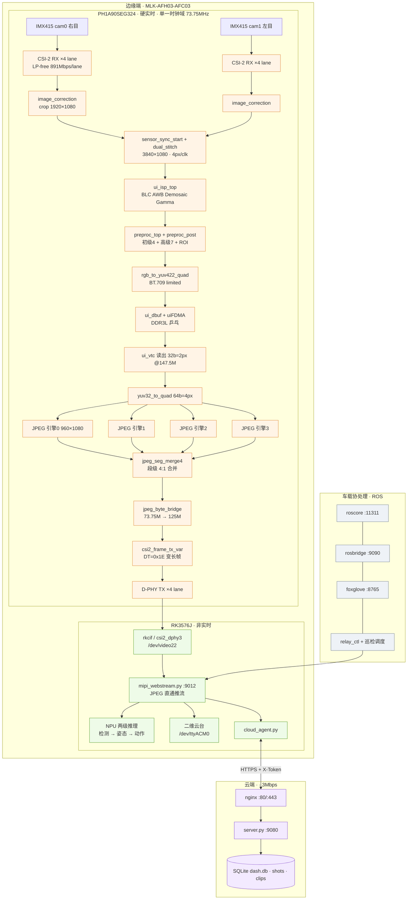
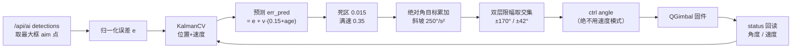
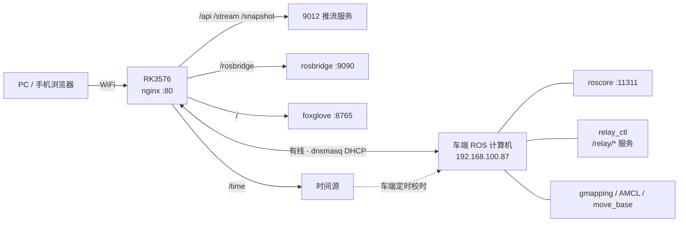
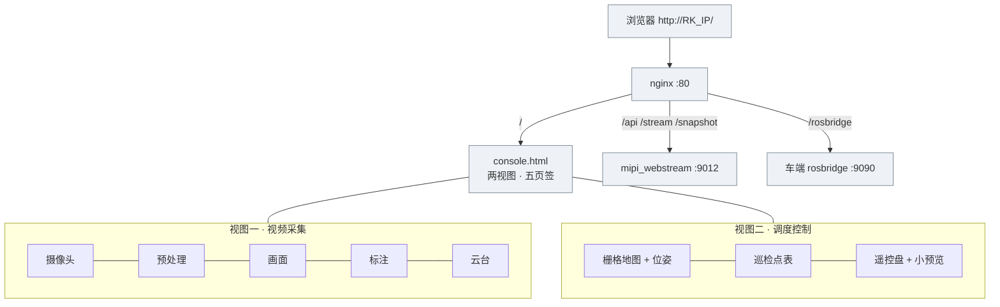
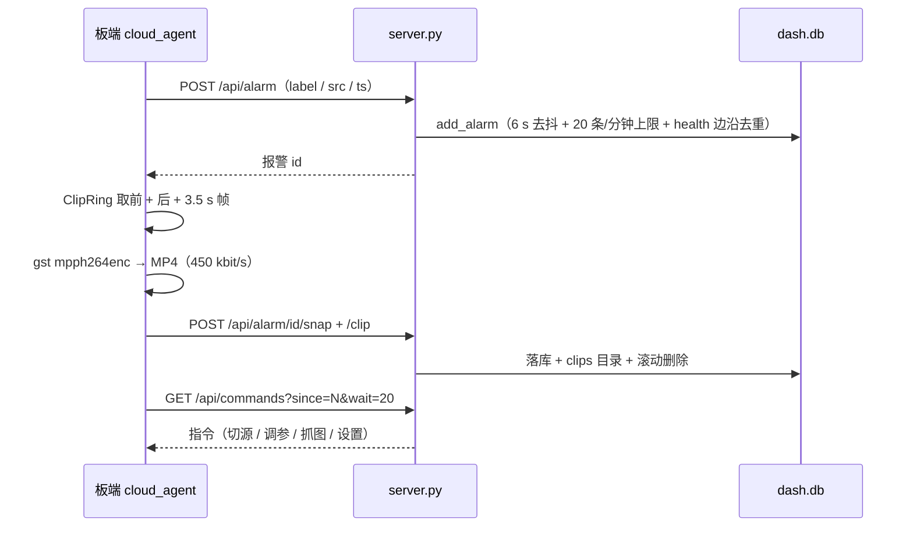

# 云端智联定点巡航安防预警系统 · 技术报告

| 项目 | 内容 |
|---|---|
| **作品名称** | 云端智联定点巡航安防预警系统 |
| **作品方向** | 基于 FPGA 的图像采集压缩与智能预处理加速系统设计 |
| **参赛平台** | MLK-AFH03-AFC03（安路 PH1A90SEG324 国产 FPGA + 瑞芯微 RK3576J） |
| **核心器件** | PH1A90SEG324 / RK3576J（8 核 A72+A53，6 TOPS NPU）/ 2×Sony IMX415 / DDR3L 2 Gb / LPDDR4X / 32 GB eMMC |
| **FPGA 配置版本** | `CFG_VER = 0x5400`（唯一真源：`ctrl/cfg_ctrl_top.v`） |
| **代码分支** | `feature/dual-front-stitch` |
| **报告日期** | 2026-10-30 |

> 本文件是工程的**总技术报告**。原文的"模块—寄存器—踩坑"型技术手册已归档为
> [`docs/ARCHIVE_README_2026-10-30_技术手册版.md`](docs/ARCHIVE_README_2026-10-30_技术手册版.md)，
> 两者互补：本报告给出**设计动机、架构、量化指标与验证方法**，归档文件给出逐文件级实现细节。

---

## 1 摘要

园区、厂区等工业场景的移动式智能巡检，长期受制于"高分辨率双目视频的实时性、压缩算力与回传带宽"三者相互挤压：未压缩的双目 1080p60 视频按 YUV422 计为 3840×1080×16 bit×60 fps ≈ **3.98 Gbit/s（497.7 MB/s）**，远超现场 Wi-Fi、4G/5G 上行与公网回传能力；而若把逐像素的拼接、滤波、压缩交给通用处理器，又会挤占智能推理所需的算力，形成"要么看不清、要么传不回、要么算不动"的三难。

本文设计并实现了一套以**国产 FPGA 为硬实时算力载体、以 RK3576J 为非实时智能与业务载体**的分层异构巡检安防系统。系统在安路 PH1A90SEG324 上以纯 RTL 实现了从两路 IMX415 的 CSI-2 接收、双目同步、1280 行级流水拼接、ISP、多算子硬件预处理，到四引擎并行 JPEG 硬件压缩、CSI-2 变长帧组包与 D-PHY 发送的**完整硬实时通路**；RK3576J 侧只接收已压缩的 JPEG 码流，承担网页直通推流、NPU 两级人体检测与姿态推理、危险动作时序判定、二维云台闭环跟踪与云端上行。

设计上有三个关键取舍。**其一，用单一时钟域收敛全部像素带宽**：拼接、ISP、预处理、JPEG 全部工作在 73.75 MHz 像素域，4 px/clk 即 295 Mpx/s，相对 248.8 Mpx/s 的需求留出 18.6% 余量，避免了为每一级单独设计跨时钟域所带来的时序与验证成本。**其二，把一幅 3840×1080 的 JPEG 拆给四个并行引擎**：每个引擎独立编码 960×1080（8100 MCU），借助 DRI（Define Restart Interval）把每 1/4 行（60 MCU）做成独立熵编码段，四路码流在字节层按段号 0/1/2/3 交错背对背拼接，无需重做熵编码。实测 151.3 clk/MCU，8100×151.3/73.75 MHz = **16.617 ms → 60.19 fps**，恰高于 IMX415 的 16.66 ms 帧周期。**其三，放弃"原始像素流"这一传统回传方案**：由于 4 lane、1 Gbps/lane 的 CSI-2 链路容量（500 MB/s）与 NV16 3840×1080@60 所需的 498 MB/s 仅差 0.4%，物理上不可能稳定传输，因此 V51 起**物理删除** NV16 直通通路，只发送硬件 JPEG 码流；又因 rkcif 不支持 JPEG 数据类型，最终采用"借用 YUV422 的 DT=0x1E 传输 JPEG 码流、应用层扫描 `FF D8…FF D9` 取帧"的变长帧方案，把回传码率从 3.98 Gbit/s 压到约 **72 Mbit/s**（≈55:1）。

系统已完成的量化结果：FPGA 侧 slice 占用 44 691/64 320（69.48%）、ERAM 219/272（80.51%）、DSP 182/240（75.83%）；像素域最差建立余量 +0.697 ns（等效 fmax ≈73.85 MHz），全设计仅剩 1 条 −0.417 ns 违例且位于厂商 D-PHY 时钟 lane 的 ODDR 原语内部；RK 侧单级检测 17 ms、逐人姿态 22~26 ms，无人场景 50 fps、单人 36 fps、4 人 26.7 fps，而视频通路稳定 59 fps 不受 AI 影响；云端在 3 Mbit/s 链路上以 5 s 心跳 + 长轮询实现远程调度，日均流量约 16 MB。

本系统的工程意义在于：证明了**在国产中等规模 FPGA 上实现"双目 1080p60 采集 + 多算子预处理 + 硬件 JPEG"是可行的**，并给出了一条可复现的、以字节级不变量为准绳的设计与验证方法——任何"改完应该更好"的优化，都必须由逐字节等价或可机检的硬数字作证。

---

## 2 功能与特性

系统按"采集—增强—压缩—传输—理解—处置"六段闭环组织功能。

**（1）双目同步采集与拼接。** 两路 IMX415 各以 4-lane CSI-2（891 Mbit/s/lane）输出 1920×1080@60 RAW10；同拍复位释放 + 20 ms 稳定窗 + 双表同拍重跑实现传感器级同步，再以环形行缓冲做帧级交替调度，输出 3840×1080、4 px/clk 的左右拼接图（左 cam1、右 cam0）。任一路掉线时该半幅补黑而流水线不死锁，恢复后自动回图。

**（2）硬件增强与预处理。** 片内 ISP 完成黑电平、自动白平衡、去马赛克与伽马；两级可编程预处理提供灰度、高斯、直方图均衡、对比度与 Sobel、阈值分割、形态学、中值、拉普拉斯、浮雕、Prewitt 等十余种算子，另有后级白平衡与 ROI 裁剪。全部按 4 px/clk 并行、行数不变，可运行中逐项开关调参。

**（3）硬件 JPEG 与低带宽传输。** 四引擎并行 Baseline 4:2:2 编码，量化表 128 项在线可写、重启间隔可配，码流按段合并为单幅 JPEG 后以 CSI-2 变长帧直发（DT=0x1E），平均码率约 72 Mbit/s，链路占用不足 10%。

**（4）边缘智能与云端闭环。** NPU 上跑 yolov8n 检测 + yolov8n-pose 17 关键点两级级联，配合 ID 跟踪、骨架平滑与时序状态机输出跌倒、攀爬、冲突、越界、举手等分级告警；云台按卡尔曼预测跟踪；车载 ROS 支持建图、导航与循环巡检；云端提供大屏报警灯、远程调参、指令下发与事件抓拍回放。

**（5）可运维性。** 全参数经 I²C（`/dev/i2c-9`，0x40）读写并回读校验，支持参数持久化、看门狗自恢复与 systemd 顺序化开机。

---

## 3 应用领域

**园区与厂区常态化巡检。** 系统的直接目标场景。人工定时巡逻成本高、覆盖稀疏，固定点位摄像头布线困难且盲区多。本系统以"可移动双目视觉节点 + 云端分级安防"替代：无人车按预设点循环巡视，到点停留并让云台左右扫视，检测到人后自动跟踪设定秒数再继续；异常实时上报并附抓拍图与短视频，值班人员在 3 Mbit/s 链路上即可确认处置。

**危险与受限区域的分级防护。** 变电站、配电房、管廊隧道、化工装置区对"闯入、攀爬、跌倒、静止倒地"高度敏感且不宜大规模布线。电子围栏 + 三级风险（正常/预警/报警）+ 事件去抖可把"每帧都报"压成"一个回合只报一次"，显著降低误报疲劳。

**施工现场与仓储物流。** 工地存在临边、洞口与吊装作业，仓储存在人车混行。预处理可切到阈值分割或形态学增强，提升逆光、粉尘、低照度下的可辨识度；压缩后的低码率码流适合 4G/5G 或无线网桥回传。

**无人值守与教学科研。** 农业、矿区、边海防等场景供电与带宽都紧张、维护周期长，逐像素运算下沉 FPGA 后可长期稳定运行；工程本身亦是完整的"国产 FPGA + 国产 SoC"参考实现（40 个自研 RTL、45 个测试台、131 个板上脚本），可用于教学与二次开发。

---

## 4 主要技术特点

**（1）硬实时与非实时彻底分层。** FPGA 只承担"定长、逐像素、有硬时限"的运算，RK 只承担"非定长、事件驱动"的逻辑，边界写进设计约束：RK 侧**明确不接收原始视频流、不做逐像素处理**。这条边界一旦被打破（例如让 RK 解码 NV16 再重编码），延迟会立刻从十毫秒量级恶化到百毫秒量级，这是本工程用 A/B 实测确认过的结论。

**（2）像素域单时钟收敛全部带宽。** 拼接、ISP、预处理、YUV 转换、四引擎 JPEG 全部运行在 73.75 MHz 的同一时钟域，4 px/clk 提供 295 Mpx/s，相对 248.8 Mpx/s 需求余量 18.6%。全设计只需处理三处真实跨时钟域：两路 MIPI 恢复时钟（各 111.4 MHz）→ 像素域、DDR 读侧（147.5 MHz）→ 像素域、字节桥（73.75 MHz）→ D-PHY 发送域（125 MHz），且后两者分别由 `yuv32_to_quad` 握手与异步 FIFO 显式隔离。

**（3）"段级"而非"帧级"并行。** 四引擎并行编码最棘手的问题是熵编码器的串行性：码流必须连续。本设计用 DRI 把每个引擎的每 1/4 行（60 MCU）做成**自包含的熵编码段**（段首插 RSTn，段内不依赖前文），于是四路码流可以在字节层直接按段交错拼接，合并器只需 4 个 4096×9 bit FIFO，不需要整帧缓冲、不需要重编码，也不引入额外延迟。

**（4）以行缓冲替代帧缓冲。** 拼接用 4 块环形行缓冲、JPEG 用 8 行乒乓、3×3 窗口用单行缓冲"同址先读后写"取上一行；全系统仅一处整帧级缓存（DDR3L 乒乓），用来吸收 0.26% 的帧率微差。

**（5）借用既有数据类型承载新载荷。** rkcif 不支持 JPEG 数据类型，而它本质是 DMA；于是用 DT=0x1E 承载变长 JPEG 码流、应用层以 `FF D8…FF D9` 定界，链路占用从 99.6%（物理不可行）降到不足 10%，且不必改内核。

**（6）可机检的验证方法论。** 所有关键改动以逐字节等价或可机检硬数字为判据：DCT 逐位一致、量化倒数 256 个 Q 穷举、端到端 862 B 逐字节相同、段合并 5 372 B 逐字节相同。这把"看起来能出图"变成"能证明每一字节都对"。

---

## 5 主要性能指标

| 指标 | 数值 | 依据 / 测量条件 |
|---|---|---|
| **采集能力** | 2 × 1920×1080@60（IMX415 binning，VMAX=2283、行周期 7.3 µs） | 传感器寄存器表 + 板级实测 59~60 fps |
| **拼接输出** | 3840×1080，4 px/clk，73.75 MHz | `system_top.v` 几何参数；295 Mpx/s vs 248.8 Mpx/s 需求，余量 18.6% |
| **JPEG 编码吞吐** | 8100 MCU/引擎 × 151.3 clk/MCU @73.75 MHz = **16.617 ms → 60.19 fps** | `tb_jpeg_e2e` / `run_jpeg_thru` 实测 clk/MCU；高于 16.66 ms 输入帧周期的 0.26% |
| **压缩率** | 一帧 120~200 KB（原 8.29 MB）⇒ **41:1 ~ 69:1，典型 ≈55:1** | 变长帧实测帧长区间；等效码率 72~120 Mbit/s |
| **传输链路** | 4 lane × 1 Gbps = 4 Gbit/s，byte clk 125 MHz；实际占用 <10% | D-PHY 500 MHz link freq；变长帧不补零 |
| **FPGA 资源** | slice 44 691/64 320（**69.48%**）、LUT6 38 188/64 320（59.37%）、FF 35 126/128 640（27.30%）、ERAM 219/272（**80.51%**）、DSP 182/240（75.83%）、PLL 4/12 | `phy_1/fpga_prj_phy.area`（2026-10-29 20:24 布线后） |
| **时序** | 像素域最差建立余量 **+0.697 ns**（预算 14.237 ns ⇒ fmax ≈73.85 MHz）；保持余量 +0.020 ns；全设计仅 1 条违例 **−0.417 ns**（厂商 D-PHY 时钟 lane ODDR） | `phy_1/final_timing.rpt` / `route.qor` |
| **NPU 推理耗时** | 一级检测 17 ms（单核 24 ms）；逐人姿态 22~26 ms（单核 33 ms） | RK3576J 850 MHz、双核 `NPU_CORE_0_1`、INT8 + 关键点头 float16 混合量化 |
| **端到端帧率** | 视频 59 fps；AI 无人 **50 fps**、单人 **36 fps**、4 人 **26.7 fps** | `/api/status` 与 `/api/ai` 长期实测 |
| **延迟** | 直通后"采集就绪→可分发"目标 5~10 ms；MJPEG 帧间隔 16.8 ms（抖动 σ=1.45 ms）；AI 结果新鲜度 27~40 ms | `tools/board_jpeg_latency_ab.py` + `/api/ai` 的 `age_ms` |
| **云端带宽** | 3 Mbit/s 链路，心跳 0.9 KB/5 s（≈16 MB/天），报警图 23~30 KB/张 | `cloud/docs/API.md` 与线上实测 |

> **证据分级说明**：上表中"资源/时序/编码吞吐/压缩率/NPU 耗时"来自综合布线报告与仿真台架的实测文件；
> "端到端帧率/延迟"来自板级运行日志；"压缩率区间"为变长帧实测帧长分布，非单帧采样。

---

## 6 主要创新点

**（1）四引擎 + DRI 段级拼接的硬件 JPEG 架构。** 每引擎只编 1/4 幅，用 DRI 把 1/4 行（60 MCU）切成自包含熵段，四路码流在字节层按段号交错拼接，RST 编号交错后全局恰为 `RST0…RST3` 循环。代价仅 4 个 4 KB FIFO，收益是四倍并行与零重编码。

**（2）像素域单时钟 + 行缓冲的带宽收敛方法。** 以 480 组/行的行缓冲与 8 行乒乓替代帧缓存，使 295 Mpx/s 在 69.48% 的 slice 占用下成立，并把跨时钟域收敛为三个可证明的握手点。

**（3）受限协议栈上的"数据类型借用"。** rkcif 不支持 JPEG 数据类型，却本质是 DMA；用 DT=0x1E 承载变长 JPEG 码流并以 `FF D8…FF D9` 定界，不改内核即把链路占用从 99.6% 降至 <10%，并把端到端延迟从百毫秒量级降到十毫秒量级（直通通路实测帧间隔 16.8 ms）。

**（4）以逐字节不变量为纲的验证体系。** 全链独立参考模型 + 可参数化到 3840×1080 的台架，使故障可在 2 分钟内于仿真中复现，不必反复上板试错。

**（5）时间预算式 NPU 调度。** 双核绑定 + 检测帧跳姿态 + 多人姿态预算 + 全核亲和 + 前处理流水，消除 45 ms 长尾帧，使 4 人场景 15→26.7 fps 而视频通路零损失。

---

## 7 设计流程

系统采用"指标分解 → 算术校核 → RTL 实现 → 台架验证 → 后端收敛 → 板上 A/B"的六段式流程，每段都有可机检的通过门限。

**指标分解：** 把赛题要求换算成三条恒等式——像素域 ≥62.2 MHz（4 px/clk）、编码域 ≤16.66 ms/帧、链路 ≤500 MB/s，后续全部参数由此反推。

**算术校核：** 先算天花板。单引擎需 291.6 MHz 不可行，双引擎各 146 MHz 属临界，四引擎各 8100 MCU 需 73.75 MHz 可行；再堆到八引擎则 DSP 需 298 > 240 不可行。这一步否决了三条"更快"的路线。

**RTL 与台架：** 按"可独立验证的行为"切分模块；算子级、链路级到系统级均以逐字节/逐像素判据收口，故障先在仿真复现再上板。

**后端收敛：** 每轮判"是逻辑深度还是布线拥堵"——像素域最差路径曾呈 net 占 76% 的拥堵特征，据此改用官方策略包而非盲目加流水。

**板上 A/B：** 寄存器级改动一律直写原始寄存器并回读对比；每次上板只烧 SRAM、保留 flash 兜底版本。

## 8 系统架构

系统是三级异构结构：**FPGA 硬实时层**（单帧内完成、时限确定）、**RK3576J 非实时层**（事件驱动、允许抖动）、**云端/车载业务层**（跨网络、允许秒级延迟）。三层的职责边界是硬约束，写入设计规范并在此后所有迭代中被遵守——例如"RK 不接收原始视频流"这条，直接把一条带宽不可行的通路从系统里物理删除。



**分层职责边界（越界即架构腐化）**

| 层 | 只承担 | 明确不承担 |
|---|---|---|
| FPGA | 采集、同步、拼接、ISP、预处理、JPEG、CSI-2 组包；全部**逐像素、定长、有硬时限** | 任何非定长、非实时、事件驱动的逻辑 |
| RK3576 | 取流、JPEG 直通、NPU 推理、HTTP/API、云上行与指令下行、云台串口 | **任何逐像素处理**（不解码、不缩放、不重编码） |
| 云端 | 状态汇总、报警落库、远程调参、看板、指令队列 | 图像处理（3 Mbit/s 不允许）、视频转码 |

**人机交互的四个入口**（分别对应 §9.10–§9.13）

| 入口 | 实现 | 职责边界 |
|---|---|---|
| 网页控制台 | `rk/relay/web/console.html`（单文件、80 端口） | **唯一人机入口**：看画面、调参、控云台、地图与巡检 |
| 推流/调参服务 | `rk/web/mipi_webstream.py` :9012 | 只监听回环，所有对外访问经 80 端口反代 |
| 云台控制 | `rk/web/gimbal_web.py` + `/api/gimbal` | 唯一串口写者，绝对角度 + 双层限幅 + 看门狗 |
| 云端看板 | `cloud/server.py` :9080 + `static/index.html` | 跨公网只读看板、报警落库、指令队列 |

**时钟域与跨域点**

| 时钟 | 频率 | 承载 |
|---|---|---|
| `sys_clk` | 25 MHz | 配置常开域、同步启动计数、SCCB 主控 |
| `S_hs_clk0/1` | ≈111.4 MHz | 两路 MIPI 恢复时钟（891 Mbit/s ÷ 8），各为 `ui_image_correction` 的域 |
| `S_clk_70m` (= `S_st_clk` = `S_enc_clk` = `S_hs_rx_clk`) | **73.75 MHz** | 拼接、ISP、预处理、YUV 转换、4×JPEG |
| `S_pclkx1` | 147.5 MHz | DDR 读侧、VTC 节拍（32 b = 2 px） |
| `S_dsi_byte_clk` | 125 MHz | 字节桥读侧、CSI-2 组包、D-PHY `I_hs_clk` |
| `S_dsi_hs_x2/x4` | 250 / 500 MHz | D-PHY 串行化（PHY 原语内部） |

全系统只有 **3 处**真实跨时钟域：① 111.4 MHz → 73.75 MHz（`sensor_sync_start` 内的环形行缓冲，异步 FIFO/格雷指针）；② 147.5 MHz → 73.75 MHz（`yuv32_to_quad` 显式 `valid/ready` 握手）；③ 73.75 MHz → 125 MHz（`jpeg_byte_bridge` 的 4 KB 异步 FIFO）。其余"看似跨域"的地方（如 `jpeg_enc_if` 的 `s_clk`/`e_clk`）实际是同一根时钟，不需要 CDC——这一点曾被注释误导过，属本项目重要教训之一。

---

## 9 模块详细设计

全系统按数据流与职责拆为 **9 个 FPGA 侧模块**（§9.1–§9.9，逐像素、硬实时）与 **4 个软件侧模块**（§9.10–§9.13，事件驱动、允许抖动）。每个模块统一按"职责 → 关键实现 → 量化指标 → 已知边界"四段组织，指标一律给出测量条件或来源。

### 9.1 双路 MIPI CSI-2 接收前端

接收前端解决的是"两路 4-lane 高速差分信号如何在通用 HR bank 上完成解串与协议还原"。硬件上子卡已去掉 LP 抽头，因此采用厂商 `mipi_csi_lpfree` IP 家族（13 个源码文件）：`csi_rx_phy` 负责差分输入与位对齐，`csi_rx_byte_align` 做字节对齐，`csi_rx_hdr_ecc` 做包头 ECC 校验，`csi_rx_10bit_unpack` 把 4 字节打包的 RAW10 还原为 10 bit 像素，`csi_rx_vid2stream` 输出 AXI4-Stream 视频流。

由于 PH1A90 的 HR bank 没有 HP_ISERDES 原语，解串必须用软逻辑实现：每 lane 使用 `PH1_LOGIC_DYNAMIC_IDELAY`（5 bit 可调延迟，用于训练采样窗口）+ `PH1_LOGIC_IDDRx2` 完成 1:2 双沿采集，再级联得到 1:4 的并行字。这一选择带来两个工程后果：其一，采样窗口需要在初始化阶段训练，板级调试寄存器 `0xD6~0xD9`/`0xDD~0xDF` 保留了对齐状态、eye-scan 与手动步进的读数，用于在链路误码时快速定位；其二，恢复时钟由数据本身恢复（891 Mbit/s ÷ 8 = 111.4 MHz），不能用 PLL 生成，因此**每一路必须自成一个时钟域**，这一点在早期的"两路共用一个恢复时钟"实现中曾造成偶发丢帧。

`csi_rx_byte_align` 的同步字硬编码为 0xB8，等价于只支持 VC=0、RAW10 的配置；这不是缺陷而是取舍——本系统的两路传感器配置固定（1080p binning、10 bit RAW、单 VC），去掉可配置性换取了组合逻辑与资源的节省。像素进入 `ui_image_correction` 后按 `S_cam_h=1920` 做水平裁剪，得到每目 1920×1080；裁剪在该路自己的恢复时钟域内完成，直到 `sensor_sync_start` 才跨到 73.75 MHz 像素域。

物理引脚在 `fpga/uisrc/04_pin/fpga_pin.adc` 中固化：cam0 时钟 E13、数据 C14/D14/A15/G17；cam1 时钟 E16、数据 F18/K16/D17/J17，IOSTANDARD 统一为 LVDS18。由于子卡去 LP 抽头后 LP 四对脚已悬空（恒 LP 电平在 11/01/00 任一组合下都不可用），约束中恢复了对这些引脚的上拉配置。链路预算为 4 lane × 891 Mbit/s = 3.56 Gbit/s，对应每目 1920×1080×10 bit×60 fps = 1.24 Gbit/s 的净荷，占用约 35%，为后续提高帧率或位深保留了空间。

### 9.2 双目同步与拼接

双目系统的核心难题不是"把两幅图并排"，而是**两颗独立运行的传感器如何在像素级对齐**。本模块用两级机制解决：帧级同步启动与行级缓冲调度。

**帧级同步启动（`sensor_sync_start`）。** 上电后模块同时拉低两颗传感器的 RSTn，保持后再同时释放，然后等待一个 20 ms 的稳定窗（`HOLD_CYCLES = 500_000 @25 MHz`），最后把两张初始化寄存器表**同拍**重新下发。这样两颗传感器的行计数器在同一起点开始，帧起始时刻的偏差被压到一个行周期（7.3 µs）以内。该流程可由寄存器 `0xDB[1]` 触发重跑，用于运行中恢复同步。

**行级缓冲调度（`dual_frame_sched` + `dual_stitch`）。** 两路的恢复时钟虽同标称频率，实际存在 ppm 级偏差，不能直接拼接。设计让 cam1（左目）写入一个 4 块环形行缓冲，读侧恒定按 cam0（右目）的节拍推进、滞后约 2 行；每行 1920 px ÷ 4 px = 480 组（`HGRP=480`），FIFO 深度 `FIFO_AW=11`（2 048 word ≈4.2 行）。饥饿保护阈值 `STARVE_MAX=2400`，在 73.75 MHz 下约 32.5 µs ≈2.1 行，超时即补黑而不是停等，从而保证输出时序永不中断。

输出为 3840×1080、4 px/clk、RGB888×4（128 bit）的拼接帧，左半幅来自 cam1、右半幅来自 cam0（`SWAP=0`）。这个左右顺序与"人站在车前"的直觉一致，也让后续 NPU 的左右目语义固定下来。

**掉线行为是被显式设计的。** 当某一路 `line_ok=0`（无有效行）时，读侧不前进只补黑，于是画面该半幅变黑但整体时序不乱、下游 JPEG 与 CSI-2 照常出帧；该路恢复后左半幅自动重新出图。测试台 `tb_dual_stitch` 以三阶段验证：正常同拍采集（6 帧、47 行、tuser=6、tlast=47）→ 停 cam1（left 黑 864 组、`starve_l=1`）→ cam1 恢复（左右黑计数归零），结果 PASS。台架故意给两路 32.4/33.2 MHz 的不同时钟、输出 73.75 MHz，以确保异步条件被真实覆盖。

值得注意的是，拼接输出行/帧边界由**本地计数器**生成，读侧从不使用源端的 `tuser/tlast`；这让时序完全可控，代价是依赖"每行都有 ≥10 拍行间空闲"来分行（`S_grp_per_line=0`）。若某行没有空闲，两行会被并成一行且整帧错位、无法自愈——这是当前实现的已知脆弱点，修复方向是改用源端 `tuser` 对齐并加入丢行补偿，已在缺陷清单中列为 P2。

### 9.3 ISP 图像信号处理

ISP 模块（厂商 `ui_isp_top` 及其子模块，全源码）把 RAW10 Bayer 数据转换为可编码的 RGB888，串行经过黑电平校正、自动白平衡、去马赛克、亮度、对比度、饱和度与伽马七级。每级都按 4 px/clk 展开，模块间以 valid/ready 直连，不引入额外缓冲。

**黑电平校正（BLC）** 逐通道减去光学黑电平，消除暗电流偏置；**自动白平衡（AWB）** 用两个 32 位除法器做通道增益归一化，是 ISP 内最大的组合资源消耗点（4 197 LUT，其中除法器占 3 572），也是后续可优化的重点；**去马赛克** 采用双线性插值并按 `DEM_TWO_BRANCH=0` 只保留一条分支（因此 Bayer 相位选择寄存器 `0xDA` 在当前版本已是死寄存器，写 2/3 静默无效）；**亮度/对比度/饱和度** 为定点增益与偏移，对比度用 `×160 → (<<7)+(<<5)` 的移位加实现；**伽马** 用 9 段 LUT 拟合，兼顾资源与单调性。

ISP 输出为 BT.709 + limited range（16~235）的 RGB888×4。这个色彩约定贯穿全链路，并在 RK 侧被显式对齐：驱动上报 `V4L2_COLORSPACE_REC709` + `YCBCR_ENC_709` + `LIM_RANGE`，`mipi_webstream.py` 以 `--yuv-matrix 709 --yuv-range limited` 启动；若应用层用 OpenCV 默认参数解码会得到偏灰的画面，必须 `CAP_PROP_CONVERT_RGB=0` 自行按 limited range 转换。这是一个"参数不写在图像里、只能靠约定传递"的典型陷阱。

资源上，ISP 占 48 个 DSP（对比度 12 + 饱和度 28 + AWB 8）。在 240 个 DSP 的总预算下，这一占比曾一度把"加第二个 JPEG 引擎"的可能性挤掉；后续通过把 BT.601/BT.709 亮度选择的 5 处乘法（共约 60 DSP）改写为**逐位等价的移位加**，才腾出空间让四引擎方案落地。这条经验说明：在资源紧张时，最有效的优化往往不是改算法，而是把"参数化乘法"换成"常数移位"。

### 9.4 硬件预处理加速

预处理是本作品"并行算力"卖点的直接载体，插在 ISP 与 `rgb_to_yuv422_quad` 之间，4 px/clk 全流水、延迟约 4 拍、**不改变行数**（ROI 裁剪也只填黑不改分辨率，因为 VTC 时序是编译期参数）。

**初级层（`preproc_basic`）** 提供灰度、高斯、直方图均衡、对比度四路并行能力，固定串联顺序为"高斯 → HE → 灰度 → 对比度"，各算子独立使能（`0xF0`）。灰度支持 BT.601 / BT.709 两种系数（`0xF1`）。高斯用单行缓冲 + 3×3/5×5/7×7 可配核（`0xF8`），强度 0~8（`0xF2`），且为了不把 R/G 噪声注入 B 通道，专门实现了 RGB 三通道窗口模块 `preproc_win3x3_rgb`。

**高级层（`preproc_edge`）** 提供 8 路并行算子：Sobel、阈值分割、形态学（腐蚀/膨胀/开/闭）、中值、拉普拉斯、浮雕、Prewitt、锐化，由 `0xB1` 单选、参数由 `0xB2~0xB7` 配置（其中锐化通路因 `0xF7` 参数寄存器已废弃而实际未用，故当前在用的是 7 路）。这一层的设计目标是"让 FPGA 的并行性可见"：多条数据通路同时存在，同一拍内可以同时算出多种结果，只是输出端按模式选择其中一路。

**后级（`preproc_post`）** 做数字白平衡与 ROI 中心裁剪填黑，ROI 档位 100/75/50/37.5/25/12.5%，全部用移位实现、无除法器（`0xC8`）。

**窗口与对齐是这一层最容易出错的地方。** 3×3 窗口需要"上一行同列"，实现上让单行缓冲（`AW=10`、深度 960）同址**先读后写**，读出的就是上一行；`preproc_win3x3`（亮度）与 `preproc_win3x3_rgb`（三通道）分别服务不同算子。历史上这里曾出现两类系统性错位：一是窗口链 4 拍、像素链 5 拍，导致结果整体右移 4 像素；二是级联两级 3×3 后累计 2 行 + 2 列偏移。修复手段是显式补齐延迟链，并在 `preproc_linefix` 里提供"行首 16 像素校正"这一寄存器开关（`0xFB`，默认关闭——它在某些配置下反而制造错位）。

**直方图均衡的稳定性是一个独立课题。** 早期实现用两相位构建 CDF/LUT，在高帧率下出现帧间闪烁；根因是 LUT 更新与帧边界竞争，导致同一场景在不同帧用了不同的映射表。改为三相位构建（每 bin 3 拍、共 768 拍，远小于场消隐约 99 k 拍），并给桶计数加上限（`0xF9`，上限 ×64），使 8 帧连续统计的均值与 LUT 校验和完全一致（均值 111 / lutsum 26 841，无漂移）。

### 9.5 硬件 JPEG 编码引擎

编码器是本系统最复杂的自研模块，共 16 个文件。格式为 Baseline 4:2:2，MCU = 16×8 = 128 px；整幅 3840×1080 被切成 4 × (960×1080)，每引擎 60 MCU/行 × 135 行 = 8100 MCU。

**流水结构。** `jpeg_linebuf` 用 8 行乒乓把逐行 YUV422 重排为 MCU 可读顺序（y/cb/cr 各 16 行 × 64 bit）；`jpeg_dct2d` 做 8×8 定点 2D DCT，利用对称性只做 4 次乘法、30 拍/块，输出与 `tools/jpeg_ref.py` **逐位一致**；`jpeg_quant_zz` 做量化与 zigzag，用倒数乘法替代 8 个除法器，倒数由 `jpeg_recip_pipe` 的 22 级流水长除法产生（1 项/拍），256 个量化值穷举验证逐位一致；`jpeg_huff_enc` 做 DC 差分 + AC 游程 + 霍夫曼编码，1 符号/拍，并用 `i_nz_mask[63:0]` 位图跳零、支持双符号快路径；`jpeg_bitpack` 用 40 位累加器做位打包与 `FF→FF 00` 填充（40 位是必需的：7 + 27 > 32，32 位会溢出）。

**DRI 分段机制。** 每个引擎的 `i_rst_int = 60`，即每 1/4 行（60 MCU）作为一个重启段，段首插入 `RSTn` 标记，段内熵编码不依赖前文。四引擎的 RST 编号取 `RST_INIT = 引擎号`、`RST_STEP = 4`、3 bit 自动回绕，于是引擎 0/1/2/3 分别产生 `RST0/1/2/3`，下一行再回到 0/1/2/3——**合并后全局恰好是 `RST0…RST3` 循环**，解码器看到的是一幅合法的、带重启标记的 JPEG。`LAST_RST_EN` 只在前三个引擎打开：因为拼接后引擎 3 的最后一段之后还有引擎 0 的下一段，该边界需要重启标记。

**段合并（`jpeg_seg_merge4`）。** 四路码流由一个 4:1 串行多路选择器按段服务，每路带 4096×9 bit FIFO，`o_ready[k] = ~f_full[k]`，因此非选中引擎的码流可以暂存而不被憋死。合并器的 `sel` 只在复位释放（`S_enc_rst_rel`）时归零，绝不能接某个引擎的 `st_busy` 上升沿——这是 V53b 排查出的**全链死锁真根因**：早期实现里 `sel` 被引擎 0 的忙信号反复重置，而引擎 0 的帧头又需要连续 613 拍 `m_ready` 才能发完，两者互相等待即形成死锁。

**吞吐账与验证。** 实测 151.3 clk/MCU，四引擎各 8100 MCU 在 73.75 MHz 下为 16.617 ms，对应 60.19 fps；无损路径（SOF3 + DPCM + MED 预测）为 320.2 clk/MCU，单引擎仅约 22 fps，需 4~8 段并行才能上 60 fps，故当前版本未启用。验证采用三组硬判据：`tb_jpeg_e2e` 端到端 862 B 与 Python 参考 JPEG 逐字节相同；`tb_jpeg_merge` 双引擎合并熵段 5 372 B 与单引擎参考逐字节相同且 RST0…RST6 连续；`run_jpeg_thru` 输出 clk/MCU 必须 ≤151.7。

### 9.6 帧缓存、VTC 读出与字节桥

这一组模块解决"前后端时基不一致"的问题。拼接/ISP/预处理/编码的稳态速率与输入端速率只差 0.26%，但在启动、模式切换、反压时会瞬时失配；同时 VTC 读出与 D-PHY 组包需要固定的节拍。因此设计了一处**整帧级缓存**：`ui_dbuf` + `ui_FDMA` 在 DDR3L 上做乒乓，写入 16 bpp（YUV422 打包，64 bit = 4 px @73.75 MHz），读出 32 bit = 2 px @147.5 MHz。

带宽账：写 3840×1080×2 B×60 = 497.7 MB/s，读同为 497.7 MB/s，合计约 996 MB/s。板载 DDR3L 为 16 bit 位宽、1866 Mbit/s 速率，器件级带宽约 3.7 GB/s，本系统占用约 27%，仍有余量承载更高帧率或第二路编码。`ui_vtc` 按 1 125 行的固定时序（对应 59.6 fps）读出，为下游提供严格的像素节拍——这也是当前系统"帧率上限由 VTC 时序而非编码器决定"的原因。

跨时钟域发生在 `yuv32_to_quad`：把 32 bit/2 px @147.5 MHz 转为 64 bit/4 px @73.75 MHz，转换用显式 `valid/ready` 握手，且 `c_ready` 与组计数都被 `S_enc_gate_r` 门控——门控的目的是让编码器在帧边界整齐停流，避免行缓冲吃到半行数据。`yuv32_to_quad` 之后数据进入四个 `jpeg_enc_if`（每个带 12 bit 地址、`START_LEVEL=3840` 即 16 行预取），四个接口同时保持各自的 4 行窗口，使得四引擎可以并行起步。

最后一级 `jpeg_byte_bridge` 是**全系统唯一的真实字节流跨域点**：写侧 73.75 MHz、读侧 125 MHz，用 4 KB（`AW=12`）异步 FIFO 隔离，读侧直接对接 `csi2_frame_tx_var` 与 D-PHY 的 `I_hs_clk`。把发送域统一到 125 MHz 是本项目交叉验证得到的重要结论：V51 曾把组包器接到 70.24 MHz，导致 32 位 `hs_data` 以 1.78 的非整数比裸跨到 125 MHz D-PHY，每个数据拍被采样 1 或 2 次，码流必然错乱；改回与 PHY 同源后问题消失。诊断上可通过 `0xA7`（写侧停顿计数）与 `0xE4/0xE5`（桥水位/读计数）判断桥是否真的在流动。

### 9.7 参数与控制通路

控制通路承担"把上位机的意图变成 FPGA 内部状态"的全部工作，由 I²C 从机、配置寄存器堆、传感器主控三个子模块构成，另有单线串口作为备用通道。

**I²C 从机（`i2c_slave`）** 挂在 `/dev/i2c-9`（`i2c@2ae80000`，pinctrl `i2c9m1_xfer`），7 位器件地址 `0x40`，引脚 `IO_cfg_scl=L18` / `IO_cfg_sda=M18`。协议为"子地址 + 数据"两拍式：先写目标寄存器地址，再读或写数据。实现上采用纯过采样采样判决（不在从机侧拉伸时钟），因此不依赖外部时钟频率，也就不需要在系统时钟变化时重新调参。需要注意的是，DTS 里的 `fpga@1a` 节点**只是 V4L2 的虚拟占位**，板子上并不存在地址 0x1a 的物理 I²C 设备；真正可用的参数通道只有 0x40。

**配置寄存器堆（`cfg_ctrl_top`）** 是整个设计的"单一真源"：`CFG_VER` 只在这里定义（当前 `0x5400`），顶层不再覆盖，避免出现"两处版本号不一致"的历史问题。寄存器堆工作在 25 MHz 常开域，所有跨到像素域的控制量都经过一次跨域打包：先在常开域寄存成准静态总线，再用两级同步器在 73.75 MHz 域打两拍取用。这种"准静态 + 两级同步"的方式适合参数类信号（写入后长时间不变），但不适合单拍脉冲，因此软件侧约定"写后回读"来确认生效。

**传感器主控（`cam_param` + `ui_i2c`）** 把语义化参数换算成 IMX415 寄存器值：曝光行数 = VMAX − SHR0（3 字节，`0xC0~0xC2`）、增益 `0x3090`（0~100，0.3 dB/step，`0xC3`）、EV 偏移（`0xC4`，8 表示 0 EV）；换算完成后触发一次 SCCB 下发。cam0 的 SCCB 引脚为 `O_cam_scl=B14` / `IO_cam_sda=A14`，cam1 为 `N10` / `N11`。这里有一个必须遵守的测试纪律：**测增益必须在低曝光下测**——满曝光时画面已饱和，0↔36 dB 的亮度差为 0.0，会误判成"增益通路坏了"。

**备用单线通道（`jpeg_cmd_1wire`）** 复用 `I_dsi_en` 这一根线实现 8N1 串口（4 800 baud），帧格式为 `SYNC=0x55 | ADDR | DATA | CHK(ADDR^DATA^0x5A)`，用于 I²C 不可用时的应急调参。

**可观测性设计。** 除参数寄存器外，还布置了一组纯诊断量：`0xA0~0xA2` 上一帧 JPEG 字节数（判断"是否真的出过帧"最关键的指标）、`0xA3~0xA6` 看门狗触发/源 FIFO 溢出计数、`0xA8` 忙/完成/溢出/无损回读状态、`0xB8~0xBB` CSI-2 帧起始短包计数（等于传感器真实帧率）、`0xBC` 心跳、`0xE1~0xE9` 冻结定位与三个自由跑计数器。这些量的意义在于：当现象是"黑屏"时，可以逐级判断卡在采集、拼接、编码还是发送，而不必靠猜测。

### 9.8 RK3576 采集驱动与网页推流服务

RK 侧的第一层是虚拟 MIPI sensor 驱动 `rk/driver/milianke_mipi.c`。它只做三件事：向 V4L2 异步框架注册一个 subdev（名字形如 `m02_b_FPGA-MIPI`）、上报唯一的媒体总线格式 `MEDIA_BUS_FMT_YUYV8_2X8`、给出三档模式表（1920×1080@60 / 3840×2160@25 / 3840×2160@30）。它**不注册 `video_device`**——`/dev/video22` 由 rkcif 侧产生，这一分工容易被误解为"驱动没工作"。链路参数为 4 data lane、continuous clock、125 MHz byte clock（1 000 Mbit/s/lane），并实现 `RKMODULE_GET_MODULE_INFO` 等私有 ioctl 以兼容 Rockchip 的通用采集栈。

设备树把接收端串成三级：`fpga@1a` 的 `port/endpoint` → `csi2_dphy3` 的 `mipi_in_fpga3` → `csidcphy3_out` → `mipi3_csi2`。其中 `mipi-en-gpios = <&gpio1 RK_PD0>` 直连 FPGA 的 `I_dsi_en`，驱动在 `s_stream()` 打开流时置高——它既是 D-PHY 发送使能，也是组包器的 enable，从而避免 D-PHY 复位期间往乒乓里塞包。

用户态是单文件服务 `rk/web/mipi_webstream.py`（约 4 900 行，仅用标准库），内部按职责分为若干类与后台线程：`FrameHub` 做最新帧广播与客户端计数，`SysMonitor` 采集 CPU/GPU/NPU/RAM/DDR 带宽，`ParamStore` 做参数持久化，`JpegMode`/`HwJpegEncoder` 管软/硬 JPEG，三种采集后端（`OpenCVCapture`/`GstCapture`/`GstLiveCapture`）可互相回退，`FpgaI2C` 直读直写 0x40 寄存器，`Handler` 承载全部 HTTP 路由；后台线程负责采集自愈、日志裁剪、重启、云台控制、AI 推理与服务自重启。

**JPEG 直通是这一层最重要的设计。** 服务在帧首检测到 `FF D8` 即认定进入直通模式，用 `find(b"\xff\xd9")` 定位帧尾（熵编码中的 `FF` 都已填充为 `FF 00`，所以第一个 `FF D9` 就是真正的 EOI），然后把这几万字节**原样**推给浏览器，既不进 `_raw_q/_bgr_q` 队列，也不触发任何编解码。这一改动把 RK 侧 CPU 占用压到接近 0，也把"解码 + 重编码"引入的 20~27 ms/帧延迟彻底移除。需要逐像素处理（缩放/几何/亮度/AI 叠加）时才 `cv2.imdecode` 一次走老路，两条路径可无缝切换。

对外暴露面上，服务只监听 `127.0.0.1:9012`，公网/局域网入口统一走 80 端口的 nginx 反代；`/api/fpga?compact=1` 能把寄存器快照体积压掉约 90%，用于高频轮询。参数面共 15 个字段（亮度/对比度/饱和度/色相/伽马/镜像/翻转/旋转/缩放/质量/帧率 + 双目/演示/AI 源 + JPEG 三档），全部支持 `reset` 与增量 patch。

### 9.9 NPU 两级视觉流水线与动作识别

智能层是"两级级联 + 可解释规则"的组合。一级用 yolov8n（COCO person）在 640×640 上给出人体框，二级用 yolov8n-pose 在同一 ROI 内给出 17 个关键点；随后进入 ID 跟踪、骨架 EMA 平滑与危险动作状态机，最终把框、骨架、动作标签与警戒区叠加到推流帧上。

**量化是这条路线上最大的坑。** `yolov8n-pose` 直接做 INT8 会把关键点输出的 `conf` 通道压成 0（坐标仍正确），表现为"框有、没骨架"。解法是两阶段混合量化：只把 `/model.22/Concat_6_output_0_int8` 设为 float16，代价约 +3 ms，坐标与置信度都恢复正常，与 FP32 对比 15/17 个高置信关节一致。这条修法**只对 640 有效**：384/320 的小模型即使同样混合量化，`kpt conf` 仍全为 0；改走 FP16 又因 RK3576 的 NPU 跑 FP16 极慢（384 输入 56.6 ms > 640 INT8 的 29 ms）而不可用。因此线上固定使用 640 一套模型，"快"只能靠调度优化。

**四个调度手段带来了全部性能提升。** 一是 NPU 双核绑定：`RKNNLite` 默认 `NPU_CORE_AUTO` 只挑一个核，改为 `NPU_CORE_0_1` 后检测 25.2→17.3 ms、姿态 29.9→25.8 ms。二是 `spread_pose`：两级串在同一帧会出现 45 ms 长尾帧（30+35），跑姿态的那一帧跳过检测、检测帧跳过姿态（关节沿用上一帧并按框位移补偿），帧率从 17 fps 升至 26 fps，代价是骨架滞后约 35 ms。三是 `pose_budget`（默认 2）：姿态逐人串行，4 人时每帧只更新 2 人，其余平移复用，4 人场景 15.1→26.7 fps。四是 CPU 全 8 核亲和与前后处理流水：8 线程挤 4 大核是 2 倍超订，改为全核后 AI 46.5→51 fps、视频 57.7→59.3 fps；letterbox 交独立线程与 NPU 重叠再得约 3.6%。

**误报治理是第三层价值。** 关键点"飘到画面另一角"曾是最难缠的问题，根因有二：`kpt_margin`（框 ±x%）永远拦不住 ROI 内的鬼点，以及"用肩/髋估躯干长"的门限自举失败。最终改用一级检测框（独立、稳定）定门限：距框中心 ≤ `kpt_scale_max × (框对角/2)`，默认 1.2；同时补上"跳帧回写框前先剔除距中心 >0.6 对角的点"与"EMA 只对两帧都有效的点做"。骨架归一化则从"框高"改为"骨段长度加权中位数"（站立/下蹲的实测比值为 1.00~1.03 / 1.16），并把缺失关节返回 NaN 而非 0，从结构上消除"看不见就判错"。

### 9.10 二维云台与控制律

云台是系统中唯一"输出会改变物理世界"的执行机构，因此设计目标不是"跟得最快"，而是**在任何异常下都不越界、不失控**。硬件为 QGimbal 系列二轴云台，经 `/dev/ttyACM0`（CDC-ACM 虚拟串口）以 115200 8N1 通信，协议为文本行（`ctrl angle` / `ctrl speed` / `status`）。整条控制链只有一个写者——`gimbal_web.py` 的串口线程，HTTP 层只投递目标值，避免多线程抢串口造成指令交错。

**安全实现分四层。** 第一，**只发绝对角度**，永不下发速度模式：即使进程崩溃，云台也停在最后一个已限幅的目标角，而非持续转动。第二，**两层限幅取交集**：绝对层用固件关节角（Yaw ±170°、Pitch 取用户 42° 与固件限位−1° 的较小值），相对层以软件零点为基准（±170°/±42°），因此零点设歪也不会多转半圈。第三，**看门狗**：点动 `hold` 0.8 s 到期归零，页面 `pointerup` 绑到 `window` 并监听 `blur`/`visibilitychange`/`pageshow` 强制发零；同时显式关闭固件的空闲位置保持（`POS_FB_ENABLE=False`），消除松手后云台自行缓慢漂移。第四，**拒绝即回滚**：固件拒绝某条运动指令时回滚目标并停止跟踪，不刷错误。

**控制律。** 误差取 `/api/ai` 中面积最大目标的归一化框中心偏差（用 AI 帧宽高归一化，半宽 = 1），先过 `_KalmanCV`（位置 + 速度，`r=5e-4`、`q=0.8`）估计速度，再按

$$e_{pred}=e+v\cdot(0.15+\text{age})$$

做提前量，其中 `age` 为 AI 结果新鲜度（封顶 0.6 s，避免 AI 停更时外推发散）。死区 0.015、|e| ≥ 0.35 满速；控制拍 25 ms，并按"本拍开始时刻"扣除串口命令耗时以保持固定节拍；输出累加为绝对角目标，前级再加速率斜坡 250°/s²。



**双闭环的保守形态。** 外环位置只在内环速度 ≤3°/s 时闭合（`kp_vel=0.5`，修正速率限 2°/s），快速段不闭合——编码器最多滞后 1 s，用旧位置拉目标只会拽出节奏。超前量用"实测速度 × 测量龄期"推算，超过 `lead_max=12°` 即冻结目标，防止积分饱和把堵转误判成"还可以再快"（这正是早期版本"越堵越用力、连回零都不干净"的根因）。

**瞄准点与可观测性。** 瞄准点在头脚均可见且框未被上下边裁时取框中心，否则取头部中心——这样"抬头/低头"不会把目标顶出画面。`/api/gimbal` 回读角度、误差、KF 速度、预测误差、提前量与瞄准模式（头部/身体），页面提供死区、满速阈值、加速度、预测时间四个滑块；参数随 `state.json` 持久化，「设置零点」默认只改软件零点，写固件 Flash 需显式二次确认。

### 9.11 车端 ROS 中继与定点巡航

**拓扑与中继。** 车端是一台运行 ROS 的计算机（LAN 内固定 `192.168.100.87`），与 RK 板以有线相连。RK 板同时挂在 WiFi 侧与车端网段，扮演"四合一"角色：nginx 反向代理（`/rosbridge` → 9090、`/` → foxglove 8765、`/time` → 毫秒时间戳）、dnsmasq（向车端发 `192.168.100.50–150` 地址）、chrony（授时中继）、nftables（转发与防火墙），并开启 `ip_forward`。这样浏览器只需访问 `http://<RK_IP>/`，既不必知道车端 IP，也不必在车端开放任何对外端口。



**车端进程。** `start_all.sh` 幂等拉起 `roscore(11311) → foxglove_bridge(8765) → rosbridge(9090) → relay_ctl`。`relay_ctl.py` 向上暴露 `/relay/{start_mapping,save_map,start_navigation,last_pose,stop}` 五个服务、`/relay/robot_pose` 位姿话题与**裁剪后的** `/map`——原始栅格图对 WebSocket 太大，中继先降采样/裁边再发布；地图列表按 `~/maps/*.yaml` 的 mtime 排序，而不是读某条"最近保存"记录（后者只代表最后一次经页面保存，重启或换图后即失真）。

**定点巡航。** 由前端状态机驱动而不新增 ROS 节点，便于与界面状态同源。巡检点表 `S.patrol=[{x,y,yaw,dv,du}]`（`yaw=null` 为无向目标），300 ms 一个 tick 推进：「到位」判定为距目标 <0.35 m 连续 2 次；单点超时 3 分钟自动跳过；到点停稳后才开始停留计时，停留结束下发下一点；到点立即 cancel 目标以防车在原地摆动；巡检点按地图身份（`map_base`）存 `localStorage`，换回同一张图自动恢复。执行期间若 AI 检测到人，云台按配置秒数自动跟踪，结束后回正继续巡视。

**三条被固化的规则。** ① 取消目标必须连发两遍（间隔 400 ms）：`/goal_pose` 到 action goal 的转发可能晚于 cancel 到达，单发会"取消了还在跑"（实测车又走了 0.2 m）。② 判断"是否处于导航模式"必须用 `lookupNode('/amcl')` 探测节点，不能拿 `getSystemState()` 的返回去比节点名（那是"话题 → 节点列表"）。③ 时间：车端时钟曾慢 856 天并导致 `navigation.launch` 崩溃，现改为 RK 板作时间源，车端 `rk-time-sync` 每 5 分钟校时；RK 自身由 systemd timer 每 10 分钟同步并 `hwclock -w`——因为该板 cron 服务并未运行，写 `/etc/cron.d` 一次都不会执行。

### 9.12 网页控制台（单页应用）

控制台是 `rk/relay/web/console.html`，单文件（板上版本约 164 KB）内联全部 CSS/JS、无外部 CDN 依赖，因此断网也能用。它部署在 nginx 的 80 端口根路径，是**唯一的人机入口**：`/api/`、`/stream`、`/snapshot.jpg` 反代到 9012 的推流服务，`/rosbridge` 反代到车端 9090。

**信息架构：两个视图、五个页签。**「视频采集」视图下——摄像头（输出格式档位与切换）、预处理（FPGA 初级/高级算法开关与参数）、画面（亮度/对比度/饱和度/伽马/镜像/旋转/缩放/质量）、标注（AI 画面源、模型档位、灵敏度、多边形警戒区、纯骨骼显示）、云台（八向 D-pad、速度、设零点、回零、追踪开关、实时角度与误差）。「调度控制」视图下——栅格地图（地图 + 机器人位姿 + 激光 + 目标点）、工具条（放目标、加入巡检、清除目标、停止全部）、巡检点表（上下调序、停留时长、循环）、遥控盘（56×56 方向键 + 滑条 + 左下角小画面预览）。



**通信与状态。** 静态量走 `fetch` REST，实时量（地图、位姿、TF、规划路径）走 WebSocket（rosbridge 协议）。页面**不做业务判断，只按后端返回渲染**：例如"是否在导航模式"由 `relay_ctl` 的 `nav` 字段下发、"是否 JPEG 直通"由 `/api/sys` 的 `jpeg_direct` 决定、"预处理是否在跑"由 `/api/fpga` 回读。这种"界面即状态机投影"的写法，避免了前后端各存一份状态导致的长期漂移。

**交互细节都有来由。** 小画面预览改为按带宽自定速轮询后，从 2.4 fps 提升到 6.2 fps（既看得到人，又不抢推流带宽）；方向键放大到 56×56、面板透明度提到 0.84，是为强光下触屏可读；事件记录卡按列数自适应每页条数（读取 `gridTemplateColumns` 项数，1500 px → 15 条/页、400 px → 5 条/页）；未登录时轮询降到 15 s 以免刷 401；所有 HTML 响应带 `Cache-Control: no-store`——否则浏览器启发式缓存会造成"改了页面看不到效果"，只能靠 Ctrl+F5。

### 9.13 云端管控平台与看板

**设计前提。** 服务器只有 3 Mbit/s 带宽、2 核 CPU、1.6 GB 内存，因此后端是单文件、仅标准库、无 ORM、无图像处理；存储用 SQLite（`data/dash.db`，WAL，表 `alarms`/`clips`/`meta`）+ `shots/` + `clips/`；**明确不做云端 MJPEG 与直播**，实时画面只允许"点一下抓一张"。

**接口面。** GET 侧：`/api/ping`、`/api/state`（遥测 + 最近报警 + 配置回显）、`/api/health_open`（未恢复的健康告警）、`/api/history`、`/api/stats`、`/api/shot/<name>`、`/api/clip/<id>.mp4`（支持 Range）、`/api/live.jpg`、`/api/commands`（长轮询）、`/api/ext`。POST 侧：`/api/login|logout|settings|ingest|alarm|alarm/<id>/snap|alarm/<id>/clip|live|result|cmd|ack|test|ext/<name>`。

**通信模型。** 板卡无公网 IP，一切由板端主动外连：心跳/遥测每 5 s 以 gzip 约 0.9 KB 上行（≈16 MB/天），报警时附抓拍图；下行指令靠 `GET /api/commands?since=N&wait=20` 长轮询取走，执行后 `POST /api/result` 回执。鉴权三路：板端 `X-Token`（`hmac.compare_digest` 常量时间比较）、浏览器 `POST /api/login` 换 HttpOnly Cookie（值由 HMAC-SHA256 派生，改密码即失效，无需会话表）、脚本 Basic 或 `X-UI-Pass`。不用浏览器原生 Basic 的原因很具体：Chrome/Edge 对 fetch 的 401 挑战会反复重试并最终报 `ERR_TOO_MANY_RETRIES`，页面能打开但所有 `/api/*` 全挂。



**报警治理。** 同标签 6 s 去抖、每分钟 20 条上限；`src=health` 走"边沿触发、恢复前只留最早一条"，并可在隐藏设置里彻底拒收（`accept_health=false`）。事件视频由板端 `ClipRing` 抓 640 px / 8 fps 的 JPEG 环形缓冲，报警后把选中帧硬链接到临时目录（避免环形删除与编码器抢文件），再用 GStreamer + Rockchip MPP 硬编 H.264（cbr 450 kbit/s、GOP 16、`mp4mux faststart`）上传；云端按 1 GB 上限滚动删除。

**看板形态。** 单文件暗色大屏：顶部四色大灯（绿正常 / 黄预警 / 红报警 / 灰离线）+ 链路与遥测 pill，中部六张卡片（含「FPGA 硬件预处理」状态与 24 h 报警趋势图），下部事件记录（跟随列数自适应、`▶ 回放` 弹窗播放 MP4），右下角一个很淡的 ⚙ 进设置。整体刻意"只读"，避免误操作影响现场。

**带宽与部署。** 首页 52 KB raw / 18.4 KB gzip，之后靠 ETag 304；`/api/state` gzip 后 953 B；报警图 23~30 KB。nginx 必须用 `location ^~ /api/`（否则 `/api/shot/*.jpg` 会被静态图片规则截胡成 404）；systemd 单元限制 `MemoryMax=96M`、`CPUQuota=25%`；运行期设置写 `data/settings.json` 而非 `config.json`（后者对服务用户只读）。

---

## 10 硬件系统

**板卡形态。** MLK-AFH03-AFC03 是"异构核心板 + 底板"结构：核心板集成安路 PH1A90SEG324 与瑞芯微 RK3576J，底板提供两路 MIPI 子卡接口、千兆以太网、USB、调试串口、电源与连接器。这种形态的好处是 FPGA 与 SoC 共享同一块 PCB 的电源与地平面，MIPI 走线长度可控，也便于把"采集—压缩—传输"整条链路封闭在一块板内验证。

**主控 1：安路 PH1A90SEG324。** 器件资源为 LUT4 115 776、DFF 128 640、分布式 RAM 1 680、ERAM20K 272 块、DSP 240、PLL 12。需要特别说明资源口径：综合工具 GUI 的"LUT"列统计的是 LUT 个数（分母 115 776），而工程上真正该看的是 **slice 占用（分母 64 320）**，本设计 slice 44 691（69.48%）即为该口径。之所以强调这一点，是因为用错分母会得出虚高的占用率，进而误判"没有空间加第二个编码引擎"。

**主控 2：瑞芯微 RK3576J。** 8 核 CPU（A72×4 + A53×4）、Mali-G52 GPU、6 TOPS NPU（双核，运行在 850 MHz）、2 GB LPDDR4X + 32 GB eMMC。NPU 双核这一硬件事实在本项目中价值极高：默认的 `NPU_CORE_AUTO` 只用单核，显式绑定双核后检测与姿态耗时各降 25% 左右，是"零成本"的性能收益。

**存储子系统。** FPGA 外挂一颗 GigaDevice `GDP1BFLM-CB` DDR3L（2 Gb = 256 M×16，1 866 Mbit/s，1.35 V/1.5 V，96-ball FBGA），代码中 `DRAM_TYPE="DDR3"`、`DRAM_SIZE="2G"`、`DRAM_BYTE_NUM=2`、`APP_ADDR_WIDTH=27`、`DQ_WIDTH=16` 与之匹配。选择 x16 单颗粒而非 x32 是成本与布线的折中：带宽 3.7 GB/s 对 996 MB/s 的实际占用仍有 3.7 倍余量，而引脚数与 PCB 层数显著降低。RK 侧则是 LPDDR4X，容量与 eMMC 一起承担系统、模型（8 个 rknn）、参考快照与事件环形缓冲。

**图像传感与子卡。** 两片 Sony IMX415（原生 3840×2160）工作在 1080p binning 模式：VMAX=2283 行、HMAX=542、行周期 7.3 µs，帧周期 2283×7.3 µs = 16.66 ms（60.0 fps）。子卡为去 LP 抽头的 LP-free 版本，只保留 1 对时钟 + 4 对数据差分线，IOSTANDARD 为 LVDS18；由于去掉了 LP 通道，模组的热插拔与低功耗状态无法通过协议感知，这也是"接插件松动"类故障只能靠 eye-scan 与帧计数排查的原因。

**两段 MIPI 物理层。** 传感器 → FPGA 为 4 lane × 891 Mbit/s（每目 1.24 Gbit/s 净荷，占 35%）；FPGA → RK 为 4 lane × 1 000 Mbit/s（500 MB/s），仅传输 JPEG 码流，占用 <10%。两段的物理层实现不同：接收侧用 `PH1_LOGIC_DYNAMIC_IDELAY` + `PH1_LOGIC_IDDRx2` 做软解串（HR bank 无 HP_ISERDES），发送侧用厂商加密网表 `mipi_dphy_tx_wrapper.enc.v` + 自研 `csi2_frame_tx_var` 组包。

**控制与调试接口。** 参数通道为 `/dev/i2c-9` + 地址 0x40（引脚 L18/M18）；传感器 SCCB 由 FPGA 内部 I²C 主控驱动（cam0 B14/A14、cam1 N10/N11）；另有单线 4 800 baud 备用通道复用 `I_dsi_en`。调试侧提供 JTAG、串口与一组寄存器级诊断计数器（见 §9.7）。

**时钟树。** 板载 25 MHz（T16）与 100 MHz（T13，LVDS18）两路参考。主 PLL `ui_pll` 以 25 MHz×59 = 1 475 MHz 为 VCO，输出 C1=147.5 MHz（VTC/DDR 读侧）、C2=737.5 MHz（DDR PHY）、C3=73.75 MHz（像素/编码域，由 1 475/20 得到）；第二片 PLL `ui_pll_dsi` 产生 25/75/125/250/500 MHz 与 90° 相移及 10 MHz 参考，供 D-PHY 串行化使用。把 C3 从 21 分频改为 20 分频（70.238→73.75 MHz）是达成 60 fps 的**唯一可行解**：70.238 MHz 下编码需 17.45 ms（57.3 fps），低于传感器 60.0 fps，会持续溢出并触发门控死锁。

**约束与时序现状。** `fpga/uisrc/04_pin/timing.sdc` 只声明了 `sys_clk`（40 ns）与 `ddr_clk`（10 ns）两条基准时钟，其余靠 `derive_clocks` 与 `rename_clock` 从 PLL 输出映射；全设计有一条 `set_clock_groups -asynchronous` 覆盖 6 个时钟组，没有 input/output delay、没有 false path、没有 multicycle。当前布线结果：像素域最差建立余量 +0.697 ns（预算 14.237 ns，等效 fmax ≈73.85 MHz），保持余量 +0.020 ns，全设计唯一违例为 D-PHY 时钟 lane ODDR 的 −0.417 ns（厂商 PHY 原语内部、x2/x4 相位关系，板级实测显示正常）。

**功耗与结构。** 整机由 12 V 供电经多路 DCDC 生成 FPGA 各 bank 电压（1.0/1.2/1.35/1.8/3.3 V）、RK 核心电压与传感器 1.8/2.8 V。FPGA 侧的主要动态功耗来自 DDR PHY 与 D-PHY 串行化，逻辑部分因大规模并行（4 px/clk × 多算子）而呈"高吞吐、低频率"特征，这使得系统可以在 73.75 MHz 这种较低时钟下获得 295 Mpx/s 的处理能力，热设计压力远小于同吞吐的 CPU/GPU 方案。

## 11 软件系统

软件栈自上而下分为五层，各层之间以"进程边界 + HTTP/ROS/串口"通信，尽量不共享内存与状态，目的是让单点崩溃不扩散。

**第一层：内核驱动的设备抽象。** 除 `milianke_mipi.c` 这个虚拟 sensor 驱动外，软件栈刻意**不加"必须改内核才能工作"的设计**：rkcif 与 mipi3_csi2 的行为已被大量现网验证，改动它们的收益远小于风险。因此所有"FPGA 特性"都以"与既有驱动兼容"的方式表达——用 YUYV8_2X8 承载 JPEG 码流、用 `mipi-en-gpios` 控制 D-PHY 使能、用 `/dev/i2c-9` 读写参数。这条原则让整个项目的 RK 侧可以只替换 `boot.img`（内核 + DTS + 驱动）而不触碰上游代码，也把"改内核导致的其他功能回归"风险降到最低。

**第二层：单进程服务 `mipi_webstream.py`。** 约 4 900 行的单文件服务承担采集、编码（或直通）、推流、调参、AI、云台六件事，仅使用 Python 标准库。线程模型是刻意的"一职责一线程"：采集线程持续取帧并投递最新帧；编码线程按需解码并生成 MJPEG；HTTP 线程按连接处理 MJPEG 流与 REST；AI 线程按 `--ai-fps` 限频推理；云台线程按 25 ms 节拍下发角度；另有自愈、日志裁剪、重启等辅助线程。帧数据通过 `FrameHub` 做"最新帧广播"，AI 结果通过"最近值共享"给渲染线程，因此**叠加标注不会拖慢视频帧率**。

**第三层：智能推理 `rk/ai/`。** 分 `board/`（部署到板上的运行时代码）、`convert/`（29 个转换脚本，ONNX→RKNN、两阶段混合量化、数据审计、一致性校验）、`models/`（8 个 rknn）、`dist/`（aarch64 wheel）。运行时核心是 `det_core.py`（两级推理 + DFL 解码，解码逻辑与官方 postprocess 对齐）与 `action_*.py`（动作识别四种后端：模型版、numpy 版、几何规则状态机、演示分类器），三者接口同构，可热切换而不改上层。这种"后端可替换"的设计让项目在"模型精度不够/训练数据脏"时能迅速退回到可解释规则，而不至于整条链路报废。

**第四层：交互与业务。** RK 侧 nginx 只对外开 80 端口，`/` 是 `console.html` 单页控制台（遥控盘、地图、巡检、云台、AI 页签、参数面板，详见 §9.12），`/api/`、`/stream`、`/snapshot.jpg` 反代到 127.0.0.1:9012，`/rosbridge` 反代到车端 9090。云端是另一套独立程序（详见 §9.13）：`server.py`（路由 + SQLite）、`static/index.html`（单文件暗色大屏）、`board/cloud_agent.py`（板端上行代理）、`deploy/install.sh`（幂等安装）。两套程序的耦合点只有一个 JSON 协议与一个 `X-Token`。

**第五层：部署与自愈。** 板端 systemd 单元顺序被固化为 `wifibt-init → load-drv（Before=NetworkManager）→ NetworkManager → NetworkManager-wait-online → mipi-webstream → cloud-agent`，并用 `RequiresMountsFor=/mnt/sd` 保证 SD 卡挂载完成后再启动代理（否则事件录像会被永久关闭）。服务内部还有四重自愈：采集看门狗（连续取帧失败即重开设备）、HTTP 服务自重启、`heal` 线程周期性探测、以及 FPGA 侧的软复位与参数重下发。云端的自愈体现在 SQLite 的 WAL 管理（`wal_autocheckpoint=512`、每 10 s PASSIVE checkpoint、SIGTERM 时 TRUNCATE），确保"单拷 `dash.db` 就是完整数据"。

**工程纪律。** 脚本化的工具链共 131 个板上脚本（`tools/`）与 98 个部署脚本（`rk/deploy/`），每个都对应一个曾真实发生的故障：`board_jpeg_latency_ab.py` 回答"直通到底省了多少毫秒"，`board_capfps.py` 回答"采集真能跑多快"，`board_preproc_sweep.py` 回答"每个算子开了之后画面数值怎么变"。这些脚本的存在使得"汇报可复现的数据"成为默认行为，而不是靠主观描述。

**关于一致性的两条硬性约定。** 其一，**参数修改必须能回读**：写寄存器后立即读回比对，不一致就报错而不是静默失败。其二，**改动必须自带不变量**：凡是触碰熵编码相关代码，`tb_jpeg_e2e` 与 `tb_jpeg_merge` 的逐字节判据必须同时通过；凡是触碰拼接/时钟，`tb_dual_stitch` 的三阶段必须 PASS。这两条把"看起来能出图"和"证明每一字节都对"区分开来。

---

## 12 可拓展方向

**（1）编码能力补全。** 无损路径（320 clk/MCU）需 4~8 段并行才能上 60 fps，且存在"第二帧无输出"缺陷；可变码率寄存器已定义但未接硬件，补齐后可按链路预算自适应质量。

**（2）分辨率与帧率上探。** 像素域余量 18.6%、DDR 余量 3.7 倍、CSI-2 占用 <10%，瓶颈在编码器与 VTC 时序。改 720p90 时序 + 8 段并行即可覆盖 720p@90；4K30 受 ERAM（80.51%）与 DSP（75.83%）限制，需先把 linebuf 分布式 RAM 全量迁 ERAM、并把 AWB 的两个 32 位除法器换成流水倒数。

**（3）多目扩展。** 拼接目前固定 2 目（`HGRP=480`、4 块环形缓冲）。参数化后可支持 3~4 目，代价是每路增加一个恢复时钟域与一份行缓冲，并需重算 lane 数与 DDR 带宽。

**（4）智能层升级。** 动作识别可由规则状态机换为 ST-GCN / PoseC3D（NPU 预算允许）；更现实的路径是把 AI 推理**移到独立进程**——MJPEG 抖动根因是 Python GIL，单进程内无解。

**（5）云边深化与本机可视化。** 云端由单板登记扩展为多板地图、任务下发与跨板接力跟踪，并引入告警的模型侧二次确认；板载 HDMI 通路接入后可实现"无网络本地监看"。

---

## 附录 A 指标溯源

| 指标 | 数值 | 来源文件 |
|---|---|---|
| slice / LUT6 / FF | 44 691 (69.48%) / 38 188 (59.37%) / 35 126 (27.30%) | `fpga/fpga_prj_Runs/phy_1/fpga_prj_phy.area` |
| ERAM / DSP / PLL | 219/272 (80.51%) / 182/240 (75.83%) / 4/12 | 同上 |
| 像素域 slack | +0.697 ns @ budget 14.237 ns | `phy_1/final_timing.rpt`（Path Group `S_clk_70m`） |
| 唯一违例 | −0.417 ns，DSI 时钟 lane ODDR | `phy_1/final_timing.rpt` / `route.qor` |
| clk/MCU | 有损 151.3、无损 320.2 | `fpga/sim/run_jpeg_thru.ps1` |
| 端到端字节等价 | 862 B 逐字节相同；段合并 5 372 B 逐字节相同 | `tb_jpeg_e2e` / `tb_jpeg_merge` |
| 全宽台架 | 3840×32：WORDS 30 720、ERR 全 0、MERGED 41 049 B、segcnt 123 | `docs/V54_SIM_LOG.md` |
| NPU 耗时 | det 17 ms、pose 22~26 ms | `rk/ai/README.md`（RK3576J / librknnrt 2.3.0） |
| 帧率 | 无人 50 / 单人 36 / 4 人 26.7 fps；视频 59 fps | `rk/web/README.md` 性能速查表 |
| 抖动 | MJPEG 间隔 16.8 ms、σ=1.45 ms（无 AI）/ 5.75 ms（有 AI） | `rk/web/bench_stream_jitter.py` |
| 直通收益 | NV16→NV12 2.5 ms + imencode 21.6~22.7 ms + 硬编往返 24.3 ms | `docs/JPEG_DIRECT_2026-10-27.md` |
| 云端带宽 | 心跳 0.9 KB/5 s ≈16 MB/天；报警图 23~30 KB | `cloud/README.md` |

## 附录 B 目录结构

```
08_csi2rk_mipi_imx415/
├── README.md                    # 本技术报告
├── QUICKSTART.md / MODIFICATIONS.md
├── fpga/
│   ├── fpga_prj.al              # TD 工程（GUI 会覆盖此文件，勿手改）
│   ├── uisrc/01_rtl/            # 自研 RTL
│   │   ├── system_top.v         # 顶层：时钟、几何、连线、寄存器解码
│   │   ├── csi2_frame_tx.v      # CSI-2 组包（含 _var 变长版）
│   │   ├── dual/                # sensor_sync_start(+dual_stitch) / dual_frame_sched
│   │   ├── preproc/             # top/basic/edge/post/win3x3(_rgb)/line1/linefix
│   │   ├── jpeg/                # 16 文件：linebuf/dct/quant/huff/bitpack/merge4/…
│   │   └── ctrl/                # i2c_slave / cfg_ctrl_top / cam_param
│   ├── uisrc/03_ip/             # 厂商 IP（mipi_csi_lpfree / ui_isp / ui_dbuf / ui_vtc / D-PHY …）
│   ├── uisrc/04_pin/            # fpga_pin.adc / timing.sdc
│   └── sim/                     # 45 个测试台 + 运行脚本 + 参考数据
├── rk/
│   ├── driver/ dts/             # 虚拟 sensor 驱动 + 板级 dts/dtsi
│   ├── web/                     # mipi_webstream.py（主服务）+ gimbal_web.py + 页面
│   ├── ai/                      # board/(运行时) convert/(29) models/(8) dist/
│   ├── gimbal/                  # QGimbal 串口驱动与键盘控
│   ├── relay/                   # ROS 中继：nginx/chrony/dnsmasq/nftables + jetson/(31) + web/
│   ├── deploy/                  # 98 个启动/诊断/验证/抓图脚本
│   └── boot.img / boot.4k25.img
├── cloud/                       # server.py + static/ + board/ + deploy/ + docs/ + tools/
├── tools/                       # 131 个板上 A/B、参考模型与诊断脚本
└── docs/                        # 46 份设计/缺陷/工作日志 + 器件手册
```

## 附录 C 构建与运行

```bash
# FPGA：GUI 工程 fpga/fpga_prj.al，工具链 TD Release 2026.1_SP2.200.067
#   产物在 fpga/fpga_prj_Runs/best_result/，烧写用 fpga_prj_compress.bit

# 仿真（OSS CAD Suite / iverilog 14.0）
cd fpga/sim
./run_dual_stitch.ps1        # 双目拼接三阶段
./run_jpeg_thru.ps1 0        # 有损 clk/MCU
./run_jpeg_recip.ps1         # 量化倒数 256 个 Q 穷举
./run_pre2jpeg.ps1           # preproc_post → rgb2yuv → 4 引擎 → 合并 → 桥 → CSI-2
./run_tb_wd_full.ps1 -W 3840 -H 1080
cd ../../tools && ./run_jpeg_sim.ps1     # Python 参考 → iverilog → 逐字节比对

# RK3576
rk/driver/build_module.sh                # 可选：独立编 .ko
systemctl restart mipi-webstream         # 主服务（ExecStart=/root/rk/deploy/boot_start.sh）
# 浏览器访问 http://<RK_IP>/             （对外只开 80，nginx 反代 9012）

# 云端 / 中继
cloud/deploy/install.sh && cloud/board/install_board.sh
rk/relay/deploy_relay.sh
```

## 附录 D 验证矩阵

| 测试台 | 判据 | 结果 |
|---|---|---|
| `tb_jpeg_e2e` | 与 Python 参考 JPEG 逐字节相同 | 862 B 一致 |
| `tb_jpeg_merge` | 四/双引擎合并熵段与单引擎参考逐字节相同 | 5 372 B 一致，RST 连续，PIL 解码通过 |
| `tb_jpeg_dct` / `tb_jpeg_recip` | 逐位一致 / 256 个 Q 穷举 | 全部一致 |
| `tb_dual_stitch` | 左右对齐 + 掉线恢复 | 三阶段 PASS |
| `tb_pre2jpeg` | rgb2yuv 输出与定点参考逐字节相同（`ERR yuv=0`） | PASS |
| `tb_wd_full` | 3840×32 逐像素 0 错、`ovf=0`、段数 123 | PASS |
| `tb_he_big` | 1920×1080×8 帧 HE 后统计量无漂移 | 均值 111 / lutsum 26 841 |
| `verify_jpeg.py` | SOF0 尺寸正确、熵数据非空、尾部 `FF D9` | PASS |

## 附录 E 寄存器速查（`0x00–0xFF`，详见归档技术手册）

| 地址 | 含义 |
|---|---|
| `0x00` | MODE：[0] 无损 [1] bypass [2] 单帧（部分未接硬件） |
| `0x01` / `0x02~0x04` / `0x05~0x06` | QUALITY / 目标字节数 / 码率控制（已定义，未接硬件） |
| `0x08` / `0x09` | 重启间隔（MCU）/ 无损预测器 |
| `0x0A` | SOFT_RST（1 拍脉冲） |
| `0x0B` | [0] JPG_TX（V51 起锁 1）[1] DT18（锁 0，用 0x1E）[2] JPAD（默认 0 = 变长帧） |
| `0x10~0x4F` / `0x50~0x8F` | 亮度 / 色度量化表（各 64 项） |
| `0xA0~0xA2` | 上一帧 JPEG 字节数（判断是否出过帧的关键） |
| `0xA3~0xA6` | 看门狗触发次数 / 源 FIFO 溢出次数 / 合并段计数 |
| `0xA7` | 字节桥写侧背压低位 |
| `0xA8` | [0] 忙 [1] 完成 [2] 溢出 [3] 无损回读 |
| `0xA9/0xAA` | `CFG_VER` 低/高字节（当前 0x00 / 0x54） |
| `0xB0~0xB7` | 预处理高级层总使能 / 模式 / 各算子参数 |
| `0xB8~0xBB` | CSI-2 帧起始短包计数（= 传感器真实帧率） |
| `0xBC` | 心跳 |
| `0xC0~0xC2` / `0xC3` / `0xC4` | 曝光 SHR0（3 字节）/ 增益 0~100 / EV 偏移 |
| `0xC8` / `0xC9` | ROI 百分比 25~100 / 强制重发传感器参数 |
| `0xDA` / `0xDB` | Bayer 相位（当前配置下无效）/ CSI 源选择、双目交替、同步重跑触发 |
| `0xE0` | RES_MODE（当前固定 1080p60，4K 分支已废弃） |
| `0xF0~0xFB` | 初级层使能 / 灰度系数 / 高斯强度与核 / HE 强度与桶上限 / 对比度 / 浮雕 / 行首校正 |

## 附录 F 更新记录

| 日期 | 变更 |
|---|---|
| 2026-10-30 | 报告补充 **Web 控制台、云端看板、云台控制律、ROS 中继与定点巡航** 四章（§9.10–§9.13），并在 §8 增加“人机交互四入口”表 |
| 2026-10-30 | **本技术报告成文**；V54（`0x5400`）修 `rgb_to_yuv422_quad` 控制链错拍、PLL C3 改 73.75 MHz 达成 60.19 fps；巡检联动云台、车端校时、地图身份记忆 |
| 2026-10-29 | V52b/V53c：发送域时钟改回 `S_dsi_byte_clk`（消除 70→125 裸跨）、修复 4 引擎全链死锁、全链审计与 `0x450D` 交叉验证 |
| 2026-10-28 | 双引擎 → 四引擎 + DRI 段级合并；`jpeg_linebuf` ERAM 推断修复（分布式 RAM 9 264→1 304）；NV16 通路物理删除 |
| 2026-10-27 | 双目同步拼接 `dual_stitch`；量化倒数改流水长除法；JPEG 直通（`0x470A`） |
| 2026-10-19 | 发布基线（单相机 CSI→RK，4K30 / 1080p60 可选） |

---

## 维护约定

1. **数字必须可追溯**：资源、时序、吞吐均须标注来源文件，不接受推算值。
2. **优化必须自带不变量**：触碰熵编码须同时通过 `tb_jpeg_e2e` 与 `tb_jpeg_merge`；触碰拼接/时钟须通过 `tb_dual_stitch`。
3. **寄存器/接口变更必须同步**：改 `jpeg_regfile.v` 或 `mipi_webstream.py` 路由，同步更新本报告 §9 与附录 E。
4. **状态变更即更新**：完成任一路线图条目后，同步更新 §5、§12 与附录 F。


