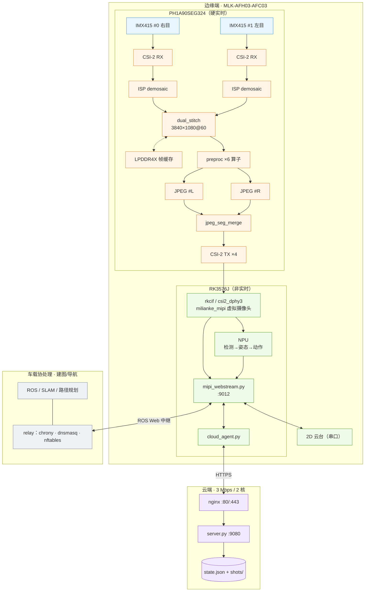
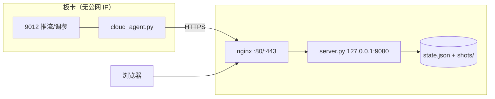

# 云端智联定点巡航安防预警系统

> **异构平台**：安路 PH1A90SEG324（国产 FPGA） + 瑞芯微 RK3576J
> **作品方向**：基于 FPGA 的图像采集压缩与智能预处理加速系统设计
> **核心指标**：1080p@60FPS 双目采集 · 硬件预处理 · 硬件 JPEG 压缩 · NPU 分级安防
> **分支**：`feature/dual-front-stitch`

---

## 摘要

本系统面向园区/厂区的移动式智能巡检与分级安防，采用**分层异构**架构：
安路 PH1A90SEG324 承担全部**硬实时**的图像通路（双目同步、拼接、预处理、JPEG 压缩），
RK3576J 承担**非实时**的智能与业务（NPU 推理、网页推流、云端交互），
车载协处理单元负责建图/导航，STM32 管控底盘。

设计核心是把"带宽"与"算力"各自放在最合适的位置：FPGA 内部以 70 MHz × 4 px/clk =
280 Mpx/s 的像素时钟完成双路拼接（相对 248.8 Mpx/s 需求余量 12.6%），并把一张
3840×1080 的 JPEG 拆给**两个并行编码引擎**（147.5 MHz 下 60.6 fps）——两者在字节级
验证等价。压缩后的码流经单条 CSI-2 ×4 lane 送入 RK，**RK 侧不接收原始视频流**，
网页直接透传 JPEG，把 3 Mbps 的公网链路留给真正需要的内容。

> **当前状态**：FPGA 功能链路打通并通过字节级等价验证；**编码器在 147.5 MHz 的时序
> 尚未收敛**（Setup WNS −8.013 ns），是本项目阻塞 60 fps 的唯一问题。
> 详见 [§10](#10-已知问题与路线图)。

---

## 1. 系统总览



**三段职责边界**

| 层 | 承担 | 不承担 |
|---|---|---|
| FPGA | 采集、拼接、预处理、JPEG、CSI-2 打包 | 任何非定长 / 非实时逻辑 |
| RK3576 | 取流、解包、NPU 推理、网页 / API、云上传 | 任何逐像素处理 |
| 云端 | 状态汇总、报警落库、远程参数下发 | 图像处理（3 Mbps 带宽不允许） |

---

## 2. 硬件与拓扑

| 项目 | 规格 |
|---|---|
| FPGA | 安路 PH1A90SEG324 —— LUT6 64,320 / FF 128,640 / ERAM20K 272 / DSP 240 / PLL 12 |
| SoC | RK3576J（2 GB LPDDR4X + 32 GB eMMC） |
| 板卡 | MLK-AFH03-AFC03（异构核心板 + 底板） |
| 传感器 | 2 × Sony IMX415（原生 3840×2160，工程用 1920×1080 有效区） |
| FPGA ⇄ IMX415 | MIPI CSI-2 ×4 lane |
| FPGA ⇄ RK3576 | MIPI CSI-2 ×4 lane，`csi2_dphy3` / `mipi3_csi2`，DT = 0x1E |
| FPGA 控制口 | I²C `i2c9`，器件 `fpga@1a`；`mipi-en-gpios = gpio1 RK_PD0` 控制 D-PHY 使能 |
| 云台 | 2D 云台，串口控制（`rk/gimbal/`） |

**时钟树（FPGA 内部）**

| 时钟 | 频率 | 用途 |
|---|---|---|
| `S_pclkx1` | 147.5 MHz | DDR 读侧、JPEG 编码域 |
| `S_clk_70m` | 70 MHz | 像素域，4 px/clk = 280 Mpx/s |
| `S_dsi_byte` / `S_dsi_hs_x4` | 150 / 300 MHz | DSI 发送（本地显示，可选） |

---

## 3. FPGA 子系统

### 3.1 双目采集与拼接

| 参数 | 值 |
|---|---|
| 单目有效区 | 1920×1080 |
| 拼接输出 | **3840×1080**（左目 = cam1，右目 = cam0） |
| 数据粒度 | 4 px / group，960 group / 行；2 ×（40 bit × 2048）乒乓 FIFO |
| 容错 | 源空数据补黑、不可写行丢弃，**保证下游行数恒定** |

写 FSM 三态（`W_NORM` / `W_PAD` / `W_DROP`）确保每行恰好写入 HGRP 个 word；
读 FSM 以 2 拍延迟背靠背读左右 FIFO。**本模块是全链路唯一跨时钟点**
（两路异步 FIFO 的写侧）。

### 3.2 硬件预处理（6 类算子）

| # | 算子 | 参数 |
|---|---|---|
| 1 | 高斯混合滤波 | 核 3×3 / 5×5 / 7×7，混合强度 0–8 |
| 2 | 直方图均衡（HE） | 强度、限幅、斜率限制、IIR 反馈 |
| 3 | 灰度 | BT.601 / BT.709 |
| 4 | 对比度 | 增益 + 偏移 |
| 5 | 反色 | 开关 |
| 6 | 边缘增强 | Sobel / Laplacian / Prewitt，各自独立增益 |

HE 的 CDF/LUT 在**场消隐期**构建（每 bin 3 拍 × 256 = 768 拍；1080p 场消隐约 99k 拍），
不占有效行带宽。亮度算子用**移位加**实现（`77 = 64+8+4+1` 等），逐位等价且不占 DSP。

### 3.3 JPEG 压缩：双引擎 + DRI 段合并

单引擎 150 clk/MCU 在 147.5 MHz 只有 30 fps，故把 MCU 行对半切开并行编码：

| 项 | 值 |
|---|---|
| 格式 | Baseline 4:2:2，MCU = 16×8 = 128 px |
| 每引擎 | 120 MCU/行 × 135 行 = 16,200 MCU |
| 代价 | **150.0 clk/MCU**（实测） |
| 吞吐 | 2 × 16,200 × 150 / 147.5 MHz = **16.48 ms → 60.6 fps** |
| 重启间隔 | **DRI = 120 MCU**（半个行） |
| 合并 | `jpeg_seg_merge` 按段交替：`L(r0) RST0 R(r0) RST1 L(r1) …` |

DRI 使每个半行成为**独立的熵编码段**，两段可直接背对背拼接，无需重做熵编码。
两引擎的 RST 编号取奇偶交错（左 0,2,4… / 右 1,3,5…），拼好后全局恰为 `RST0…RST7` 循环。

| 引擎 | `HDR_EN` | `EOI_EN` | `RST_INIT` | `RST_STEP` | `LAST_RST_EN` | `i_width` |
|---|---|---|---|---|---|---|
| 左（cam1） | 1 | 0 | 0 | 2 | **1** | 3840 |
| 右（cam0） | 0 | 1 | 1 | 2 | 0 | 3840 |

> `LAST_RST_EN=1` 只给左引擎：拼接后左引擎最后一段后面还跟着右引擎最后一段，
> 那个边界**需要**重启标记。`i_width` 仅用于 SOF 头字段，引擎内部仍按 1920 编。

### 3.4 控制通路

`ctrl/` 提供 I²C 从机与配置寄存器组，RK 通过 `i2c9 / fpga@1a` 读写采集开关、各算子
强度、JPEG 量化表与码率参数。

---

## 4. RK3576 子系统

### 4.1 采集通路

| 层 | 组件 |
|---|---|
| 设备树 | `rk/dts/rockchip/mlk-rk03-rk3576-linux.dts`，关键节点 `rockchip/rk03/csi-imx415-2.dtsi`、`HDMI.dtsi` |
| 驱动 | `rk/driver/milianke_mipi.c` —— 把 FPGA 送来的 CSI-2 字节流注册成**虚拟摄像头** |
| 内核 | 已内置驱动的 `boot.img`；另有 `boot.4k25.img`（4K25 模式） |

FPGA 送来的 JPEG 字节流按 CSI-2 帧承载，RK 侧只需从 buffer 取字节，**不做像素处理**。

### 4.2 Web 服务与 HTTP 接口

`rk/web/mipi_webstream.py`，监听 **`:9012`**（单文件、仅 Python 标准库）。

| 路由 | 用途 |
|---|---|
| `/stream` | MJPEG 视频流 |
| `/api/jpeg` | 单帧 JPEG（页面快照 / 云端取证） |
| `/api/params` | 画面参数读写 |
| `/api/fpga` | FPGA 寄存器直读直写（调试 / 调参） |
| `/api/ai` | AI 流水线状态与调参 |
| `/api/pose`、`/skel.jpg` | 姿态关键点与骨架图 |
| `/api/gimbal` | 2D 云台 |
| `/api/controls`、`/api/ctrl`、`/api/mode`、`/api/modes` | 采集与画面模式切换 |
| `/api/status`、`/api/sys`、`/api/net`、`/api/ping` | 状态 / 系统 / 网络 / 连通性 |

**帧率解耦**：采集与渲染按视频帧率跑，AI 按自己的限频跑（`--ai-fps`，默认 30，上限 60；
真正天花板由单帧耗时 `run_ms` 决定，限频只是闸门）。AI 结果通过"最近值"共享给渲染线程，
**叠加标注不会拖慢视频帧率**。

### 4.3 NPU 视觉流水线

```
一级：人体检测（yolov8n, COCO person）
二级：肢体关节（yolov8n-pose, 17 关键点, ROI 内）
  → 跟踪(ID) + 骨架平滑(EMA) + 危险动作状态机
  → 叠加标注（框 / 骨架 / 中文动作标签 / 越界警戒区）
  → MJPEG 推流
```

| 模型 | 输入 | 实测 NPU 耗时（双核） |
|---|---|---|
| `yolov8n-slim.rknn` | 640 | 17 ms（单核 24 ms） |

档位可网页热切换。`rk/ai/convert/` 提供从 JHMDb 原始数据到 `.rknn` 的全套转换与一致性
校验工具。

### 4.4 云台与快照

- `rk/gimbal/`：串口 2D 云台控制（`gimbal_cmd.py`、`gimbal_keyctrl.py`、斜坡测试脚本）
- `rk/snap/`：1080p60 参考快照，用于板级 A/B 对比

---

## 5. 云端平台

`cloud/`（对外称"云端智联定点巡航安防预警系统 · 管控平台"）。

设计前提：服务器仅 **3 Mbps / 2 核 / 1.6 GB**，故按"能省就省"实现——单文件后端
（仅标准库）、无数据库、无图像处理、**无 MJPEG 上云**、报警图 640 px（约 25 KB）、
图片按条数 + 总字节滚动删除。



职责：汇总运行状态与全部可调参数、接收 AI 危险动作报警、报警时板卡自动抓图上传、
提供远程调度与告警记录查询。接口细节见 [`cloud/docs/API.md`](cloud/docs/API.md)。

---

## 6. 车载协处理与 ROS 中继

`rk/relay/` 为建图/导航提供 Web 中继与网络基础设施：

| 文件 | 作用 |
|---|---|
| `web/`、`index.html` | ROS 数据 Web 中继前端 |
| `chrony-relay.conf` | 授时中继 |
| `dnsmasq-ros-relay.conf` | DHCP / DNS |
| `nftables.conf` | 转发与防火墙规则 |
| `deploy_relay.sh`、`find_orin.sh` | 一键部署与对端发现 |

---

## 7. 工具链

| 目录 | 内容 |
|---|---|
| `tools/` | 构建 / 仿真 / 检查脚本；大量 `board_*.sh` 板级 A/B 与诊断脚本 |
| `fpga/sim/` | 跨模块、JPEG、预处理测试台 |
| `rk/ai/convert/` | 数据集审计、导出、一致性校验 |
| `rk/web/bench_*.py` | NPU / 管线 / 抖动基准 |

---

## 8. 构建、部署与运行

### 8.1 FPGA

```bash
# 图形界面
F:\Anlogic\TD_Release_2026.1_SP2.200.067\bin\td.exe

# 命令行（必须用正斜杠，反斜杠会被 PowerShell 吞掉）
cd fpga/fpga_prj_Runs/syn_1  &&  td_commands_prompt.exe <TD>/scripts/DefaultFlow.tcl
cd fpga/fpga_prj_Runs/phy_1  &&  td_commands_prompt.exe <TD>/scripts/DefaultFlow.tcl
```

启用官方策略包（syn：`LogicLevelOptimize`，phy：`TimingUltra`）后后端耗时显著增加，
单次 ≫ 30 min 属正常。

### 8.2 仿真

环境：OSS CAD Suite（`iverilog 14.0`）。

```bash
cd fpga/sim
./run_jpeg_thru.ps1 0      # 有损 clk/MCU 实测
./run_jpeg_thru.ps1 1      # 无损 clk/MCU 实测
./run_jpeg_recip.ps1       # 量化倒数位精确性
./run_dual_stitch.ps1      # 双目拼接（含相机掉线 / 恢复）
```

### 8.3 RK3576

```bash
# 内核 + 设备树（已内置 milianke_mipi 驱动）：刷写 rk/boot.img
# 4K25 模式刷 rk/boot.4k25.img

# 推流与调参 → 浏览器打开 http://<RK_IP>:9012/
cd rk/web && ./start_webstream.sh
AI=1 AI_FPS=8 AI_ZONE="0.2,0.6;0.8,0.6;0.8,1;0.2,1" ./start_webstream.sh

# 服务化
systemctl status mipi-webstream
```

### 8.4 云端与中继

```bash
cloud/deploy/             # nginx + systemd
rk/relay/deploy_relay.sh  # ROS Web 中继
```

---

## 9. 资源与时序（FPGA）

最新一次完整布线（`fpga/fpga_prj_Runs/phy_1/route.qor`，2026-10-28）：

| 资源 | 占用 | 总量 | 比例 |
|---|---|---|---|
| SLICE | 43,946 | 64,320 | **68.3 %** |
| LUT6 | 36,971 | 64,320 | 57.5 % |
| 寄存器 | 37,105 | 128,640 | 28.8 % |
| ERAM20K | 229 | 272 | **84.2 %** |
| DSP | 202 | 240 | **84.2 %** |

| 时序 | 值 |
|---|---|
| Hold WNS | **+0.020 ns**（全部时钟组通过） |
| Setup WNS | **−8.013 ns**（`S_pclkx1` 域，4,661 / 23,167 端点违例） |
| 其余 | 仅 DSI 时钟 lane ODDR 一条 −0.539 ns（厂商 PHY 原语，板级实测正常） |

违例集中在熵编码器（`u_huff/o_code_reg`、`u_quant/qzz_reg`），单条约 14.8 ns
（预算 6.78 ns）：

```
kk → qzz 双口异步读(~2ns) → 取绝对值 + ssss 优先级编码(~1.5)
   → 霍夫曼码表 ROM(~2) → 幅度整形(~1.5) → 32 位变量移位(~2.3) → o_code
```

该编码器此前运行在由 toggle-FF 分频得到的 36.875 MHz 时钟上，**SDC 无法为其建立
`create_clock`，长期处于"不受时序检查"状态**；迁到 PLL 直出的 `S_pclkx1` 后才首次暴露。

---

## 10. 已知问题与路线图

### P0 · 阻塞 60 fps

| 问题 | 现状 | 计划 |
|---|---|---|
| 熵编码器 147.5 MHz 时序 | WNS −8.013 ns，4,661 端点 | ① 启用 TD 官方策略包（零 RTL 风险）② 若仍不足，将熵编码数值通路拆 2–3 级流水（地址生成由 `nz_mask` 位置驱动，可提前运行而不增加周期） |

### P1 · 功能补全

| 项目 | 说明 |
|---|---|
| 无损压缩 | 代码在（SOF3 + DPCM），320 clk/MCU；需 4–8 段并行；另有"第二帧无输出"缺陷 |
| 可变码率 | `jpeg_qtable_ram` 写端口目前恒接 `1'b0`，需接配置寄存器 |
| 单帧字节上限 | `JPAD_BYTES` 已按拼接幅 8,294,400 配置；**仅送 JPEG 时必须关闭补零**，否则 8 MB/帧 × 60 = 497 MB/s 超出 CSI-2 带宽 |

### P2 · 清理与加固

- 删除 NV16 直通通路（约 5.2k LUT / 34 ERAM），JPEG 稳定后执行
- DSI 时钟 lane ODDR 一条 −0.539 ns 违例（厂商 PHY 原语，暂不修）

### 板级待验证

70 MHz 像素域实测、左右目顺序与 Bayer 相位、DDR 带宽（估算 996 MB/s）、
rkcif 对 3840×1080@59.6 的接受度、端到端 60 fps 实测。

---

## 11. 验证

原则：**任何"改完应该更好"的优化，都必须有字节级不变量作证**。

| 测试台 | 判据 | 当前结果 |
|---|---|---|
| `tb_jpeg_e2e` | 输出与参考 JPEG **逐字节相同** | 862 B 完全一致 |
| `tb_jpeg_merge` | 双引擎合并熵段与单引擎参考**逐字节相同** | 5,372 B 一致；`RST0…RST6` 连续；PIL 解码 512×32 通过 |
| `tb_he_big` | 1920×1080、8 帧，HE 后统计量**无漂移无闪烁** | 8 帧均为 均值 111 / `lutsum` 26,841 |
| `run_jpeg_thru` | clk/MCU ≤ 151.7（60 fps 预算） | 有损 150.0；无损 320.2 |

> ⚠️ `tb_jpeg_e2e` 的参考用例目前是 **64×16（8 MCU）**，覆盖度偏低；
> 原始 320×40（100 MCU）仍在 git 历史中，恢复后可显著加强对
> "两符号快路径 / ZRL / EOB" 等分支的覆盖。

---

## 12. 目录结构

```
08_csi2rk_mipi_imx415/
├── fpga/
│   ├── uisrc/01_rtl/       # 自研 RTL：system_top, dual/, preproc/, jpeg/, ctrl/
│   ├── uisrc/03_ip/        # 厂商 IP：ISP / DDR / MIPI / FIFO
│   ├── uisrc/04_pin/       # 引脚约束与 timing.sdc
│   ├── sim/                # 测试台
│   └── fpga_prj_Runs/      # TD 综合/布线输出（不入库）
├── rk/
│   ├── driver/             # milianke_mipi.c + Kconfig/Makefile 片段
│   ├── dts/                # RK3576 设备树（含 FPGA 虚拟摄像头节点）
│   ├── web/                # mipi_webstream.py（:9012）、页面、基准脚本
│   ├── ai/                 # board/ convert/ models/（rknn 模型与转换工具）
│   ├── gimbal/             # 2D 云台串口控制
│   ├── relay/              # ROS Web 中继 + chrony/dnsmasq/nftables
│   ├── snap/               # 参考快照
│   ├── deploy/             # 部署脚本与板级诊断
│   ├── boot.img            # 内核 + 设备树 + 驱动
│   └── boot.4k25.img       # 4K25 模式
├── cloud/                  # 云端管控平台（server.py :9080、static、deploy、docs）
├── tools/                  # 构建 / 仿真 / 板级 A/B 与诊断脚本
└── docs/                   # 设计与调试文档（见 §13）
```

---

## 13. 文档索引

| 文档 | 内容 |
|---|---|
| [`QUICKSTART.md`](QUICKSTART.md) | 快速命令集 |
| [`MODIFICATIONS.md`](MODIFICATIONS.md) | 相对米联客官方例程的改动清单 |
| [`rk/web/README.md`](rk/web/README.md) | 网页推流、调参、AI 叠加 |
| [`rk/deploy/README.md`](rk/deploy/README.md) | RK 侧部署与排错 |
| [`rk/ai/README.md`](rk/ai/README.md) | NPU 模型与动作识别 |
| [`cloud/README.md`](cloud/README.md) · [`cloud/docs/API.md`](cloud/docs/API.md) | 云端平台与接口 |
| [`docs/FPGA_FUNCTION_MAP.md`](docs/FPGA_FUNCTION_MAP.md) | FPGA 功能与引脚映射 |
| [`docs/JPEG_ENCODER_DESIGN.md`](docs/JPEG_ENCODER_DESIGN.md) | JPEG 编码器结构与调度 |
| [`docs/PLAN_JPEG_60FPS_REWRITE.md`](docs/PLAN_JPEG_60FPS_REWRITE.md) | 60 fps 达成路线（实测吞吐 / 资源账） |
| [`docs/IMX415_4K_MODE.md`](docs/IMX415_4K_MODE.md) | IMX415 4K 寄存器配置 |
| [`docs/ACTION_MODEL.md`](docs/ACTION_MODEL.md) | 动作识别模型与规则 |
| [`docs/ARCHIVE_README_2026-10-19_legacy.md`](docs/ARCHIVE_README_2026-10-19_legacy.md) | 旧版工程说明（单相机时代，已归档） |

---

## 14. 更新记录

| 日期 | 变更 |
|---|---|
| 2026-10-28 | README 重写为整项目说明；双引擎 + DRI 段合并落地并验证；预处理亮度链流水化 + 移位加（DSP 214→154）；编码器迁至 147.5 MHz 并暴露时序问题（−8.013 ns） |
| 2026-10-27 | 双目同步拼接 `dual_stitch`；量化倒数改流水长除法 |
| 2026-10-19 | 发布基线（单相机 CSI→RK，4K30 / 1080p60 可选） |

---

## 维护约定

1. **数字必须可追溯**：资源 / 时序 / 吞吐均须标注来源（`route.qor`、`*_pr.timing`、
   `*_phy.area` 或测试台实测），不接受推算值。
2. **优化必须自带不变量**：改动熵编码相关代码时，`tb_jpeg_e2e` 与 `tb_jpeg_merge`
   的逐字节判据必须同时通过。
3. **状态变更即更新**：完成 P0 / P1 任一项后，同步更新
   [§9](#9-资源与时序fpga)、[§10](#10-已知问题与路线图)、
   [§11](#11-验证)、[§14](#14-更新记录)。
