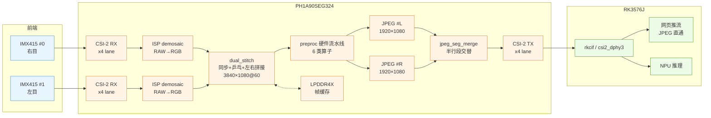

# 双目光学巡检前端的 FPGA 硬实时视频压缩链路

> **平台**：安路 PH1A90SEG324（国产 FPGA） + 瑞芯微 RK3576J
> **链路**：双 IMX415 → MIPI CSI-2 ×4 → FPGA 拼接/预处理/JPEG → MIPI CSI-2 ×4 → RK3576 → 网页 / NPU
> **目标指标**：双目 1080p@60FPS 采集 · 硬件预处理 · 硬件 JPEG 压缩
> **分支**：`feature/dual-front-stitch`

---

## 摘要

本工程在单块 MLK-AFC03 板卡上实现一条**全硬件、定延迟**的视觉前端：两路 Sony IMX415
以 MIPI CSI-2 输入 FPGA，经双目同步、乒乓缓存、左右拼接为 3840×1080@60 的原始流，
再经六类硬件预处理算子，最终由**两个并行的 JPEG 编码引擎**压缩成**一张 3840×1080 的
标准基线 JPEG**，经 CSI-2 送入 RK3576，由 RK 侧直接透传给网页与 NPU。

设计上把"拼接"与"压缩"的吞吐都压到像素时钟一处解决：像素域 70 MHz × 4 px/clk =
280 Mpx/s（相对 248.8 Mpx/s 需求余量 12.6%），编码域 147.5 MHz 下双引擎各编半行 =
60.6 fps。双目拼接与双引擎合并在字节级验证等价性，详见 [§7 验证](#7-验证)。

> **当前状态**：功能链路打通并通过字节级等价验证；**编码器在 147.5 MHz 的时序尚未收敛**
> （Setup WNS −8.013 ns），是本工程唯一阻塞 60fps 的问题，见 [§8](#8-已知问题与路线图)。

---

## 1. 系统架构



**数据面**：两路 RAW 各自在恢复时钟域完成 demosaic，唯一跨时钟点是 `dual_stitch`
（写侧两路异步 FIFO，读侧 70 MHz 像素域）。此后全链路单时钟域直到编码器与 DSI 发送域。

**控制面**：RK 通过 I²C（`i2c9`，器件 `fpga@1a`）读写 FPGA 配置寄存器，控制采集开关、
预处理各算子强度、JPEG 量化表与码率参数；`mipi-en-gpios` 控制 D-PHY 使能。

---

## 2. 硬件平台

| 项目 | 规格 |
|---|---|
| FPGA | 安路 PH1A90SEG324 —— LUT6 64,320 / FF 128,640 / ERAM20K 272 / DSP 240 / PLL 12 |
| SoC | RK3576J（2 GB LPDDR4X + 32 GB eMMC） |
| 板卡 | MLK-AFH03-AFC03 |
| 传感器 | 2 × Sony IMX415（3840×2160 原生，工程用 1920×1080 有效区） |
| 互联 | FPGA ⇄ IMX415：CSI-2 ×4 lane；FPGA ⇄ RK3576：CSI-2 ×4 lane（`csi2_dphy3` / `mipi3_csi2`，DT=0x1E YUV422 承载 JPEG 字节流） |

**时钟树**

| 时钟 | 频率 | 用途 |
|---|---|---|
| `S_pclkx1` | 147.5 MHz | DDR 读侧、JPEG 编码域 |
| `S_clk_70m` | 70 MHz | 像素域（`S_st_clk` / `S_hs_rx_clk`），4 px/clk |
| `S_dsi_byte` / `S_dsi_hs_x4` | 150 / 300 MHz | DSI 发送（本地显示） |

---

## 3. FPGA 数据通路

### 3.1 双目采集与拼接

| 参数 | 值 | 说明 |
|---|---|---|
| 单目有效区 | 1920×1080 | IMX415 内部 crop |
| 拼接输出 | **3840×1080** | 左目 = cam1，右目 = cam0 |
| 像素格式 | 4 px/clk | 每行 960 个 pixel-group（4 px 一组） |
| 乒乓缓存 | 2 × 40 bit × 2048 | 每行固定写 480 word/通道 |
| 丢帧策略 | 空数据补黑 / 溢出丢行 | 保证下游行数恒定，不破坏时序 |

`dual_stitch` 的写 FSM 保证**每行恰好写入 HGRP 个 word**（`W_NORM`/`W_PAD`/`W_DROP`
三态），读 FSM 以 2 拍延迟背靠背读左右 FIFO；源丢帧时补黑而非错位。

### 3.2 硬件预处理（6 类算子）

| # | 算子 | 可选参数 |
|---|---|---|
| 1 | 高斯混合滤波 | 核 3×3 / 5×5 / 7×7，混合强度 0–8 |
| 2 | 直方图均衡（HE） | 强度、限幅、斜率限制、IIR 反馈 |
| 3 | 灰度 | BT.601 / BT.709 |
| 4 | 对比度 | 增益 + 偏移 |
| 5 | 反色 | 开关 |
| 6 | 边缘增强 | Sobel / Laplacian / Prewitt，各自独立增益 |

HE 的 CDF/LUT 在**场消隐期**构建（每 bin 3 拍 × 256 = 768 拍，1080p 场消隐约 99k 拍，
余量充足），不占用有效行带宽。

### 3.3 JPEG 压缩：双引擎 + 段合并

核心矛盾：一张 3840×1080 的 JPEG 含 32,400 个 MCU，单引擎 150 clk/MCU 在 147.5 MHz 下
只能做到 30 fps。解决办法是**按 MCU 行对半切开、两个引擎并行**：

| 项 | 值 |
|---|---|
| 编码格式 | Baseline 4:2:2（MCU = 16×8 = 128 px） |
| 每引擎 | 1920×1080 → 120 MCU/行 × 135 行 = 16,200 MCU |
| 代价 | **150.0 clk/MCU**（实测） |
| 吞吐 | 2 × 16,200 × 150 / 147.5 MHz = **16.48 ms → 60.6 fps** |
| 重启间隔（DRI） | **120 MCU = 半个行** |
| 合并方式 | `jpeg_seg_merge` 以段为单位交替：`L(r0) RST0 R(r0) RST1 L(r1) …` |

**为什么用 DRI**：DRI（Define Restart Interval）使每个半行成为**独立的熵编码段**，
两段可直接背对背拼接，无需重新做熵编码。两个引擎的 RST 编号取奇偶交错
（左 0,2,4… / 右 1,3,5…），拼好后全局恰为 `RST0…RST7` 循环，完全符合 JPEG 规范。

| 引擎 | `HDR_EN` | `EOI_EN` | `RST_INIT` | `RST_STEP` | `LAST_RST_EN` | `i_width` |
|---|---|---|---|---|---|---|
| 左（cam1） | 1 | 0 | 0 | 2 | **1** | 3840 |
| 右（cam0） | 0 | 1 | 1 | 2 | 0 | 3840 |

> `LAST_RST_EN=1` 只给左引擎：拼接后左引擎的最后一段后面还跟着右引擎的最后一段，
> 那个边界是**需要**重启标记的。`i_width` 只用于 SOF 头字段，引擎内部仍按 1920 编。

---

## 4. 资源与时序

最新一次完整布线（`phy_1/route.qor`，2026-10-28）：

| 资源 | 占用 | 总量 | 比例 |
|---|---|---|---|
| SLICE | 43,946 | 64,320 | **68.3 %** |
| LUT6 | 36,971 | 64,320 | 57.5 % |
| 寄存器 | 37,105 | 128,640 | 28.8 % |
| ERAM20K | 229 | 272 | **84.2 %** |
| DSP | 202 | 240 | **84.2 %** |
| PLL / GCLK | 4 / 18 | 12 / — | |

| 时序 | 值 |
|---|---|
| Hold WNS | **+0.020 ns**（全部时钟组通过） |
| Setup WNS | **−8.013 ns**（`S_pclkx1` 域，4,661 / 23,167 端点违例） |
| 其余时钟组 | 仅 DSI 时钟 lane ODDR 一条 −0.539 ns（厂商 PHY 原语，板级实测正常） |

**违例集中在熵编码器**：`u_huff/o_code_reg` 与 `u_quant/qzz_reg`，单条路径约 14.8 ns
（预算 6.78 ns），构成为

```
kk → qzz 双口异步读(~2ns) → 取绝对值 + ssss 优先级编码(~1.5)
   → 霍夫曼码表 ROM(~2) → 幅度整形(~1.5) → 32 位变量移位(~2.3) → o_code
```

该编码器此前运行于由 toggle-FF 分频得到的 36.875 MHz 时钟上，**SDC 无法为其建立
`create_clock`，长期处于"不受时序检查"状态**；本次把编码器迁到 PLL 直出的
`S_pclkx1` 后才首次暴露。

---

## 5. 目录结构

```
08_csi2rk_mipi_imx415/
├── fpga/
│   ├── uisrc/01_rtl/          # 自研 RTL
│   │   ├── system_top.v       # 顶层：时钟、几何、各子系统连线
│   │   ├── dual/              # 双目同步 / 拼接（dual_stitch）
│   │   ├── preproc/           # 六类预处理算子
│   │   ├── jpeg/              # 编码器：DCT/量化/熵编码/位打包/头/段合并
│   │   └── ctrl/              # I²C 从机 + 配置寄存器
│   ├── uisrc/03_ip/           # 第三方与厂商 IP（ISP、DDR、MIPI、FIFO）
│   ├── uisrc/04_pin/          # 引脚与 timing.sdc
│   ├── sim/                   # 测试台（跨模块、JPEG、预处理）
│   └── fpga_prj_Runs/         # TD 综合/布线输出（不入库）
├── rk/
│   ├── driver/                # 内核模块 milianke_mipi
│   ├── dts/                   # 设备树
│   ├── web/                   # 网页推流、JPEG 直通、AI 叠加
│   ├── ai/                    # NPU 模型、动作识别、数据转换工具
│   └── deploy/                # 部署与性能文档
├── cloud/                     # 云端管理平台（任务/告警/记录）
├── docs/                      # 设计与调试文档（见 §9 索引）
└── tools/                     # 构建、仿真、检查脚本
```

---

## 6. 构建与验证

### 6.1 FPGA 构建

```bash
# 图形界面
F:\Anlogic\TD_Release_2026.1_SP2.200.067\bin\td.exe

# 命令行（可用正斜杠，反斜杠会被 PowerShell 吞掉）
cd fpga/fpga_prj_Runs/syn_1  &&  td_commands_prompt.exe <TD>/scripts/DefaultFlow.tcl
cd fpga/fpga_prj_Runs/phy_1  &&  td_commands_prompt.exe <TD>/scripts/DefaultFlow.tcl
```

构建 ≫ 30 min 时属正常（`TimingUltra` 策略的后端优化耗时显著）。

### 6.2 仿真

环境：OSS CAD Suite（`iverilog 14.0`）。

```bash
cd fpga/sim
./run_jpeg_thru.ps1 0      # 有损 clk/MCU 实测
./run_jpeg_thru.ps1 1      # 无损 clk/MCU 实测
./run_jpeg_recip.ps1       # 量化倒数位精确性
./run_dual_stitch.ps1      # 双目拼接（含相机掉线/恢复）
```

---

## 7. 验证

工程遵循一条原则：**任何"改完应该更好"的优化，都必须有字节级不变量作证**。目前有三把尺子：

| 测试台 | 判据 | 当前结果 |
|---|---|---|
| `tb_jpeg_e2e` | 输出 `rtl.jpg` 与参考 `ref.jpg` **逐字节相同** | 862 B 长度相同且逐字节一致 |
| `tb_jpeg_merge` | 双引擎合并的熵数据段与单引擎参考**逐字节相同** | 5,372 B 完全一致；`RST0…RST6` 连续；PIL 解码 512×32 通过 |
| `tb_he_big` | 1920×1080 尺度、8 帧，HE 后统计量**无漂移无闪烁** | 8 帧均为 均值 111 / `lutsum` 26,841 / `lut[128]`=64 / `lut[255]`=248 |

> ⚠️ **注意**：`tb_jpeg_e2e` 的参考用例目前是 64×16（8 MCU），覆盖度偏低。
> 原始 320×40（100 MCU）仍在 git 历史中，恢复后可显著加强对
> "两符号快路径 / ZRL / EOB"等分支的覆盖。

---

## 8. 已知问题与路线图

### P0 · 阻塞 60fps

| 问题 | 现状 | 计划 |
|---|---|---|
| 熵编码器 147.5 MHz 时序 | WNS −8.013 ns，4,661 端点 | ① 启用 TD 官方策略包（`LogicLevelOptimize` + `TimingUltra`，零 RTL 风险）② 若不足，将熵编码数值通路拆为 2–3 级流水（地址生成由 `nz_mask` 位置驱动，可提前运行而不增加周期） |

### P1 · 功能补全

| 项目 | 说明 |
|---|---|
| 无损压缩通路 | 代码在（SOF3 + DPCM），320 clk/MCU；需 4–8 段并行才能满足 60fps；另有"第二帧无输出"缺陷 |
| 可变码率（VBR） | `jpeg_qtable_ram` 写端口目前恒接 `1'b0`，需接配置寄存器 |
| 单帧字节上限 | `JPAD_BYTES` 已按拼接幅 8,294,400 配置；**仅送 JPEG 时必须关闭补零**，否则 8 MB/帧 × 60 = 497 MB/s 超出 CSI-2 带宽 |

### P2 · 清理与加固

- 删除 NV16 直通通路（约 5.2k LUT / 34 ERAM），JPEG 稳定后执行
- DSI 时钟 lane ODDR 一条 −0.539 ns 违例（厂商 PHY 原语，未修复）

### 板级待验证

70 MHz 像素域实测、左右目顺序与 Bayer 相位、DDR 带宽（估算 996 MB/s）、
rkcif 对 3840×1080@59.6 的接受度、端到端 60 fps 实测。

---

## 9. 文档索引

| 文档 | 内容 |
|---|---|
| [`QUICKSTART.md`](QUICKSTART.md) | 快速命令集 |
| [`MODIFICATIONS.md`](MODIFICATIONS.md) | 相对米联客官方例程的改动清单 |
| [`docs/IMX415_4K_MODE.md`](docs/IMX415_4K_MODE.md) | IMX415 4K 模式寄存器配置 |
| [`docs/FPGA_FUNCTION_MAP.md`](docs/FPGA_FUNCTION_MAP.md) | FPGA 功能与引脚映射 |
| [`docs/JPEG_ENCODER_DESIGN.md`](docs/JPEG_ENCODER_DESIGN.md) | JPEG 编码器结构与调度 |
| [`docs/PLAN_JPEG_60FPS_REWRITE.md`](docs/PLAN_JPEG_60FPS_REWRITE.md) | 60fps 达成路线（含实测吞吐/资源账） |
| [`docs/ACTION_MODEL.md`](docs/ACTION_MODEL.md) | 动作识别模型与规则 |
| [`rk/web/README.md`](rk/web/README.md) | 网页推流与 API |
| [`rk/deploy/README.md`](rk/deploy/README.md) | RK 侧部署与排错 |
| [`docs/ARCHIVE_README_2026-10-19_legacy.md`](docs/ARCHIVE_README_2026-10-19_legacy.md) | 旧版工程说明（单相机 CSI→RK 时代，已归档） |

---

## 10. 更新记录

| 日期 | 变更 |
|---|---|
| 2026-10-28 | 本文档建立；双引擎 + DRI 段合并落地并验证；preproc 亮度链流水化 + 移位加（DSP 214→154）；SP1 收敛（−3.243→−0.223 ns）；SP2 引入双引擎后暴露编码器时序问题（−8.013 ns） |
| 2026-10-27 | 双目同步拼接 `dual_stitch`；量化倒数改流水长除法 |
| 2026-10-19 | 发布基线（单相机 CSI→RK，4K30 / 1080p60 可选） |

---

## 维护约定

1. **数字必须可追溯**：本文表中的资源/时序/吞吐均来自 `fpga/fpga_prj_Runs/*/route.qor`、
   `*_pr.timing`、`*_phy.area` 或测试台实测，不接受推算值。
2. **优化必须自带不变量**：改动熵编码相关代码时，`tb_jpeg_e2e` 与 `tb_jpeg_merge` 的
   逐字节判据必须同时通过。
3. **状态变更即更新**：完成 P0/P1 任一项后，同步更新 [§4](#4-资源与时序)、[§7](#7-验证)、
   [§8](#8-已知问题与路线图) 与 [§10](#10-更新记录)。
