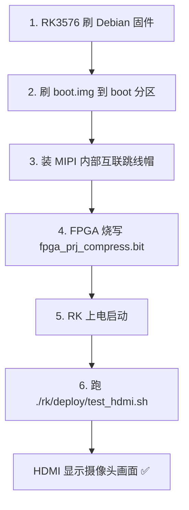

# 08_csi2rk_mipi_imx415 —— FPGA MIPI x4 采集 → MIPI x4 送 RK3576 → HDMI 输出

一套可直接烧录、上电即可出图的**异构视频链路测试工程**：

**IMX415 摄像头 →（MIPI CSI-2 x4）→ FPGA（ISP 预处理 + DDR 缓存）→（MIPI CSI-2 x4）→ RK3576 →（HDMI 2.1）→ 显示器**

> 本工程以米联客官方 `AFC03_IMX415_MIPI_RK(0531)` 例程为基础整理、参数化并补充部署脚本。
> 参考原件保留在 `fpga_reference_src.zip`，改动清单见 [`MODIFICATIONS.md`](MODIFICATIONS.md)。

> 🚀 **只想尽快跑起来？直接看 [`QUICKSTART.md`](QUICKSTART.md)**
> —— 当前已实现功能清单 + 全部启动/操作指令（链路自检、HDMI、网页推流、摄像头参数、
> 模式切换、FPGA 预处理、AI 检测、云台、诊断脚本、HTTP API）。

---

## 1. 系统框图

```mermaid
flowchart LR
    CAM["IMX415<br/>MIPI CSI-2 4lane"] -->|"CSI RX x4"| DPHYRX["FPGA MIPI D-PHY RX<br/>(LVDS 复用)"]
    DPHYRX --> UNPACK["CSI-2 解包<br/>RAW10 还原"]
    UNPACK --> CROP["图像裁剪"]
    CROP --> ISP["米联客 ISP<br/>BLC/AWB/Demosaic/Gamma<br/>输出 RGB888 x4 (128b)"]
    ISP --> YUV["RGB888 → YUV422<br/>4像素/拍"]
    YUV --> DBUF["ui_dbuf 三帧缓存<br/>+ ui_FDMA"]
    DBUF <--> DDR["DDR3 2G"]
    DBUF --> VTC["ui_vtc<br/>1080P60 读时序"]
    VTC --> PACK["csi2_pack_yuv422_stream<br/>跨时钟域打包"]
    PACK --> FRAME["csi2_frame_tx<br/>CSI-2 组包 DT=0x1E"]
    FRAME --> DPHYTX["FPGA MIPI D-PHY TX<br/>4lane HS + LP"]
    DPHYTX -->|"MIPI CSI3 x4 (板内互联)"| RKDPHY["RK3576 MIPI D-PHY<br/>csi2_dphy3 / mipi3_csi2"]
    RKDPHY --> DRV["milianke_mipi<br/>虚拟摄像头驱动"]
    DRV --> CIFISP["rkcif → rkisp → rkvpss"]
    CIFISP --> HDMI["HDMI 2.1 输出"]
```



关键约束（FPGA 与 RK 必须一致）：

| 项目 | FPGA 侧 | RK 侧 |
|------|---------|-------|
| 分辨率 | `H_ACTIVE=1920`, `V_ACTIVE=1080` | `DUMMY_WIDTH/HEIGHT = 1920/1080` |
| 数据格式 | CSI-2 `DT=0x1E` (YUV422-8bit) | `MEDIA_BUS_FMT_YUYV8_2X8` |
| Lane 数 | 4 | `data-lanes = <1 2 3 4>` |
| 帧率 | 60 fps | `DUMMY_FPS_DEN = 60` |
| 发送使能 | `I_dsi_en`（高有效） | `mipi-en-gpios = <&gpio1 RK_PD0 ...>` |

---

## 2. 目录结构

```
08_csi2rk_mipi_imx415/
├── fpga/                          FPGA 端 TD 工程（安路 TD 6.2 打开 fpga_prj.al）
│   ├── fpga_prj.al                工程文件（顶层 system_top）
│   ├── fpga_prj.bit               未压缩 bit（调试用）
│   ├── fpga_prj_compress.bit      ★ 压缩 bit（直接烧录用这个）
│   ├── readme.txt                 官方原版 readme
│   └── uisrc/
│       ├── 01_rtl/                system_top.v / csi2_frame_tx.v / csi2_pack_yuv422_stream.v
│       │                          system_top_tx_tpg.v（无摄像头自检顶层）
│       ├── 03_ip/                 ui_isp / ui_dbuf / ui_fdma / dphy_tx_general / mipi_dsi ...
│       ├── 04_pin/                fpga_pin.adc（引脚约束）/ timing.sdc
│       └── 06_doc/
├── rk/                            RK3576 端
│   ├── boot.img                   ★ 内核+设备树+驱动（刷到 boot 分区）
│   ├── driver/                    milianke_mipi.c 驱动源码
│   ├── dts/                       AFC03 RK3576 设备树
│   ├── web/                       ★ 网页推流 + 远程调参（详见 rk/web/README.md）
│   └── deploy/                    ★ 一键自检 / HDMI 出图脚本（详见 rk/deploy/README.md）
├── docs/                          官方教程与硬件手册
├── fpga_reference_src.zip         官方原始例程（backup）
├── QUICKSTART.md                  ★ 快速开始指令集（功能清单 + 全部命令）
├── MODIFICATIONS.md               相对官方例程的改动清单
└── README.md                      本文件
```

---

## 3. 硬件准备

1. **MLK-AFC03 异构核心板/开发板**（RK3576J + 安路 PH1A90SEG324）
2. **IMX415 摄像头模组**，接 FPGA 的 MIPI CSI 接口（4 lane）
3. **HDMI 显示器**，接 RK3576 的 HDMI OUT
4. **JTAG 下载器**（下载 FPGA bit）
5. **AFC03 板内 MIPI 互联跳线帽** —— 按硬件手册「RK3576J-PH1A90SEG324-MIPI 交互」章节装上
6. 12V 电源

---

## 4. 部署步骤（总览）



### 4.1 FPGA 端烧写

1. 开发板**断电**，接上 JTAG，再上电开机。
2. 用安路 **TD 6.2** 打开 `fpga/uisrc/../fpga_prj.al`。
3. 左侧「连接硬件」→ 选择器件（PH1A90SEG324）。
4. 「下载」页选择 bit 文件：**`fpga/fpga_prj_compress.bit`**（压缩版，体积小、下载快）。
5. 选择 **MODE**（本项目 `boot_mode = mspix4`，CPU 用 MSPI x4 启动）。
6. 点 **Run**，下方出现 `succeeded` 即烧写成功。

> 也可以把 bit 固化到 Flash 做上电自启动；调试阶段用 JTAG 直接下载即可。

### 4.2 RK3576 端部署

详细步骤见 **[`rk/deploy/README.md`](rk/deploy/README.md)**，速览：

```bash
# ① 从米联客官网下载 RK3576 Debian 镜像并整机烧写
#    https://www.uisrc.com/t-6245.html   (烧写时不要按 BOOT 键)

# ② 升级 boot 分区(内核+设备树+驱动)，例如：
dd if=/root/boot.img of=/dev/disk/by-partlabel/boot bs=4M conv=fsync
sync && reboot

# ③ 装好板内 MIPI 互联跳线帽

# ④ 拷贝并运行测试脚本
scp -r rk/deploy/ root@<板子IP>:/root/deploy/
ssh root@<板子IP> "cd /root/deploy && chmod +x *.sh && ./rk_mipi_selftest.sh"
ssh root@<板子IP> "cd /root/deploy && ./test_hdmi.sh"
```

等价的一条命令（与官方教程一致）：

```bash
gst-launch-1.0 v4l2src device=/dev/video22 ! kmssink
```

---

## 5. 上电与开流顺序（很重要）

```
RK3576 先上电（FPGA 侧电源由 RK 的最后一级电源使能）
        ↓
运行 gst 命令 → 驱动 s_stream(1) → 拉高 mipi-en(GPIO1_D0)
        ↓
FPGA 的 I_dsi_en 变高 → D-PHY TX 开始发送 HS 数据 → RK 收到画面
```

因此：**只烧了 FPGA bit 但没在 RK 上开流时，FPGA 是不发数据的**，这是正常现象。

---

## 6. 无摄像头自检（可选，强烈建议第一次上手时用）

工程里额外提供了一个不接摄像头也能跑的测试图案顶层：

- `fpga/uisrc/01_rtl/system_top_tx_tpg.v` —— 用内部测试图案（彩条/灰度渐变/棋盘/坐标）
  替代 IMX415，直接走 `csi2_pack_yuv422_stream → csi2_frame_tx → D-PHY TX`。
- 配套约束：`fpga/uisrc/04_pin/fpga_pin_tx_tpg.adc`、`timing_tx_tpg.sdc`。

用法：在 TD 里把顶层模块临时切换为 `system_top_tx_tpg`、约束换成 `fpga_pin_tx_tpg.adc`，
重新综合布线后烧写，即可在**没有摄像头**的情况下验证
「FPGA → MIPI → RK → HDMI」整条链路。链路通了之后，再换回 `system_top` 接摄像头。

---

## 7. 想改分辨率 / 帧率

| 改什么 | 改哪里 |
|--------|--------|
| FPGA 输出分辨率 | `fpga/uisrc/01_rtl/system_top.v` 顶部的 `H_ACTIVE` / `V_ACTIVE`（`ui_dbuf`、`ui_vtc`、`csi2_*` 的派生参数已自动跟随） |
| RK 驱动上报分辨率 | `rk/driver/milianke_mipi.c` 的 `DUMMY_WIDTH` / `DUMMY_HEIGHT` |
| RK 设备树 | `rk/dts/rockchip/rk03/csi-imx415-2.dtsi` |
| 数据格式 | FPGA：`csi2_frame_tx` 的 `DT` / `BPP_NUM` / `BPP_DEN`；RK：驱动的 `MEDIA_BUS_FMT_*` |

> 两边必须同时改，否则 RK 侧 CIF/ISP 会因尺寸不匹配报错或出花屏。

---

## 8. 网页推流 + 远程调参（可选，不看 HDMI 也能监看）

除了 `kmssink` 直接上屏，还可以把画面推到网络，在 PC 上看图 + 在线调参。

详见 **[`rk/web/README.md`](rk/web/README.md)**，速览：

```bash
# RK 上启动服务（默认监听 9012）
scp -r rk/web/ afc03:/root/rk/
ssh afc03 "cd /root/rk/web && chmod +x *.sh && ./start_webstream.sh"

# PC 上双击打开 mipi_viewer.html，地址填 <板子IP>:9012，点「连接」
```

> **运行环境（本板实测）**：OpenCV 装在 conda 环境
> `/opt/miniforge3/envs/mlk-ov`（Python 3.8 + cv2 5.0.0），**系统 python3 没有 cv2**。
> `start_webstream.sh` 会自动挑“能 import cv2 的解释器”，无需手动 activate；
> 环境差异与各采集后端对比见 [`rk/web/README.md`](rk/web/README.md) 第 0/5 节。

- 画面地址：`http://<RK的IP>:9012/`（浏览器直开）或 `http://<RK的IP>:9012/stream`（VLC 也能放）
- 可远程调：亮度 / 对比度 / 饱和度 / 色相 / 伽马 / 镜像 / 翻转 / 旋转 / 缩放 / JPEG 质量 / 帧率
- 还会自动发现 V4L2（ISP/传感器）硬件可控参数并做成滑块
- 没有任何摄像头时，可用 `--backend test` 生成内置测试图案先验证网页链路

---

## 9. 参考文档

- [`QUICKSTART.md`](QUICKSTART.md) —— **快速开始指令集**（功能清单 + 全部启动/操作命令）
- `docs/米联客2026版异构AFC03教程-MIPI篇.pdf` —— 官方 MIPI 篇教程（含 YOLO 与自启动）
- `docs/MLK-AFH03-AFC03硬件使用手册.txt` —— 硬件手册（含 MIPI/PCIE 内部互联管脚表）
- `rk/deploy/README.md` —— RK 端详细部署与排错
- `rk/web/README.md` —— 网页推流与远程调参（含 HTTP API 说明）
- `MODIFICATIONS.md` —— 相对官方例程的改动清单
