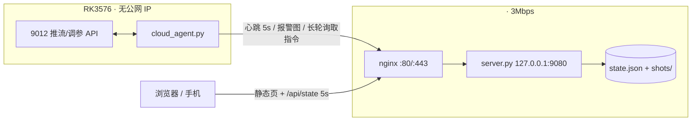

# 云端智联定点巡航安防预警系统 · 管控平台

> 代码目录名仍为 `cloud/`（历史原因）；对外名称统一为参赛作品名。

把 RK3576 + FPGA 采集板的运行状态、全部可调参数和 **AI 危险动作报警** 搬到公网，
用一个 **大号报警灯** 做第一眼提示；报警时板卡自动抓图推到云端。

> 服务器只有 3Mbps / 2 核 / 1.6G 内存，所以整个系统按“**能省就省**”设计：
> 单文件后端（仅 Python 标准库）、无数据库、无图像处理、无 MJPEG 上云、
> 报警图 640px（约 25KB）、图片按条数+总字节滚动删除。

---

## 1. 拓扑



* 板子没有公网 IP → **一切下行指令都由板子主动长轮询取走**（`/api/commands`）。
* 云端只保存「最近遥测 + 报警元数据 + 缩略图」，**不转码、不录像、不做直播**。
* 实时画面只能“点一下抓一张”（800px，约 40KB）；连续预览会吃带宽，默认关闭。

---

## 2. 已部署实例（2026-10-20）

| 项目 | 位置 |
|---|---|
| 页面 | `http://<SERVER_DOMAIN>/`（`/www/wwwroot/<SERVER_DOMAIN>/index.html`） |
| 后端 | `/opt/csi-dashboard/server.py`，systemd `csi-dashboard` |
| 配置 | `/opt/csi-dashboard/config.json`（token、看板账号密码，`600` 权限） |
| 数据 | `/opt/csi-dashboard/data/`（`state.json` + `shots/`，上限 20MB） |
| nginx | 站点配置里新增 `location ^~ /api/` → `127.0.0.1:9080` |
| 板端 | `/root/rk/cloud/cloud_agent.py` + `token`，systemd `cloud-agent`；由 `rk/deploy/start.sh` 与推流一起拉起 |

看板登录：网页内登录（`admin` / 密码见服务器 `/opt/csi-dashboard/config.json` 的 `ui_pass`），
登录后写 HttpOnly Cookie `cd_sid`（30 天），**不再用浏览器原生 Basic 弹窗**。
> 为什么改：Chrome/Edge 对 `fetch` 的 401 Basic 挑战会反复重试，最终报
> `net::ERR_TOO_MANY_RETRIES`，页面能打开但所有 `/api/*` 全挂（2026-10-20 实际踩到）。

---

## 3. 带宽预算（实测）

| 流量 | 频率 | 单次 | 常开 24h | 说明 |
|---|---|---|---|---|
| 板 → 云 心跳 | 5s | ~0.9KB(gzip) | ~16MB | 遥测 + 参数快照 |
| 云 → 浏览器 `/api/state` | 5s | **0.95KB(gzip)** | ~16MB | 标签页隐藏时自动降到 ≥20s |
| 首页 | 首次 | 18KB(gzip) / 52KB | — | 之后 ETag 304，几十字节 |
| 报警图 | 事件触发 | **23~30KB** | — | 640px / q55，同标签 15s 去抖 |
| 手动抓拍 | 点击 | ~40KB | — | 800px / q55 |
| `/api/stats` 趋势图 | ≤1 次/分钟 | ~1KB(gzip) | ~1.4MB | 报警数变化时立即拉一次 |

**3Mbps = 375KB/s ≈ 32GB/天**，上面最坏情况（看板 24h 常开）约 1GB/月，
占用不到链路的 0.1%。想再省：

* 页面右上「刷新」改成 10s / 30s（只影响看板，不影响报警）；
* 板端 `--interval 10`（`/etc/systemd/system/cloud-agent.service` 里改，重启生效）；
* 关掉页面后 `document.hidden` 会把轮询降到 20s。

---

## 4. 部署 / 重装

### 4.1 服务器

```bash
# 服务器地址不入库，按自己环境替换 <SERVER_IP>
export SRV=<SERVER_IP>

# 本地：把三个文件传到服务器
scp cloud/server.py cloud/static/index.html cloud/deploy/install.sh root@$SRV:/tmp/csi-deploy/
ssh root@$SRV
cd /tmp/csi-deploy && sh install.sh          # 幂等；已存在 config.json 不会覆盖密码
```

`install.sh` 会打印 **板端 token** 与 **看板密码**，只打印一次。

### 4.2 nginx（aaPanel）

网站 → `<SERVER_DOMAIN>` → 设置 → 配置文件，把
`deploy/nginx-snippet.conf` 的内容粘到 `server{ }` 里，然后：

```bash
/www/server/nginx/sbin/nginx -t && /www/server/nginx/sbin/nginx -s reload
```

> **必须用 `location ^~ /api/`**。站点里已有 `location ~ \.(jpg|png…)$` 的正则，
> 不加 `^~` 的话 `/api/shot/xxx.jpg` 会被当成静态文件直接 404。

### 4.3 板卡

```bash
# token 从 install.sh 的输出里复制
scp cloud/board/cloud_agent.py cloud/board/install_board.sh root@192.168.137.100:/tmp/csi-board/
ssh root@192.168.137.100
cd /tmp/csi-board && sh install_board.sh <TOKEN> http://<SERVER_DOMAIN>
rm -rf /tmp/csi-board
```

板端只用 `/usr/bin/python3`（标准库）；缩图由 9012 的
`/snapshot.jpg?w=640&q=55` 在板内用 cv2 完成，不需要给代理装 numpy/cv2。

### 4.4 与网页推流一起开机自启

代理不再需要单独记命令——`rk/deploy/start.sh` 统一管三件事（推流 + 集成 AI + 云端推送）：

```bash
start.sh              # 全栈一键起：FPGA 模式 → web(:9012) → 云端推送
start.sh stop         # 一起停（推流停了代理只会报 link_down，没意义）
start.sh status       # web / 云端推送 / 端口 / FPGA 模式 / AI 状态
start.sh cloud        # 只拉云端推送（开机脚本 boot_start.sh 调的就是它）
start.sh cloud-stop   # 只停云端推送
CLOUD=0 start.sh      # 只跑推流，不动云端推送
```

开机链路：`systemd mipi-webstream → boot_start.sh`（复位 FPGA、配 media）
→ `start.sh cloud`（幂等：已在运行就直接返回，有 systemd 单元就交给 systemd）
→ `exec start_webstream.sh`。所以 `cloud-agent.service` 即使被 disable，
只要推流起来，代理也会被拉起来；反过来 `start.sh stop` 会把两者一起停。

> 坑：不能用 `pgrep -f cloud_agent.py` 裸匹配判断"是否在跑"——
> `ssh afc03 "ps | grep cloud_agent.py"` 这类命令行自身就含该字符串，会被误判成已在运行
> （实测导致开机时没拉起）。现在以 `systemctl show -p MainPID` 为准，
> pgrep 也用 `^/usr/bin/python[0-9.]* .*cloud_agent\.py` 锚定。

**开机顺序**（`rk/deploy/fix_boot_order.sh` 幂等下发，厂镜像默认是乱的）：

```
sysinit / wifibt-init
  → load-drv               insmod AIC8800 WiFi/BT（Before=NetworkManager）
  → NetworkManager
  → NetworkManager-wait-online   厂镜像里被 mask 成 /dev/null，已解除 + 25s 超时
  → mipi-webstream        FPGA 复位 + media 通路 + :9012（内含 start.sh cloud）
  → cloud-agent           After=network-online.target + mipi-webstream.service
```

```bash
ssh afc03 "bash /root/rk/deploy/fix_boot_order.sh"          # 下发顺序
ssh afc03 "bash /root/rk/deploy/fix_boot_order.sh --check"   # 只看现状
ssh afc03 "for u in load-drv NetworkManager NetworkManager-wait-online mipi-webstream cloud-agent; do echo \$u \$(systemctl show -p ActiveEnterTimestamp --value \$u); done"
```

实测重启（2026-10-21）：`load-drv 20:37:33 → NetworkManager 20:37:34 → wait-online 20:37:40
→ cloud-agent 20:37:40`，推流进程比代理早 6s；开机 1.5 分钟后看板 `online=true, age≈5s`，
`systemctl --failed` 为空。

### 4.5 HTTPS（建议，443 已开）

aaPanel → 网站 → SSL → Let's Encrypt，签发后：

```bash
sed -i 's#--server http://<SERVER_DOMAIN>#--server https://<SERVER_DOMAIN>#' \
    /etc/systemd/system/cloud-agent.service
systemctl daemon-reload && systemctl restart cloud-agent
```

目前是 HTTP：token 会以明文经过公网。内网/短期演示可接受，长期建议开 TLS。

---

## 5. 页面功能

> 云端是**只读信息看板**：参数通过板端网页（9012）调整，云端只展示、报警与抓拍。
> 调参接口仍然保留在 `/api/cmd` 里（预留给后续权限分级），页面上不再暴露。

| 区域 | 内容 |
|---|---|
| 报警灯 | 大号灯体 + 状态 + 未确认/24h 计数 + 确认报警 + 抓拍一张 |
| 核心指标 | 推流帧率、端到端延时、CPU、NPU、温度、磁盘 |
| 右栏双页签 | **最近报警（最近 4 条）/ 抓拍画面**，等高固定 334px，切换不跳布局 |
| 智能分析 | 推理模式、运行状态、AI 帧率/人数、检测与姿态耗时、阈值、检测间隔/姿态预算、实时风险、四类动作灵敏度 |
| 报警统计 | 未确认 / 24 小时 / 累计 / 最近事件 / 限速丢弃 + **近 24 小时曲线**、**近 7 天柱图** |
| 设备与链路 | 设备名/节点/固件/内网地址/采集设备/模式/帧率/延时/客户端 |
| 采集与画质 | 曝光、增益、EV、白平衡、ROI、亮度/对比度/饱和度/伽马、JPEG、帧率上限、画面变换 |
| FPGA硬件预处理 | 处理状态、高级算法与参数、灰度系数、初级位图 chips |
| 系统资源 | CPU/NPU/内存/磁盘进度条 + GPU/温度/运行时长/心跳延时/**最近心跳时间**（绝对时间，离线时变黄） |
| 事件记录 | **按日期范围查询**（默认近 7 天）+ 全部/仅未确认 + **分页**（列数 × 5 条/页，最多 5 行）+ 确认 + 缩略图 |

### 报警灯状态

大灯框底部居中有一排颜色图例（当前状态那颗带光圈+满亮度，其余淡出）：
`绿 正常 / 黄 预警 / 红 报警 / 灰 离线`，鼠标悬停看具体含义。

| 状态 | 含义 |
|---|---|
| 绿 `正常` | 有心跳、无未确认报警、当前画面 risk=0 |
| 黄 `预警` | 当前画面 risk=1（越界/奔跑/举手…）或健康项告警（磁盘>85%、温度>72℃、AI 不出结果） |
| 红 `报警` | 有未确认报警（跌倒/倒地/攀爬/冲突/挥砍/投掷），或当前画面 risk=2，或健康项 `crit`（无帧/磁盘>92%/温度>85℃）；伴随旋转光束、闪烁与可选警笛 |
| 灰 `离线` | 超过 30s 没有心跳（板子掉电/断网/代理挂了） |

点「确认报警」后灯回绿；同标签 15s 内的重复事件合并计数（`×N`），不会刷屏。

---

## 6. 板端报警来源

| 来源 | 触发 | 带图 |
|---|---|---|
| AI 事件 | `/api/ai` 的 `events`（跌倒、倒地、攀爬、冲突、挥砍、投掷） | ✅ |
| 视频无帧 | fps < 1 持续 12s | ✅ |
| 服务不可达 | 本机 9012 连续 3 次无响应 | ❌（没图可取） |
| 磁盘将满 | 根分区 > 92% | ❌ |
| 温度过高 | > 85℃ | ❌ |
| FPGA 读失败 | `/api/fpga.ok == false` | ❌ |

> **AI 布防**：默认板端是 `source=raw`（不推理、不出事件）。
> 在「AI 报警」页把推理模式改成 **仅推理（不叠加）** 就布防了：
> NPU 持续跑，但推流画面保持干净；选「推理 + 叠加」则本地画面也画框/骨架。

> **系统异常不会连着刷**（2026-10-21）：`链路断开 / 视频无帧 / FPGA 读失败 /
> 磁盘将满 / 温度过高` 都是“持续状态”，**一次异常只留最早那一条**，
> 持续期间不再新增记录（恢复前重复上报只累加 `×N`）；恢复正常后
> （板端 `tel.health.ok`）再出同项异常才重新记一条。
> 实现：板端 `Agent.health_sync()` 边沿触发（推送失败不记已报，下一拍重试）；
> 云端 `add_alarm()` 对 `src=health` 再兑一道底，兼着代理重启的情况。

> 板子磁盘写满会伪装成“采集卡死”（历史坑），所以磁盘报警是刻意加的。

### 6.1 事件视频（前 5s + 后 5s，2026-10-21）

板端持续保留最近 **10s** 的低码率帧，出事件时把 **事件前 5s + 事件后 5s** 合成一个
mp4 传到云端，看板「事件记录」里点 **▶ 回放** 直接播放。

| 环节 | 做法 | 代价 |
|---|---|---|
| 环形缓存 | 抓 `9012 /snapshot.jpg?w=640&q=50`，8fps，存 **SD 卡** `/mnt/sd/csi_ring`（约 55KB/s） | 保留 14s ≈ 1MB |
| 合成 mp4 | `gst-launch` + Rockchip **MPP 硬件编解码**（mppjpegdec → mpph264enc → mp4mux faststart） | 640x360 / 8fps / 450kbps，10s ≈ **60KB~450KB**，编码 <1s |
| 上传 | `POST /api/alarm/<id>/clip?sec=10`，失败留本地 `/mnt/sd/csi_clips` 每 45s 重试 | 单条 1~2s 传完（3Mbps） |
| 云端存储 | **MySQL** `csi_dashboard`（alarms + clips + meta 表）+ `/data/clips/<id>.mp4` | 视频**只保留最近 15 条**（`max_clip_count`），兼 1GB 字节兑底 |
| 回放 | `GET /api/clip/<id>.mp4`，支持 Range（`<video>` 可拖进度条） | 只有点开才拉，平时不占带宽 |

板端相关参数（`cloud_agent.py`）：

```bash
--ring-dir /mnt/sd/csi_ring     # 改 /dev/shm 可省 SD 卡寿命（RAM 里也只占 1MB）
--clip-dir /mnt/sd/csi_clips    # 待上传队列
--ring-fps 8 --clip-pre 5 --clip-post 5
--clip-width 640 --clip-quality 50 --clip-bps 450000
--clip-total-mb 1024            # 本地待传目录滚动上限
--no-clip                       # 关掉视频
--selftest-clip 14 [--selftest-upload]   # 板端自检：录 14s 合片段（可选连上传）
```

> 为什么不用 ffmpeg：板子上没有 ffmpeg，但 GStreamer 带 `rockchipmpp`
> 插件（`mppjpegdec` / `mpph264enc`），硬件编解码几乎不吃 CPU。
> 合成前会把选中的帧**硬链接**到临时目录再连续编号，避免环形缓存在旁边删文件。

---

## 7. 运维

```bash
systemctl status csi-dashboard
journalctl -u csi-dashboard -n 50 --no-pager

du -sh /opt/csi-dashboard/data          # 正常 < 21MB
ls -lt /opt/csi-dashboard/data/shots | head

# 板端
systemctl status cloud-agent
journalctl -u cloud-agent -n 50 --no-pager

# 云端连通性（不需要密码）
curl -s http://<SERVER_DOMAIN>/api/ping

# 板端一键看全栈（web / 代理 / 云端连通 / 端口 / FPGA 模式 / AI）
/root/rk/deploy/start.sh status
```

**看板显示「离线」怎么查**（2026-10-21 实踩）：

| 现象 | 原因 | 处理 |
|---|---|---|
| `lamp.state=offline`、`age` 一直涨 | 板端上不了网，代理 `ingest` 全失败 | 板上 `ip route`、`getent hosts <SERVER_DOMAIN>`、`curl -s http://<SERVER_DOMAIN>/api/ping` |
| `ip route` 里有 `default via 192.168.137.1 dev end0 onlink`（**没有 metric**） | PC 的 ICS 网关不可达，但它是 metric 0，把 WiFi 的默认路由压掉 | `ip route del default via 192.168.137.1 dev end0`；**并**注释掉 `/etc/network/interfaces` 里 end0 的 `gateway`（备份 `.bak_20261021`） |
| 代理进程在跑但没心跳 | 同上（网络问题），看板不会自己恢复 | 网络通了 5s 内自动恢复，不用重启代理 |

> 注意：`nmcli con mod "有线连接 1" ipv4.never-default yes` 对 end0 **无效**——
> NM 配置是 `[ifupdown] managed=false`，end0 由 `ifupdown` 管，
> `nmcli dev status` 里它显示 `unmanaged`。必须改 `/etc/network/interfaces`。

**改看板密码**：编辑 `/opt/csi-dashboard/config.json` 的 `ui_pass` → `systemctl restart csi-dashboard`。

**清空报警历史**（会同时删图片）：

```bash
systemctl stop csi-dashboard
rm -rf /opt/csi-dashboard/data/shots/* /opt/csi-dashboard/data/live.jpg
python3 - <<'PY'
import json
p="/opt/csi-dashboard/data/state.json"
s=json.load(open(p)); s["alarms"]=[]; s["results"]=[]; s["pending"]=[]; s["live"]={"rev":0,"ts":0}
json.dump(s,open(p,"w"),ensure_ascii=False,separators=(",",":"))
PY
systemctl start csi-dashboard
```

**卸载**：

```bash
systemctl disable --now csi-dashboard
rm -rf /opt/csi-dashboard /etc/systemd/system/csi-dashboard.service
rm -f /root/<SERVER_DOMAIN>.conf.bak_csi
# 再把 nginx 配置里 `# ===== CSI2RK cloud dashboard` 那一段删掉并 reload
userdel csidash
# 板端：
systemctl disable --now cloud-agent
rm -rf /root/rk/cloud /etc/systemd/system/cloud-agent.service
```

---

## 8. 已知坑（这次踩到的）

1. **板卡默认路由被有线口抢走**：`end0`（PC ICS 网段 192.168.137.x）的默认路由 metric=0，
   但网关 192.168.137.1 已经不通 → 所有公网请求 `no route to host`，DNS 也超时。
   修复：`nmcli con mod "有线连接 1" ipv4.never-default yes ipv4.route-metric 700`，
   WiFi `509` 设 `ipv4.route-metric 100`。SSH 走的是同网段直连，不受影响。
2. **nginx 正则 location 会截胡** `/api/shot/*.jpg` → 必须 `location ^~ /api/`。
3. **Windows 上传的 .sh 是 CRLF** → 服务器上 `sh` 直接报 `\r` 错误，部署前统一转 LF。
4. **板端 AI 默认 `source=raw`**：此时 `active=false`、没有事件。
   在「AI 报警」页把推理模式改成 **仅推理（不叠加）**（或启动参数 `AI_SRC=detect`）；
   `detect` 是 2026-10-20 新加的第三档——只推理不往推流帧上画东西。
5. **90x 系列没有 reboot 接口**：看板的“远程重启”默认隐藏；`allow_reboot=false`。
6. **不要把 Basic 认证用在 fetch 上**：401 带 `WWW-Authenticate` 会让 Chrome/Edge
   反复重试（`ERR_TOO_MANY_RETRIES`）。已改成登录页 + Cookie；脚本仍可用
   `curl -u admin:密码` 或 `X-UI-Pass` 头。
7. **nginx 默认不禁止 HTML 缓存**：浏览器会启发式缓存旧看板，部署后要
   `location = / { add_header Cache-Control "no-store"; }`（已在站点配置里）。

---

## 9. 预留扩展

服务端启动时自动加载 `ext/*.py`，每个模块暴露：

```python
INFO = {"title": "云台控制", "desc": "..."}

def handle(payload, ctx):
    # ctx: {"state": 状态字典, "queue": 下发指令函数, "cfg": 配置}
    return {"ok": True, "data": ...}
```

放进去即生效（`GET /api/ext` 会显示 `已接入`），未放模块的接口返回
`501 {"ok":false,"reserved":true}`，前端已经能识别。

已登记的占位：`gimbal`（云台）、`record`（录像）、`webhook`（钉钉/企微）、
`zone`（多区域/多摄像头）、`ota`（远程升级）。
示例见 `ext/_example.py`。
