# 危险动作识别 —— 实例骨架图

> 由 `rk/ai/convert/gen_action_sheets.py` 生成（绘制走线上的 `det_core.draw_person`，拓扑与配色和真实画面一致）。
> 图中白色箭头表示**判定所依据的运动方向**。

## 总表

| 动作 | 中文名 | 英文标签 | 级别 |
|---|---|---|---|
| `fall` | 跌倒 | `Fall` | 🔴 报警 |
| `lying` | 倒地不起 | `Lying` | 🔴 报警 |
| `climb` | 攀爬翻越 | `Climb` | 🔴 报警 |
| `fight` | 肢体冲突 | `Fight` | 🔴 报警 |
| `swing` | 挥砍 | `Swing` | 🔴 报警 |
| `throw` | 投掷 | `Throw` | 🔴 报警 |
| `intrude` | 越界闯入 | `Intrude` | 🟠 提醒 |
| `run` | 奔跑 | `Run` | 🟠 提醒 |
| `handup` | 举手求救 | `Help` | 🟠 提醒 |
| `photo` | 拍照 | `Photo` | 🟠 提醒 |
| `squat` | 下蹲 | `Squat` | ⚪ 记录 |

---

## 跌倒（`fall`）— 🔴 报警

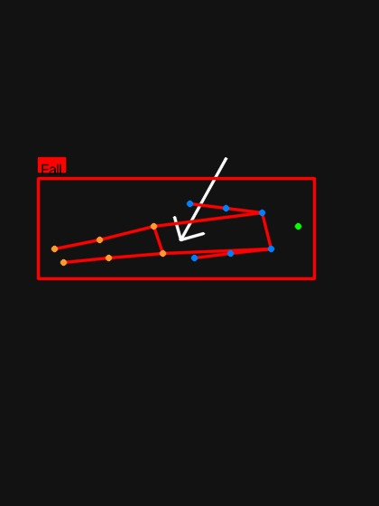

**判定**：躯干与竖直夹角 > 45°，且髋高在 1.2s 内骤降 > 0.05 身高；持续 0.35s

---

## 倒地不起（`lying`）— 🔴 报警

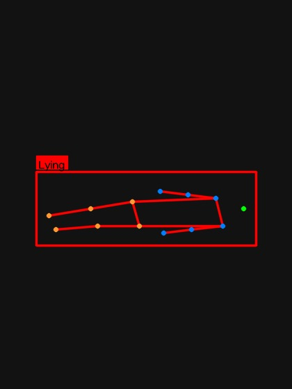

**判定**：躯干夹角 > 65° 持续 2.5s（长时间倒地不起）

---

## 攀爬翻越（`climb`）— 🔴 报警

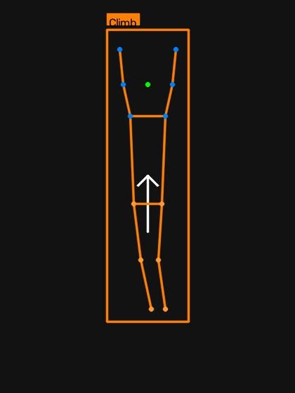

**判定**：双手高于肩线，且（髋部 1.2s 内抬升 > 0.18 身高 或 脚高于髋）；持续 0.4s

---

## 肢体冲突（`fight`）— 🔴 报警

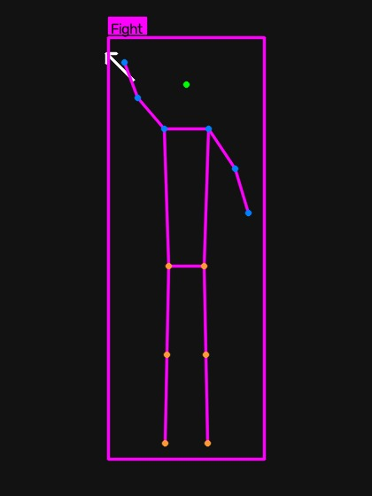

**判定**：腕部速度 > 5 身高/秒（**双手**都在高频挥动）；持续 0.4s

---

## 挥砍（`swing`）— 🔴 报警

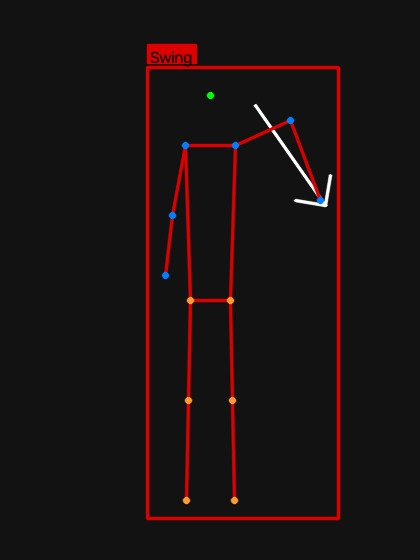

**判定**：**单侧**手腕 0.13s 内位移 > 0.5 身高（已扣除肩部整体位移）、另一侧 < 该值 40%、且手腕离同侧肩 > 0.3 身高（手臂伸出）；持续 0.2s

> 2026-10-20 收紧（原 0.45 身高 / 50% / 0.15s，误报偏高）：新增**肩部位移扣除**（消除人平移、相机抖动、骨架整体跳变造成的假位移）、
> **手臂伸展度**约束（剔除走路摆臂、双手贴身移动），并提高单侧性与去抖时长。阈值为固定值，不提供在线调节。

---

## 投掷（`throw`）— 🔴 报警

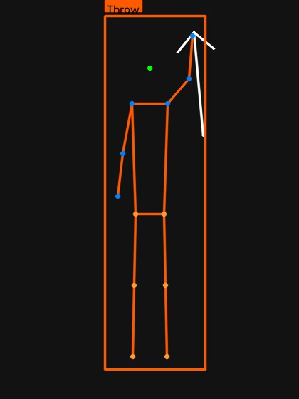

**判定**：手腕 0.13s 内**上撩** > 0.35 身高，且双手已过肩；持续 0.1s

---

## 越界闯入（`intrude`）— 🟠 提醒

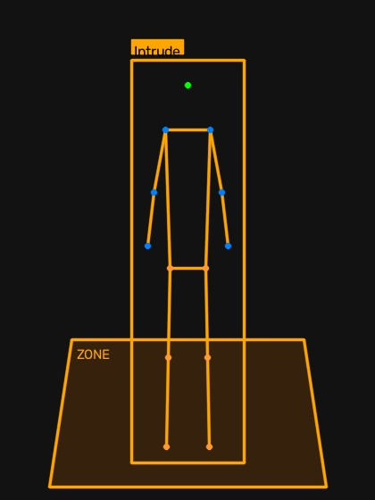

**判定**：脚部关键点落入警戒多边形，持续 0.3s

---

## 奔跑（`run`）— 🟠 提醒

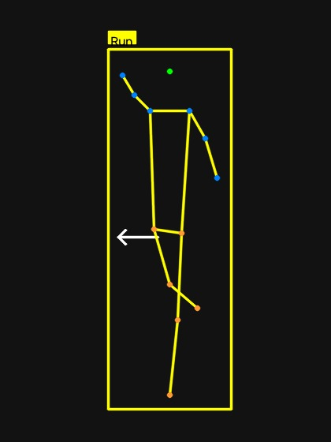

**判定**：髋部水平速度 > 1.5 身高/秒；持续 0.6s

---

## 举手求救（`handup`）— 🟠 提醒

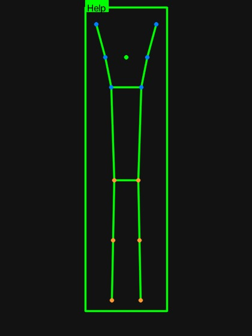

**判定**：双手高于肩线且身体近静止；持续 2s

---

## 拍照（`photo`）— 🟠 提醒

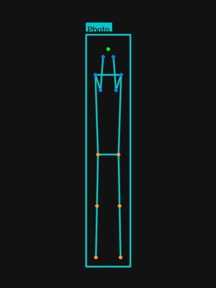

**判定**：双手都在脸高（鼻 ±0.18 身高）、**两手相距 < 0.22 身高且纵向差 < 0.15 身高**、不高于鼻 0.05 身高以上；持续 1.5s

> 2026-10-19 收紧：两手距离门限 0.40 → 0.22 身高

---

## 下蹲（`squat`）— ⚪ 记录

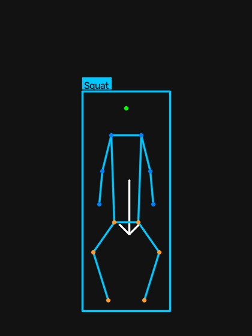

**判定**：髋部接近膝部高度（差 < 0.12 身高）；持续 0.5s
