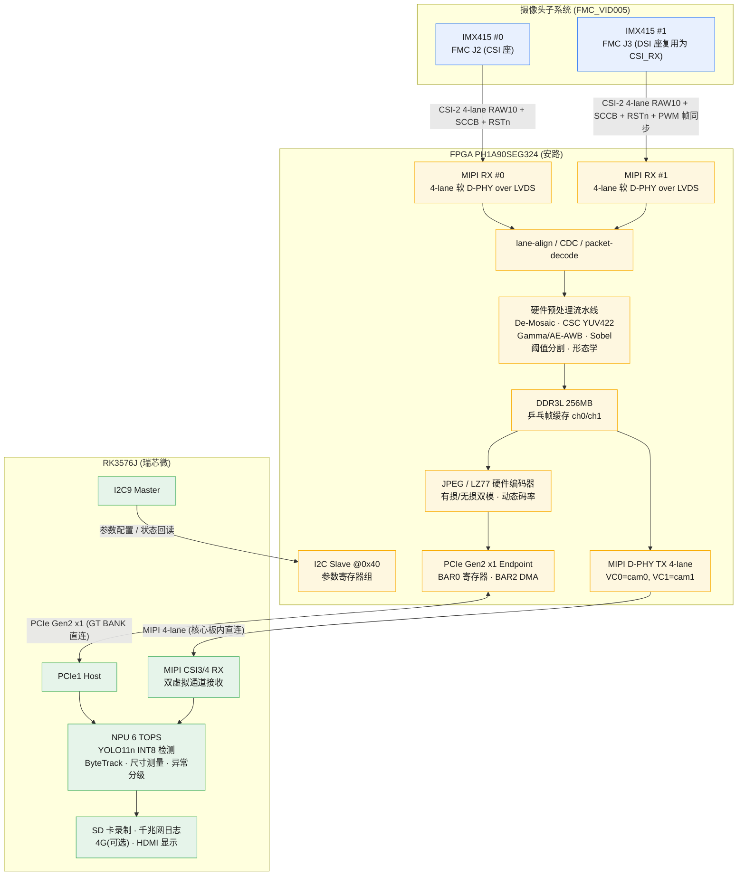

# 基于米联客 AFC03（RK3576J + 安路 PH1A90SEG324）双路 IMX415 异构视觉系统设计方案

> 适用赛题：全国大学生嵌入式芯片与系统设计竞赛 2026 · 安路赛道
> 硬件平台：MLK-AFH03-AFC03 核心板 + AFH03 底板 + FMC_VID005_MIPI 子卡 + 2× IMX415 摄像头模组

---

## 1 系统总体架构

### 1.1 拓扑

### 1.2 数据流与三路接口分工

| 通道 | 物理链路 | 方向 | 带宽量级 | 用途 |
|---|---|---|---|---|
| MIPI 视频主通道 | FPGA HR BANK DSI TX 4lane → RK CSI3/4 RX（核心板内直连） | FPGA→RK | 4 lane × ≤2.5 Gbps | 双路 YUV422 视频流（VC0=cam0, VC1=cam1） |
| PCIe 高速通道 | FPGA GT BANK PCIE30x1 ↔ RK PCIe1 | 双向 | Gen2 x1 ≈ 4 Gbps | 压缩码流 bulk 传输、原始帧 dump、寄存器批量读写 |
| I2C9 参数通道 | RK I2C9 master ↔ FPGA I2C slave | RK→FPGA | ≤400 kbps | 传感器配置、预处理开关、码率/ROI 设置、状态回读 |

---

## 2 硬件连接与引脚复用方案

### 2.1 FMC_VID005 子卡 J3（DSI 座）复用为第二路 CSI_RX

J2（CSI 座）与 J3（DSI 座）在子卡上均为 4-lane D-PHY + IIC + RSTn 接口，差异仅在 FPGA 侧收发方向定义。复用要点：

1. **高速对方向重约束**：例程中 J3 高速对（DSI_HS_CKP/N、DSI_HS_D0P/N…D3P/N）按 LVDS TX 约束；新工程中改用 `LVDS_RX` 输入缓冲，复用例程 `mipi_dphy_rx_over_lvds_wrapper` 例化第二路 RX IP。
2. **LP 对处理**：LP 对（DSI_LP_*）在连续时钟（Continuous Clock）模式下不参与数据传输，配置为高阻或用于 ULSPS/退出时序；本方案采用连续时钟模式，LP 对 tri-state。
3. **控制信号复用**：
   - `DSI_RSTn`（J3 pin4）→ IMX415 #1 的 RESETn；
   - `DSI_PWM`（J3 pin11）→ 帧同步触发输出 / 外触发输入 GPIO；
   - `DSI_IC_SDA/SCL`（J3 pin34/37）→ IMX415 #1 的 SCCB，由 FPGA I2C master #1 bit-bang。
4. **物理转接线**：J3 为 FFC 40pin 座，需自制/定制一条 FFC 排线，将 J3 的 CLK/D0~D3/IIC/RSTn 映射到 IMX415 摄像头模组的 24pin/15pin 座（与 J2 摄像头模组同引脚序，仅 net 名不同）。
5. **22R 串联电阻**：子卡 R91（DSI_CLK）、R163（CSI_CLK）保留，对 RX 方向仅作阻抗匹配，不影响功能。

### 2.2 FMC-HPC 引脚映射（已据手册核对）

| 信号组 | FPGA 引脚（手册 FMC-HPC 表） | 用途 |
|---|---|---|
| FMC_HPC_LA00_CC_P/N | C14/D13 | cam0 HS_CLK |
| FMC_HPC_LA03_P/N | D14/E15 | cam0 HS_D0 |
| FMC_HPC_LA08_P/N | G17/G16 | cam0 HS_D1 |
| FMC_HPC_LA12_P/N | H16/H15 | cam0 HS_D2 |
| FMC_HPC_LA16_P/N | C17/B17 | cam0 HS_D3 |
| FMC_HPC_LA20_P/N | A14/B14 | cam0 IIC_SDA/SCL |
| FMC_HPC_LA02_P/N | A18/B18 | cam0 RSTn / PWDn |
| FMC_HPC_CLK1_M2C_P/N | E16/F16 | cam1 HS_CLK（原 DSI_CLK） |
| FMC_HPC_LA22_P/N | A13/B13 | cam1 HS_D0（原 DSI_D0） |
| FMC_HPC_LA25_P/N | D18/E18 | cam1 HS_D1 |
| FMC_HPC_LA29_P/N | G18/K16 | cam1 HS_D2 |
| FMC_HPC_LA31_P/N | K16/K17 | cam1 HS_D3 |
| FMC_HPC_LA19_P/N | G14/G13 | cam1 IIC_SDA/SCL |
| FMC_HPC_LA21_P/N | H14/J14 | cam1 RSTn / PWM trigger |

> 实际管脚以安路 TD 工程 `pin.adc` 约束文件为准，上表来自手册第 41–42 页 FMC-HPC 引脚表与 FMC_VID005 子卡原理图交叉核对结果。

### 2.3 FPGA→RK 内部直连（核心板，无需底板改动）

| FPGA net | FPGA 脚 | RK net | RK 脚 |
|---|---|---|---|
| PLB_LANE0_P/N | T11/U12 | CSI3_RX_D0P/N | H28/H29 |
| PLB_LANE1_P/N | R11/V17 | CSI3_RX_D1P/N | J28/J29 |
| PLB_DSI_CLK_P/N | P17/P18 | CSI3_RX_CLKP/N | 1H22/1H23 |
| PLB_LANE2_P/N | R16/V12 | CSI3_RX_D2P/N + CSI4_RX_D0P/N | K28/K29 |
| TXM1_83/RXM1_83 | A3/B5 | PCIe1_TX/RX | M29/M28/N29/N28 |

### 2.4 I2C9 反向参数通道

- RK3576 I2C9（SCL=L18, SDA=M18）经底板 CON1C A11/A12 引出。
- 在底板上将 I2C9_SCL/SDA 连至 FMC_HPC_IIC_SCL/SDA（FPGA P14/P15），即 FPGA 侧实现为一个 I2C slave IP。
- 若底板未直连，用杜邦线从 CON1C A11/A12 飞线至 FMC-HPC 座的 I2C 针脚即可（仅控制总线，速率 400 kHz 无压力）。

---

## 3 FPGA 端设计

### 3.1 MIPI CSI 接收 IP（基础必做项 1）

复用例程 `uisrc/03_ip/al_ip/mipi_rx/` 下已有软 PHY：

- `mipi_dphy_rx_over_lvds_wrapper.v`：顶层封装；
- `hs_rx_wrapper.sv`：高速串并转换；
- `data_lane_rx_wrapper.enc.v`：单 lane 数据恢复；
- `channel_aligner_wrapper.enc.sv`：多 lane 字节对齐；
- `rx_clk_gen.v`：从恢复时钟生成像素时钟。

例化两路：`u_mipi_rx_ch0`（J2）、`u_mipi_rx_ch1`（J3）。每路支持 RAW10 / YUV422 数据类型解析。

**双路同步优化**：
- 两路上电后由 FPGA 统一释放 RSTn，保证曝光起始对齐；
- 帧同步信号 `frame_sync` 由 FPGA PLL 生成，同时送两路相机的 trigger 引脚（cam1 走 DSI_PWM）；
- 帧计数 `frame_cnt_ch0/ch1` 对齐校验，偏差超过 1 帧即上报 RK。

### 3.2 硬件预处理流水线（基础必做项 2 + 高级拓展 2）

| 阶段 | 算法 | 实现资源 | 对应指标 |
|---|---|---|---|
| P1 | RAW10→RGB888 De-Mosaic（Bilinear） | 行缓存 ×2 + 乘加 | 基础算法 1 |
| P2 | RGB888→YUV422 CSC | DSP 乘加矩阵 | 基础算法 2 |
| P3 | Gamma 校正 LUT + AE/AWB 统计直方图 | ERAM LUT + 累加器 | 基础算法 3 |
| P4 | Sobel 3×3 边缘检测 | 行缓存 ×3 + 240 DSP 时分复用 | 高级：边缘检测 |
| P5 | 阈值分割（Otsu/固定阈值可配） | 比较器 + 门控 | 高级：阈值分割 |
| P6 | 形态学（腐蚀/膨胀，3×3） | 行缓存 + LUT | 高级：形态学 |
| P7（可选） | 帧差法运动前景提取 | 双帧缓存差减 | 拓展高级：运动前景 |
| P8（可选） | 多曝光 HDR 融合 | 权重图加权 | 拓展高级：HDR |
| P9（可选） | 亚像素边缘定位（灰度质心法） | DSP 除法/开方 | 拓展高级：亚像素测量 |

流水线采用全流水设计，每级一行缓存，经 DSP 块时分复用在两路视频间切换，控制 LUT/DSP 占用。

### 3.3 硬件压缩加速模块（基础必做项 3 + 拓展 3）

- **JPEG 编码器**：Baseline JPEG 硬件化
  - 8×8 DCT：采用 Loeffler 算法，11 个乘加核，复用 DSP；
  - 量化：预存亮度/色度量化表，参数经 I2C9 配置（质量系数 Q=1~100）；
  - Zig-Zag + Huffman：直流 AC 表固化在 ERAM。
- **LZ77 无损编码**：32KB 滑动窗口，hash chain 查找，用于测试图/测量数据无损存档。
- **动态码率**：根据 P3 输出的场景直方图复杂度（方差/边缘密度）自动调整量化表等级；寄存器 `bitrate_mode` 支持 fixed / adaptive。
- **有损/无损双模**：寄存器 `codec_sel` 切换 JPEG（有损）/ LZ77（无损）。

### 3.4 DDR3L 帧缓存与乒乓（拓展 4）

- 例程已有 `ui_ddr` IP（256MB, 933MHz×16bit）。
- 双路各分配 4 帧 buffer（cam0: 0–16MB, cam1: 16–32MB，按 1080p YUV422 ≈4MB/帧 计）。
- 读写采用乒乓（ping-pong）：写 bank A 时读 bank B，消除撕裂。
- 跨时钟域用异步 FIFO（`fifo_w32_d512` 已有 IP）隔离像素时钟域与 DDR 控制器时钟域。

### 3.5 FPGA→RK MIPI D-PHY TX（基础必做项 4 之 MIPI 通道）

- 复用例程 `dsi/hdl_source/dphy_tx_general/mipi_dphy_tx_wrapper.enc.v`。
- 数据封装为 MIPI CSI-2 长包：
  - VC0（cam0）：YUV422 8-bit data type 0x1E；
  - VC1（cam1）：YUV422 8-bit data type 0x1E；
  - 帧起始/结束短包 + 行同步 ECC/CRC。
- RK3576 CSI3/4 配置为双虚拟通道接收，V4L2 层直接出两路帧。

### 3.6 PCIe2.0 x1 Endpoint（基础必做项 4 之 PCIe 通道 + 拓展 4）

- 利用 FPGA GT BANK（手册第 44 页）实现 PCIe Gen2 x1 endpoint。
- BAR0：映射 FPGA 内部寄存器（64KB），RK 可直接读写配置；
- BAR2：映射 DMA buffer，用于 JPEG 码流 bulk 上传至 RK 内存。
- **带宽压缩优化**：
  - DMA 采用 Scatter-Gather，描述符环形队列；
  - 仅上传 JPEG 码流（而非原始帧），PCIe 负载 = JPEG 压缩后数据，等效带宽压缩比 = 压缩率；
  - 时序收敛：GT 时钟与用户时钟域隔离，异步 FIFO 跨域。

### 3.7 FPGA I2C Slave（参数通道）

- I2C slave 地址 0x40，寄存器映射：

| 地址 | 名称 | 读/写 | 说明 |
|---|---|---|---|
| 0x00 | FPGA_VERSION | R | 固件版本号 |
| 0x04 | CAM0_CFG | RW | 分辨率/帧率/增益/曝光 |
| 0x08 | CAM1_CFG | RW | 同 CAM0 |
| 0x0C | PREPROC_EN | RW | bit0=Demosaic, bit1=Gamma, bit2=Sobel, bit3=Morph, bit4=Motion, bit5=HDR |
| 0x10 | JPEG_Q | RW | 1~100 质量系数 |
| 0x11 | CODEC_SEL | RW | 0=raw YUV, 1=JPEG, 2=LZ77 |
| 0x12 | BITRATE_MODE | RW | 0=fixed, 1=adaptive |
| 0x14 | ROI_X/Y/W/H | RW | 感兴趣窗口 |
| 0x20 | FRAME_CNT_CH0 | R | cam0 已采帧数 |
| 0x21 | FRAME_CNT_CH1 | R | cam1 已采帧数 |
| 0x22 | ERR_CNT | R | 丢帧/CRC 错误计数 |
| 0x24 | RES_UTIL | R | LUT/DSP/BRAM 占用百分比 |

- FPGA 收到 CAMx_CFG 后，由内部 I2C master bit-bang 写入对应 IMX415 寄存器（SCCB）。

---

## 4 RK3576J 端设计

### 4.1 视频接收（V4L2）

- RK3576 CSI 驱动配置为双虚拟通道：
  - `csi3` VC0 → /dev/videoX (cam0)
  - `csi3` VC1 → /dev/videoY (cam1)
- 分辨率默认 1920×1080@60，YUV422 8-bit；可经 I2C9 降为 1280×720@60 以降低 FPGA 带宽压力。
- 用户态用 V4L2 或 OpenCV（教程篇已有例程）抓取帧。

### 4.2 NPU AI 推理（基础必做项 5 + 拓展 5）

- **模型选择**：YOLO11n / NanoDet-Plus（INT8 量化后 ≤10MB），或 YOLOv8n。
- **部署链路**：PyTorch 训练 → RKNN-Toolkit2 量化 INT8 → RK3576 NPU runtime 推理。
- **检测类别**：按场景自定（如 person / car / bike / defect / 任意竞赛场景目标）。
- **高级任务**：
  - 多目标跟踪：ByteTrack（CPU 侧，基于 NPU 输出的 bbox + ReID 可选）；
  - 尺寸测量：棋盘格标定 → 像素当量 → bbox 宽高换算物理尺寸；
  - 异常分级：置信度阈值 + 类别风险表 → 正常/警告/告警三级。
- **数据记录（必做项 5 要求全部数据）**：
  - 帧率 FPS（两路分别统计）；
  - 端到端延迟（FPGA 帧时间戳 → RK 推理完成时间戳）；
  - FPGA 资源占用（I2C9 读 RES_UTIL）；
  - 压缩率（JPEG 输出大小 / 原始帧大小）；
  - NPU 推理耗时（RKNN 接口 profiling）。

### 4.3 存储与网络（拓展 6）

- **中级**：TF 卡本地录制 JPEG/MP4 片段 + 千兆网 FTP/HTTP 上传运行日志。
- **高级（可选）**：底板 4G 模块（手册第 26 页）联网，远程推送关键帧图像；双网（有线+4G）冗余。

### 4.4 工程化与低功耗（拓展 7）

- 连续 2 小时无故障运行作为中级基线；
- 低功耗：空闲时 FPGA PLL 降频、RK 进入冷热壳调度、4G 模块休眠；
- 宽温：RK3576J 与 PH1A90SEG324 均为工业级（-40~85℃），被动散热即可；
- 电池供电（高级可选）：底板 DC12V 输入改锂电池 + DC-DC。

---

## 5 量化指标覆盖对照表

### 5.1 基础必做项

| 指标 | 本方案实现 | 完成度 |
|---|---|---|
| 1. FPGA 图像采集 IP：单路稳定 CSI | 复用例程 mipi_rx，J2 单路先调通 | ✅ |
| 1. 双路同步采集 + 时序同步优化 | J3 复用为第二路 RX，硬件帧同步 trigger，帧计数对齐校验 | ✅ |
| 2. 硬件并行 3 种基础算法 | Demosaic / CSC / Gamma+AE 统计 | ✅ |
| 2. 额外边缘/形态学高级预处理 | Sobel + 阈值 + 形态学流水线 | ✅ |
| 3. JPEG/LZ77 硬件编码 | 硬件 DCT JPEG + LZ77 | ✅ |
| 3. 动态码率/有损无损双模 | adaptive 码率 + codec_sel 切换 | ✅ |
| 4. MIPI 通道稳定传输 | FPGA DSI TX → RK CSI3/4 VC0/VC1 | ✅ |
| 4. PCIe 高速通道 + 带宽优化 | Gen2 x1 endpoint + DMA + JPEG 码流压缩传输 | ✅ |
| 5. NPU 轻量模型本地推理 | YOLO11n INT8 | ✅ |
| 5. 多目标/多类别识别优化 | 多类别检测 + ByteTrack | ✅ |
| 5. 帧率/延迟/资源/压缩率/推理耗时数据 | I2C9 + RKNN profiling 全记录 | ✅ |

### 5.2 发挥创新拓展项

| 拓展项 | 中级 | 高级 | 本方案目标 |
|---|---|---|---|
| 1 多通道并行采集 | 双路同步 | 4 路+时序校准 | **中级**（双路，预留 4 路扩展） |
| 2 高级 FPGA 算法 | 边缘/阈值/形态学 | 亚像素/HDR/运动前景 | **中级全部 + 高级选做** |
| 3 高性能压缩 | 自适应码率 | 无损+有损双模/低带宽 | **高级**（双模 + JPEG over PCIe） |
| 4 异构高速传输 | 乒乓缓存 | PCIe + 带宽压缩 + 时序收敛 | **高级**（乒乓 + PCIe DMA + 码流压缩） |
| 5 AI 多任务 | 多类别识别 | 多目标跟踪/尺寸测量/异常分级 | **中级 + 高级选做** |
| 6 多网络/存储/远程 | SD 卡 + 千兆日志 | 4G/双网/远程推图 | **中级**（4G 选做高级） |
| 7 工程化/低功耗 | 2h 稳定 | 宽温/低功耗/电池 | **中级基线 + 工业级宽温** |

---

## 6 FPGA 资源预算估算（PH1A90SEG324）

| 模块 | LUT4 (估) | DFF (估) | DSP (估) | ERAMa (估) |
|---|---|---|---|---|
| 2× MIPI RX 软 PHY | ~18k | ~22k | 0 | 2 |
| 1× MIPI DSI TX | ~6k | ~8k | 0 | 2 |
| DDR3 控制器 (ui_ddr) | ~8k | ~10k | 0 | 4 |
| 预处理流水线 P1–P6 | ~15k | ~18k | 40 | 8 |
| JPEG/LZ77 编码器 | ~20k | ~25k | 30 | 16 |
| PCIe Gen2 x1 endpoint | ~25k | ~30k | 0 | 8 |
| I2C slave + 控制逻辑 | ~3k | ~4k | 0 | 1 |
| **合计** | **~95k / 115k (82%)** | **~117k / 128k (91%)** | **70 / 240** | **41 / 272** |

> DFF 占用接近上限，需在综合时做以下优化：
> - 预处理 P7–P9（HDR/运动/亚像素）仅在需要时作为可编译选项，默认关闭；
> - JPEG Huffman 表用 Block RAM 而非 LUT 实现；
> - 若 DFF 超资源，将 PCIe endpoint 用安路官方 hardened IP（若 PH1A90 提供），否则降级为仅 MIPI 主通道 + I2C 控制，PCIe 作为高优先级选做。

---

## 7 实施路线（建议阶段）

| 阶段 | 周期 | 任务 |
|---|---|---|
| S1 | 第 1 周 | 移植例程单路 IMX415 → FPGA DDR3 → DSI TX 显示/ RK CSI，验证基础链路 |
| S2 | 第 2 周 | J3 复用为第二路 MIPI RX，双路采集 + 帧同步调通 |
| S3 | 第 3 周 | FPGA→RK MIPI TX 双 VC 封装，RK V4L2 出两路视频 |
| S4 | 第 4 周 | 预处理流水线 P1–P6 上线，I2C9 参数通道打通 |
| S5 | 第 5 周 | JPEG/LZ77 硬件编码 + 乒乓缓存 |
| S6 | 第 6 周 | PCIe Gen2 endpoint + DMA 码流上传 |
| S7 | 第 7 周 | RK NPU 模型部署 + 多任务分析 + 数据记录面板 |
| S8 | 第 8 周 | SD/网口存储、2h 稳定性烤机、文档与演示视频 |

---

## 8 风险与应对

| 风险 | 影响 | 应对 |
|---|---|---|
| J3 改 CSI 后软 PHY 时序不收敛 | cam1 花屏/无数据 | 降低 lane rate 至 1.5 Gbps；用 ChipWatcher 抓 eye；LP 对 tri-state |
| DFF 资源超 128k | 综合失败 | 关闭 P7–P9；JPEG Huffman 用 BRAM；PCIe 降级为选做 |
| MIPI 4lane 带宽不足承载双路 1080p60 YUV422 | 丢帧 | 降为 720p60；或 cam1 走 PCIe JPEG 通道 |
| RK CSI 不识别 VC1 | 单路出图 | 查 RK DTSI csi3 节点 virtual-channel 配置；确认数据类型 0x1E |
| I2C9 未连至 FMC IIC | 参数通道不通 | 杜邦线飞线 CON1C A11/A12 → FMC IIC 针脚 |
| IMX415 SCCB 寄存器表差异 | 相机不输出 | 以索尼 IMX415 官方 datasheet 初始化序列为准，例程 `config_data_nes.mif` 作起点 |

---

## 9 交付物清单

1. 安路 TD 工程（双路 mipi_rx + dsi_tx + 预处理 + JPEG + PCIe + I2C slave），含 `pin.adc` / `timing.sdc`；
2. RK3576 侧：V4L2 抓帧程序、NPU 推理程序（含 FPS/延迟/资源 profiling）、I2C9 参数配置工具；
3. 量化指标数据表（帧率、延迟、FPGA 占用、压缩率、推理耗时）；
4. FMC_VID005 J3→IMX415 FFC 转接线原理图/接线表；
5. 演示视频与设计文档。
