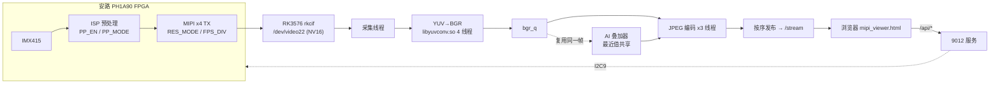

# 阶段归档报告 —— 网页控制台 + NPU 人体检测 / 危险动作识别

> 归档日期：**2026-10-16**
> 归档范围：`64b76e2` … `05931cf`（6 个提交，10-16 15:15 ~ 17:22）
> 前序基础：`f7c2bc9`（摄像头参数 + web 选项卡布局）、`9506865`（分辨率/帧率下拉）
> 相关文档：[`../rk/ai/README.md`](../rk/ai/README.md)、[`../rk/web/README.md`](../rk/web/README.md)、[`WORKLOG_2026-10-16.md`](WORKLOG_2026-10-16.md)

---

## 0. 一句话总结

在既有 **FPGA 采集 → MIPI x4 → RK3576** 视频链路上，叠加了一条**完整可交付的 NPU 视觉应用**：
`yolov8n` 人体检测 → `yolov8n-pose` 17 关节 → 可解释骨架规则的危险动作识别，
推理结果**直接画在推流帧上**（单路 MJPEG，零二次编解码），
配套 **9012 网页控制台**（5 个页签 / 参数自动存档 / 双向联动 / 模型档位热切换 / 纯骨骼隐私模式）。
**YOLO 帧率 17 → 26 fps**（不牺牲模型精度），CPU 从双进程 416% 降到单进程 270%。

---

## 1. 交付物清单

### 1.1 提交（本阶段 6 个）

| # | commit | 时间 | 内容 |
|---|---|---|---|
| 1 | `64b76e2` | 15:15 | **AI 全套入库**（26 文件 +5145 行）+ 帧率优先档把两级拆开跑（17→26 fps）+ 模型档位热切换 + 参数持久化 |
| 2 | `e17a84b` | 15:23 | 输出格式合并成单框（4K@25 / 1080P@60 / 720P@90）+ 下拉框样式统一 |
| 3 | `78fc62a` | 15:26 | 移除 AI / 摄像头页签里多余的说明文字 |
| 4 | `320e124` | 15:31 | 打开 FPGA 预处理时自动把 AI 标注切回原图（与"切 AI 自动关预处理"对称） |
| 5 | `707d214` | 16:34 | 新增「纯骨骼（黑底）」显示选项 |
| 6 | `05931cf` | 17:22 | 修好纯骨骼黑底模式"有人却没骨架"（共享帧内存被污染） |

**规模**：`26 files changed, 5266 insertions(+), 66 deletions(-)`（`64b76e2~1..05931cf`）

### 1.2 代码资产

| 文件 | 体积 | 说明 |
|---|---|---|
| `rk/web/mipi_webstream.py` | 99.7 KB | 9012 主服务：采集 → C 加速 YUV 转换 → JPEG 编码（3 线程）→ MJPEG 推流 + 全部 API |
| `rk/web/mipi_viewer.html` | 43.8 KB | 单页控制台（纯静态，`file://` 双击可用），5 页签 |
| `rk/web/ai_overlay.py` | 33 KB | AI 叠加器：推理线程 + 绘制（含纯骨骼模式）+ 热切换 + 存档 |
| `rk/web/state_store.py` | 3 KB | `state.json` 原子读写（临时文件 + `os.replace` + 线程锁） |
| `rk/ai/board/det_core.py` | 35.8 KB | 两级检测器：输入尺寸自适应、4 种输出布局解码、跟踪/EMA、空间约束 |
| `rk/ai/board/action_rules.py` | 11.5 KB | 8 条危险动作规则 + 时序状态机（中英双语元数据） |
| `rk/ai/board/ai_webstream.py` | 32.4 KB | 独立版服务（9013），供"从别处取流"场景使用 |
| `rk/ai/convert/*` | — | 模型准备：ONNX→RKNN、两阶段混合量化、ONNX 侧解码验证与回归测试 |
| `tools/board_probe_ai.sh` | — | 板上环境探测（解释器 / 依赖 / 设备 / 模型） |

---

## 2. 系统架构



**关键点**

* AI 推理**不占用视频链路时间**：采集/编码按 60 fps 跑，AI 按自己的限频跑，结果通过"最近值"共享给渲染线程；
* 标注**就地画在推流帧上** —— 只有一路 MJPEG，没有第二路流、没有二次编解码；
* 单进程集成（`AI=1 ./start_webstream.sh`）比"9012 + 9013 双服务"省掉一次 1080p JPEG 解码、一次 1280 JPEG 编码和一路回环流量（**416% → 270% CPU**）。

---

## 3. 实测指标

| 指标 | 数值 | 备注 |
|---|---|---|
| 视频帧率（1080P@60） | **59.6 fps** | 与是否开 AI 无关 |
| 一级检测 `yolov8n-slim` 640 | ~24 ms | NPU INT8 |
| 二级姿态 `yolov8n-pose-hybrid` 640 | ~29–33 ms | 关键点输出头 float16 |
| 两级**同帧串行** | 45 ms 长尾帧 | → 帧率被拖到 **17 fps** |
| **帧率优先档（跳姿态）** | **25–26 fps**（实测 26.9） | 骨架滞后一帧（~35 ms） |
| 关节最准档（逐帧姿态） | 16–17 fps（实测 16.4） | 骨架最顺 |
| 检测精度（COCO 参考图） | NPU INT8 `person 0.686` vs ONNX FP32 `0.712` | 框坐标差 ≤1 px |
| 关键点 | 15/17 高置信 | 与 FP32 一致 |
| 带宽占用 | 1080P@60 → 49.8% / 4K@25 → 82.9% / 720P@90 → 33.2% | ≤85% 才标 `ok` |

---

## 4. 功能说明

### 4.1 网页控制台（`mipi_viewer.html`，5 页签）

| 页签 | 内容 |
|---|---|
| **摄像头** | 曝光 / 增益 / 曝光补偿 / 白平衡 / 帧率 / **输出格式（单一下拉框）** |
| **预处理** | FPGA ISP 的 Sobel / 阈值分割 / 形态学等（`PP_EN` / `PP_MODE` + 参数） |
| **画面** | 画面源（原图 / AI 标注）、亮度对比度饱和度、旋转镜像、推流质量 |
| **V4L2** | 采集节点实际协商到的格式与帧率 |
| **AI 标注** | 模型档位、AI 帧率、检测阈值、关节范围 / 距框中心 / ROI 外扩、跌倒与奔跑灵敏度、显示开关 |

**输出格式单框**：只给三个选项，切换会同时写 FPGA `RES_MODE(0xE0)` + `FPS_DIV(0xC7)`、
改 RK 侧 sensor 子设备格式并重开采集（画面断 1~2 秒）：

| 选项 | 载荷 | 状态 |
|---|---|---|
| **1080P@60fps** | 49.8% | 默认，最稳 |
| **4K@25fps** | 82.9% | 可用（`MODE_SWITCH_SAFE=True`，实测可反复切） |
| **720P@90fps** | 33.2% | **FPGA RTL 未实现**，选它会提示且不切 |

模式表以 `mipi_webstream.py` 的 `MODES` 为单一事实来源（`/api/modes`），页面只从里面挑这三个 id；
服务端没有的档不会凭空出现。每条模式带 `impl`（RTL 能不能做出这个帧率）与 `ok`（带宽 ≤85%）两个标记。

**参数自动存档**：软件画面参数与 AI 设置写入服务端 `state.json`（`--state-file` 可改，传空 = 关闭），
页面刷新 / 换浏览器 / 服务重启后自动恢复；「重置参数」会把存档一起清掉。

**预处理 ↔ AI 双向联动**（对称，交替操作不会互相打架）：

| 动作 | 效果 |
|---|---|
| 画面源切到 `ai` / 重新启用 AI | 自动写 `PP_EN=0`，返回 `pp_off`（`已关闭` / `跳过(FPGA I2C 未启用)` / 失败原因） |
| 打开预处理（`PP_EN=1` 且 `PP_MODE≠0`） | 自动把 AI 画面源切回 `raw`，返回 `ai_off` |

> `PP_MODE=0` 是直通档，不算"打开预处理"，不触发联动 —— 已实测验证 4 个场景。

### 4.2 AI 标注

**两级 NPU 流水线**：`yolov8n`(COCO person) → 逐人 ROI `yolov8n-pose`(17 关键点) → 跟踪(ID) + 骨架 EMA → 动作状态机。

**危险动作规则（8 条，全部以人体框高做尺度归一化 + 持续时间去抖）**

| 标记 | 英文（画面上显示） | 判定（简化） | 级别 |
|---|---|---|---|
| `fall` | `Fall` 跌倒 | 躯干与竖直夹角 > 45° 且髀高 1.2s 内骤降，持续 0.35s | 🔴 报警 |
| `lying` | `Lying` 倒地不起 | 躯干角 > 65° 持续 2.5s | 🔴 报警 |
| `climb` | `Climb` 攀爬翻越 | 双手高于肩线 且（髀部 1.2s 抬升 > 0.18 身高 或 脚高于髀） | 🔴 报警 |
| `fight` | `Fight` 肢体冲突 | 腕部速度 > 5 身高/秒 持续 0.4s | 🔴 报警 |
| `intrude` | `Intrude` 越界闯入 | 脚部关键点落入警戒多边形，持续 0.3s | 🟠 提醒 |
| `run` | `Run` 奔跑 | 髀部速度 > 1.5 身高/秒 持续 0.6s | 🟠 提醒 |
| `handup` | `Help` 举手求救 | 双手高于肩线且身体近静止，持续 2s | 🟠 提醒 |
| `squat` | `Squat` 下蹲 | 髀部接近膝部高度 | ⚪ 记录 |

**级联空间约束**（一级框管住二/三级，三个门限缺一个都会复发）：

| 门限 | 作用 | 默认 |
|---|---|---|
| `roi_expand` | 二级输入范围（姿态只在框外扩 15% 的 ROI 里找关节） | 1.15 |
| `kpt_margin` | 二级输出（超出「框 ± 15% 宽/高」的关节判不可见） | 0.15 |
| **`kpt_scale_max`** | 二级输出**主力**（到框中心距离 ≤ 1.2×(框对角/2)） | 1.2 |

配套：`_kps_to_box` 先剔远点（防正反馈）、EMA **只对两帧都有效的点**做平滑（防鬼坐标污染历史）、
第三级 `clip_to_box()` 再过一遍，保证速度/角度/越界用同一份干净数据。

**显示内容**（用户明确要求"能看见"的部分）

| 显示项 | 位置 | 来源 |
|---|---|---|
| 视频帧率 | 顶部状态条 + AI 页签 | `/api/status` 的 `fps` |
| **YOLO 帧率** | 顶部状态条 + AI 页签 | `/api/ai` 的 `fps`（括号内为目标值） |
| **一级检测帧率** | 顶部状态条 + AI 页签 | `fps_det`（跳帧后真正执行检测的频率） |
| 耗时 检测/姿态 | AI 页签 | `det_ms` / `pose_ms` |
| **检测结果** | 顶部状态条（人数）+ AI 页签（逐人列表） | `ID / 置信度 / 框坐标 / 有效关节数 / 动作`，右上角标"多少 ms 前" |
| 画面角标（可选） | 画面左下角 | `YOLO 18.7/25 fps det 24ms pose 28ms` / `PERSONS 1 ID 14` |

### 4.3 纯骨骼（黑底）隐私模式

`POST /api/ai {"skeleton_only":true}`：画面整帧黑底，**只留骨架**（不画人体框、分数、动作标签）。
按风险级着色（绿/橙/红），关节点半径加大到 5，远程也能一眼认出姿势。
适合"要展示动作、但不暴露画面内容"的场景。

---

## 5. 关键决策与走过的弯路

### 5.1 帧率：拆帧，而不是换小模型

两级串在同一帧会出现 **45 ms 长尾帧**（det 30 + pose 35），帧率被它拖在 17 fps。
把两级拆开（检测帧跳过姿态，沿用上一帧关节）后每帧都是短帧 ⇒ **26 fps**，代价仅骨架滞后一帧。

**"换小模型"这条路已实测否决（别再走）**：

| 尝试 | 结果 |
|---|---|
| 一级 det → 512（`yolov8n-slim-512.rknn`） | 画面里较小的人**漏检**（反复出现"有人却报 0 人"） |
| 二级 pose → ultralytics 原生导出 384 / 320 | RKNN INT8 量化把**类别分支压成全 0、关键点置信度只剩零星值** ⇒ "有框无骨架"。把 cv2/cv3/cv4/Concat 全改 float16 也救不回来 |

⇒ 线上只用 640 那套（精度最高），两个小模型文件保留在 `models/` 仅作记录。

### 5.2 画面上只能用英文

`cv2.putText` 用的是 Hershey 字体，**没有汉字字形** —— 传中文进去渲染出来就是一串 `???`
（这就是框上时不时冒出"？？？"的原因）。
修法：`ACTION_META` 每个动作自带英文名（`en`），`actions/r['actions']/events` 同时给 `cn` 与 `en`；
**推流画面用 en，网页列表用 `英文 中文` 对照**；绘制前再过一道 `_ascii()` 兜底。

### 5.3 ★ 纯骨骼模式"有人却没骨架"—— 共享帧内存被污染（本阶段最值钱的坑）

原实现是**就地清屏**：

```python
if self.skeleton_only:
    frame[:] = 0        # ← 问题在这
```

而推理线程 `submit(frame)` 默认 `copy_frame=False`，**与编码线程共用同一块 numpy 内存**。
于是编码线程把这一帧涂黑后，AI 下一帧拿到的输入就是**全黑画面** → 检测不到人
→ 反过来一根骨头都画不出来。表现就是"黑底里明明有人，但什么都没有"。
（普通模式只在帧上画几条框线，对检测影响可忽略，所以一直没暴露。）

**修法**：新增 `_draw_skeleton_only()`，**另建一张黑图**只画骨架后返回，原帧保持干净；
同时去掉 `show_skeleton` 门控（纯骨骼模式看的就是骨架，不该被普通叠加的「骨架」开关挡住）。

**实测**：`skeleton_only=True` → `人数=1 关节=[17] fps=27.2`，抓帧确认黑底 + 完整 17 点骨架。

> **通用教训**：编码线程里画几笔无所谓，但**绝不能整帧改写**（涂黑 / 翻转 / 缩放 / 模糊）。

---

## 6. API 一览

**9012（集成模式）**

| 方法 | 路径 | 说明 |
|---|---|---|
| GET | `/stream` | MJPEG 推流 |
| GET | `/snapshot.jpg` | 取当前一帧 JPEG |
| GET | `/api/status` | 视频帧率、耗时、事件、动作 |
| GET | `/api/ai` | AI 状态：`fps` / `fps_target` / `fps_det` / `fps_pose` / `infer_count` / `det_ms` / `pose_ms` / `persons` / `detections` / `age_ms` / `events` / `presets` / `models.det_size`、`pose_size` / `kpt_dropped` / `kpt_far` |
| POST | `/api/ai` | 调参：`enabled` / `source` / `ai_fps` / `det_conf` / `tune` / `preset` / `show_skeleton` / `skeleton_only` … |
| GET | `/api/modes` | 输出格式表（单一事实来源） |
| POST | `/api/mode` | 切输出格式 `{"id":"4k25"}`，返回逐步执行 `log` |
| POST | `/api/fpga` | 写 FPGA 寄存器（预处理等）；可能返回 `ai_off` |

**9013（独立模式）**：`GET /api/status` / `POST /api/ai` / `GET /snapshot.jpg`（字段同名同义）。

**启动方式**

```bash
# 集成（推荐）：AI 挂在既有的 9012 里，复用已转好的 BGR 帧
cd /root/rk/web && AI=1 AI_SRC=ai ./start_webstream.sh /dev/video22 9012

# 独立服务 9013（需要从别处取流时才用）
SRC=http://127.0.0.1:9012/stream PORT=9013 AIFPS=6 bash /root/rk/ai/board/start_ai.sh
```

---

## 7. 已知限制 / 未完成

1. **720P@90fps 未实现** —— 缺 FPGA 侧 720p 裁剪（`ui_image_correction` 几何参数）与 90fps VTC 时序
   （当前 60 基分频）。网页已如实标注，选它不会误导。
2. **4K@25 的可用性依赖 `MODE_SWITCH_SAFE=True`**；4K 下 AI 与视频同时跑的资源余量未做长期压测。
3. **CPU 侧仍是 Python + rknnlite** —— 预处理/后处理占比不小。要更高 AI 帧率需改 C++
   （RGA 预处理 + MPP 硬编码），参考 `longnhan/Rockchip3576-AI-camera`。
4. **动作阈值是按常见监控视角调的**，换机位后需用页面滑块（跌倒/奔跑灵敏度）重新标定；
   空旷/纹理复杂场景建议把 `det_conf` 提到 0.45~0.5 抑制误检。
5. **更细的动作类别**（打架细分、摔倒后挣扎、未戴安全帽等）需自采数据训练轻量时序网络
   （ST-GCN / PoseC3D，量化后可跑 NPU）；当前规则的定位是"零训练、可解释、易调阈值"。
6. 画面本身的颜色/曝光问题（见项目主 README / WORKLOG）**与 AI 无关但影响检测效果**，
   建议先把曝光调到正常。

---

## 8. 复现与验收

```bash
# 1) 模型（PC/VM，需要外网；详见 rk/ai/README.md §4）
python rk/ai/convert/make_calib.py --out rk/ai/models/calib --n 20
#    一级：普通 INT8；二级：两阶段混合量化（关键点输出头保持 float16，代价 +3ms）
python rk/ai/convert/convert_rknn.py --onnx yolov8n.onnx --out yolov8n.rknn --target rk3576 --dataset dataset.txt
python rk/ai/convert/vm_hybrid.py patch --cfg yolov8n-pose.quantization.cfg --match "Concat_6_output_0_int8" --dtype float16

# 2) 部署
scp -r rk/ai rk/web afc03:/root/rk/

# 3) 运行 + 验收
ssh afc03
cd /root/rk/web && AI=1 AI_SRC=ai ./start_webstream.sh /dev/video22 9012
curl -s localhost:9012/api/ai | python3 -m json.tool | head -30     # fps / persons / detections
curl -s -o /tmp/a.jpg localhost:9012/snapshot.jpg && ls -l /tmp/a.jpg
```

页面：`http://192.168.137.100:9012/`（或本地双击 `mipi_viewer.html` 填地址连接）。

**验收要点**：① 视频帧率 59.6 fps 不受 AI 影响；② 帧率优先档 YOLO ≥25 fps；
③ 画面有人 ⇒ 框、骨架、动作标签齐全且无 `???`；④ 切 AI 自动关预处理、开预处理自动切回原图；
⑤ 重启服务后参数保持；⑥ 纯骨骼模式下黑底有骨架且检测不断（`persons` 不为 0）。
