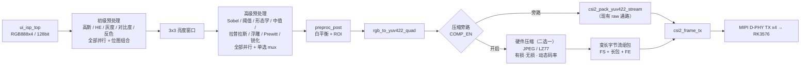

# 预处理算法扩展方案（V45）

> 状态：**方案评审稿，未开始实施**
> 日期：2026-10-18
> 适用工程：`08_csi2rk_mipi_imx415/fpga` + `rk/web`
> 版本号：`CFG_VER = 0x4501`

---

## 0. 关键约束（开工前确认）

### 0.1 不改动已验证的通路

- 现有 **MIPI RX → 解包 → 裁剪 → ISP → dbuf/FDMA → VTC → packer → frame_tx → D-PHY TX** 已实测通过，
  本次**不改其既有行为**，也不重复做链路级回归测试。
- 新增模块全部挂在 `ui_isp_top` 与 `rgb_to_yuv422_quad` 之间（V45），以及
  `rgb_to_yuv422_quad` 之后的**旁路**（V46）。
- V45 **不改** `ui_dbuf` / `ui_FDMA` / `ui_VTC` / `csi2_pack_yuv422_stream` / `csi2_frame_tx`，
  也不改 RK 驱动与 dts。
- V46 的变长 CSI-2 通路默认**关闭**（`COMP_EN=0`），只有显式开启才切到压缩流。

### 0.2 回归基线（验收口径）

| 配置 | 期望 |
|---|---|
| `BASIC_EN=0`、`PP_EN=0`、`COMP_EN=0` | 输出与当前 V43 bit **逐字节一致**（可用抓帧 MD5 对比） |
| `BASIC_EN=0`、`PP_EN=1` | 与原 V43 的 Sobel/阈值/形态学结果一致 |
| 任意预处理组合 | 帧高仍为 1080 / 2160，行数不丢失，色度平面不错位 |

### 0.3 资源红线

- ERAM 余量优先：压缩模块开启前先看 TD 报告，超限时按第 11.7 节顺序回退。
- 时序：以当前 `SWNS/HWNS` 为基线，新增路径不得让主时钟（148.5MHz）出现真实违例；
  原 `ui_dbuf` 的 -3.4ns 属厂商 SDC 缺失导致的误报，不作为本次判定依据。
- 不新增 PLL、不改变现有时钟树。

### 0.4 版本号

| 里程碑 | `CFG_VER` |
|---|---|
| V45 预处理 | `0x4501` |
| V46a JPEG 有损 | `0x4601` |
| V46b JPEG 无损 + 码控 | `0x4602` |
| V46c 变长 CSI-2 | `0x4603` |
| V46d LZ77 | `0x4604` |

### 0.5 Git 归档策略

- 仓库根：`08_csi2rk_mipi_imx415/`（已确认有 `.git`）。
- 开发分支：`feature/v45-preproc`；每完成一个**可编译/可回退**节点提交一次。
- 提交粒度（建议）：

| 提交 | 内容 |
|---|---|
| `V45-1` | `preproc_basic.v` 新增（含位图组合链） |
| `V45-2` | `preproc_edge.v` 扩展 8 模式 + 独立参数 |
| `V45-3` | `preproc_top.v` 级联 + 端口 |
| `V45-4` | `jpeg_regfile.v` / `cfg_ctrl_top.v` 寄存器与同步 |
| `V45-5` | `system_top.v` 连线 + `CFG_VER` |
| `V45-6` | Web（`mipi_webstream.py` + `mipi_viewer.html`） |
| `V45-7` | 仿真 TB + 文档（QUICKSTART / WORKLOG） |

- 每个提交前执行 `git status --short`，确保**没有**临时文件、日志、波形、bit 文件。
- 里程碑打 tag：`v45-preproc`、`v46-jpeg`…（tag 指向源码，不包含 bit）。
- 回退点：任一提交失败可直接 `git checkout <tag>`；不依赖文件系统备份。

### 0.6 测试文件与开发板资源纪律

- 仿真文件只保留**可复用**的：`fpga/sim/tb_basic.v`、`fpga/sim/tb_preproc.v`（扩展）；
  一次性验证脚本跑完即删。
- 波形/日志/`.vvp`/抓图统一输出到临时目录，验证结束删除；仓库内只留 `.gitignore` 规则。
- 板上验证：
  - 只用 `/tmp`，结束后 `rm -rf /tmp/<本次目录>`；
  - 不新增常驻进程、不新增开机自启、不覆盖现有 `start.sh` / 9012 服务；
  - 抓包文件限大小（例如 ≤ 8MB）且用完即删；
  - 不在 `/root` 留脚本副本，不留 `*.bak`、`*.log`、`*.jpg`。
- 不新增历史 boot 镜像 / bit 备份；烧写只保留当前与上一个可用版本。

### 0.7 本文档采用的默认决策

| 编号 | 决策 |
|---|---|
| 1 | 初级固定组合顺序：`高斯 → HE → 灰度 → 对比度 → 反色` |
| 2 | 对比度/反色并入初级（多选）；锐化/中值/拉普拉斯/浮雕/Prewitt 并入高级（单选） |
| 3 | 灰度保留 BT.601 / BT.709 两档系数（`BASIC_GRAY_MODE`） |
| 4 | 4K 下预处理全算法保留 |
| 5 | 压缩先做 JPEG（有损 → 无损 → 动态码率），LZ77 后做 |
| 6 | LZ77 "有损"= 前置量化；纯无损时只做码率整形 |
| 7 | ERAM 不足时允许 4K 下自动旁路压缩 |
| 8 | JPEG 走 CSI-2 `DT=0x18` 标准码流；LZ77 走自定义 DT |

---

## 1. 分层与选择语义（按赛题要求修正）

| 级别 | 选择方式 | 算法 | 硬件 |
|---|---|---|---|
| **初级预处理** | **多选位图，可全不选** | 灰度化、高斯滤波、直方图均衡（赛题三件套，**必须并行实现**）+ 可并入的低成本效果：对比度拉伸、反色 | 所有算法模块**同时钟并行工作**，位图只决定是否采用其结果 |
| **高级预处理** | **单选** | Sobel、阈值分割、形态学、中值、拉普拉斯、浮雕、Prewitt、锐化 | 所有算法模块**同时钟并行工作**，mux 选一路 |

关键点：

- 初级三件套**不是三选一**：三套硬件同时存在、同时计算，Web 上用复选框多选，也可以一个都不选（位图 = 0 → 直通原图）。
- 附加效果不单独设一级，按"能否低成本并行"并入：
  - **并入初级**：对比度拉伸、反色（纯点运算，逐像素可并行，不占行缓存）；
  - **并入高级**：中值、拉普拉斯、浮雕、Prewitt、锐化（都是 3×3 邻域运算，可复用同一窗口）。
- **每个算法都有独立参数寄存器**，互不共用（Sobel / 拉普拉斯 / Prewitt 的位移各自独立）。
- 初级与高级可同时生效（两级串联）。

---

## 2. 数据流与插入位置




- 初级预处理插在 `ui_isp_top` 与现有 `preproc_top` **之间**（即"现有预处理之前"）。
- 两级都**不改变帧的行结构**（进多少行出多少行），帧首两行纵向邻域无效时用当前行顶替。
- 下游 `preproc_post`、`rgb_to_yuv422_quad`、`csi2_pack`、RK 驱动与 V4L2 格式全部不动。

---

## 3. 初级预处理：算法、参数与组合顺序

### 3.1 算法与参数

| 位 | 算法 | 实现口径 | 独立参数 | 默认 |
|---|---|---|---|---|
| bit0 | 灰度化 | 亮度 `(77R+150G+29B)>>8`（BT.601）或 BT.709 系数，RGB 写同值 | 灰度系数档：0=BT.601，1=BT.709 | 0 |
| bit1 | 高斯滤波 | 3×3 二项式核 `[1 2 1;2 4 2;1 2 1]/16`，亮度域平滑后把亮度差加到 RGB（保色） | 强度 `0..8`（0=原亮度，8=完全高斯） | 8 |
| bit2 | 直方图均衡 | 一帧亮度直方图 → CDF → 256 项 LUT，下一帧生效；亮度域映射后把差值加到 RGB（保色） | 强度 `0..255`（与原图混合） | 255 |
| bit3 | 对比度拉伸 | `128 + (c-128)*(8+g)/8`，逐通道 | 强度 `0..8`（0=恒等） | 4 |
| bit4 | 反色 | `255 - c`，逐通道 | 无 | — |

> 首版高斯固定 3×3。若后续要 5×5，需再增加 2 行行缓冲（可作为可选扩展，不影响接口）。

### 3.2 组合顺序（固定，不随位图变化）

```
输入 → [高斯] → [直方图均衡] → [灰度] → [对比度] → [反色] → 输出
```

- 每个方括号的硬件**每个时钟都在算**，位图只决定"这一级用不用它的结果"。
- 顺序固定可保证同样的位图每次得到同样画面，便于网页显示"当前处理链"。
- 举例：

| 位图 | 实际效果 |
|---|---|
| `0b00000` | 直通原图 |
| `0b00001` | 灰度（最常用） |
| `0b00010` | 保色高斯 |
| `0b00100` | 保色直方图均衡 |
| `0b00110` | 先高斯再均衡（保色） |
| `0b00111` | 高斯 → 均衡 → 灰度 |
| `0b11000` | 先对比度拉伸再反色（负片） |
| `0b11111` | 全链路 |

### 3.3 直方图均衡的工程细节

| 项 | 方案 |
|---|---|
| 统计 | 每时钟 4 像素，4 个 bank 轮转，每拍只统计 1 个 lane（≈1/4 采样）；形状不变，避免 4 写口冲突与同 bin 连续读改写覆盖 |
| 位宽 | 每 bank `256 × 24bit`（4K 单 lane 一帧可达 ~2.07M，16bit 会溢出） |
| 帧尾检测 | 行计数达到 `v_active`（不依赖 `tuser`，本工程实测 `S_ISP_O_tuser` 恒 0） |
| 构建时机 | 最后一行结束后进入场消隐，约 1300 拍：求和 512 + 除法 32 + 写 LUT 512 + 清零 256 |
| 时间余量 | 1080p 场消隐约 99k 拍，4K 更长 → 不需要双缓冲 |
| 归一化 | 一次 Q12 除法 `scale = (255<<12)/(total-cdfmin)`，逐 bin 乘法得 LUT |
| 纯色保护 | `total == cdfmin` 时跳过本次构建，保留上一帧 LUT，避免整幅变黑 |

---

## 4. 高级预处理：算法、参数（单选）

| 模式值 | 算法 | 实现口径 | 独立参数 | 默认 |
|---|---|---|---|---|
| 0 | 关闭 / 原图 | 直通 | — | — |
| 1 | Sobel | `|Gx|+|Gy|`，右移后截顶 255 | 位移 `0..8` | 3 |
| 2 | 阈值分割 | 亮度 `>= 阈值` → 255 | 阈值 `0..255` | 128 |
| 3 | 形态学 | 对二值图做 3×3 腐蚀/膨胀 | **自己的阈值** `0..255` + 腐蚀/膨胀 | 128；膨胀 |
| 4 | 中值滤波 | 严格 3×3 中值（rank 计数法，含重值处理） | 无（窗口固定 3×3） | — |
| 5 | 拉普拉斯 | `|4c-上-下-左-右|`，右移 | **自己的位移** `0..8` | 3 |
| 6 | 浮雕 | 对角核 `[-2 -1 0;-1 1 1;0 1 2]` | 增益 `0..8` + 偏置 `0..255` | 4；128 |
| 7 | Prewitt | 与 Sobel 同形，权重全 1 | **自己的位移** `0..8` | 3 |
| 8 | 锐化 | `d=4c-(上+下+左+右)`，`out=c+d*gain/8`（保色） | 强度 `0..8` | 4 |

> 模式 1~8 输出灰度（RGB 三通道相同），与现有 Sobel/阈值/形态学一致。

---

## 5. 硬件并行实现方式

### 5.1 初级

```
                ┌──────────────┐
 像素流 ──┬────►│ 高斯 (3x3)   ├─┐
          │     └──────────────┘ │
          │     ┌──────────────┐ │   ┌─────────┐
          ├────►│ 直方图均衡    ├─┼──►│ 组合链  │──► 输出
          │     └──────────────┘ │   │ (位图)  │
          │     ┌──────────────┐ │   └─────────┘
          ├────►│ 灰度         ├─┤
          │     └──────────────┘ │
          │     ┌──────────────┐ │
          ├────►│ 对比度       ├─┤
          │     └──────────────┘ │
          │     ┌──────────────┐ │
          └────►│ 反色         ├─┘
                └──────────────┘
```

- 五套模块**同时实例化、同时钟工作**，不存在分时复用或运行时重构。
- 位图 = 0 时输出原图，但模块仍在跑（赛题要求"必须并行实现"）。

### 5.2 高级

- 八套算法共用同一个 3×3 亮度窗口，各自并行计算，`ADV_MODE` 单选 mux。
- 切换算法只改 mux 选择，不中断流水线、不丢行。

### 5.3 跨时钟域

- 所有配置仍走 `jpeg_regfile`（25MHz）→ `cfg_ctrl_top` 2 级同步到像素域。
- 参数准静态，多比特同时变化最多影响 1 帧，可接受。

---

## 6. 寄存器映射（每个算法独立参数）

### 6.1 初级预处理

| 地址 | 名称 | 位宽 | 范围 | 含义 |
|---|---|---|---|---|
| `0xF0` | `BASIC_EN` | 5 | 0..31 | bit0 灰度 / bit1 高斯 / bit2 直方图均衡 / bit3 对比度 / bit4 反色 |
| `0xF1` | `BASIC_GRAY_MODE` | 1 | 0/1 | 0=BT.601，1=BT.709 |
| `0xF2` | `BASIC_GAUSS_STR` | 4 | 0..8 | 高斯强度 |
| `0xF3` | `BASIC_HE_STR` | 8 | 0..255 | 直方图均衡强度 |
| `0xF4` | `BASIC_CONTRAST` | 4 | 0..8 | 对比度强度 |

### 6.2 高级预处理

| 地址 | 名称 | 位宽 | 范围 | 含义 |
|---|---|---|---|---|
| `0xB0` | `PP_EN` | 1 | 0/1 | 高级总使能（0 = 强制直通） |
| `0xB1` | `ADV_MODE` | 4 | 0..8 | 0=关闭 1=Sobel 2=阈值 3=形态学 4=中值 5=拉普拉斯 6=浮雕 7=Prewitt 8=锐化 |
| `0xB2` | `ADV_SOBEL_SH` | 4 | 0..8 | Sobel 位移 |
| `0xB3` | `ADV_THRESH` | 8 | 0..255 | 阈值分割阈值 |
| `0xB4` | `ADV_MORPH_SEL` | 1 | 0/1 | 0=腐蚀，1=膨胀 |
| `0xB5` | `ADV_MORPH_TH` | 8 | 0..255 | 形态学自己的阈值 |
| `0xB6` | `ADV_LAP_SH` | 4 | 0..8 | 拉普拉斯位移 |
| `0xB7` | `ADV_PREW_SH` | 4 | 0..8 | Prewitt 位移 |
| `0xF5` | `ADV_EMBOSS_GAIN` | 4 | 0..8 | 浮雕增益 |
| `0xF6` | `ADV_EMBOSS_BIAS` | 8 | 0..255 | 浮雕偏置（默认 128） |
| `0xF7` | `ADV_SHARP_GAIN` | 4 | 0..8 | 锐化强度 |

全部可回读，网页以回读值为准。

---

## 7. Web 改造

### 7.1 页面结构（`mipi_viewer.html`）

「预处理」页签分两块 + 一条链路提示：

1. **初级预处理（多选）**
   - 5 个复选框：灰度化 / 高斯滤波 / 直方图均衡 / 对比度拉伸 / 反色
   - 每个复选框**右侧直接挂自己的参数**，未勾选时置灰：
     - 灰度：系数档（BT.601 / BT.709）
     - 高斯：强度滑块 0..8
     - 直方图均衡：强度滑块 0..255
     - 对比度：强度滑块 0..8
     - 反色：无参数
2. **高级预处理（单选）**
   - 按钮组：关闭 / Sobel / 阈值 / 形态学 / 中值 / 拉普拉斯 / 浮雕 / Prewitt / 锐化
   - 只有**当前选中项**的参数显示：
     - Sobel / 拉普拉斯 / Prewitt：各自独立的位移滑块
     - 阈值分割：阈值
     - 形态学：阈值 + 腐蚀/膨胀
     - 浮雕：增益 + 偏置
     - 锐化：强度
3. **当前处理链**（只读文本）
   - 例：`高斯(6) → 直方图均衡(255) → 灰度 → 对比度(2) → 高级:Sobel(3)`

### 7.2 服务端（`mipi_webstream.py`）

- `FPGA_REGS` 增加初级 5 个 + 高级 6 个新寄存器；`fpga_meta()` 自动带出。
- `FPGA_PRESETS` 增加：`gray`、`gauss`、`he`、`gauss_he`、`gray_contrast`、`negative`、`sobel`、`thresh`、`morph`、`median`、`lap`、`emboss`、`prewitt`、`sharpen`。
- 切到 AI 标注时自动关闭两级（`BASIC_EN=0`、`PP_EN=0`），避免 AI 拿处理过的画面。
- API 端点不变，仍是 `GET/POST /api/fpga`。

---

## 8. 资源与时序评估

| 项 | 估算 | 说明 |
|---|---|---|
| 3×3 行缓冲 | +2 套 ≈ +7 ERAM | 初级、高级各一套（960 字/行 × 32bit × 2 行） |
| 直方图 | ≈ 2 ERAM | 4 × 256 × 24bit |
| LUT | ≈ 1 ERAM | 4 × 256 × 8bit |
| 组合逻辑 | slices 约 23% → 27~29% | 中值 rank 网络（每像素 36 比较器）是最大新增项 |
| DSP | +少量 | 除法后乘法、锐化/对比度乘法 |

时序风险：中值网络与锐化/对比度乘法在同一级。若 TD 报 SWNS 明显变差，统一插 1 级流水（两级一起加，不破坏对齐）。

---

## 9. 验证计划

### 9.1 仿真（iverilog）

| 用例 | 检查点 |
|---|---|
| 灰度 | 任意 RGB → 输出等于对应系数档亮度 |
| 高斯 | 阶跃边缘经 3×3 二项式核后与 Python 模型逐像素一致 |
| 直方图均衡 | CDF 单调不减；LUT 值域 0..255；纯色不黑屏；下一帧才变化 |
| 组合位图 | 32 种位图各跑一遍，输出与"固定链路模型"完全一致 |
| 高级模式 | 1~8 与预期一致；各自参数独立生效（改 A 不影响 B） |
| 回归 | 现有 Sobel/阈值/形态学结果与改动前逐字节一致 |

### 9.2 板上 A/B

- 直写寄存器 + 抓 NV16，量化：灰度均值/方差、边缘强度、HE 前后直方图分布。
- 确认帧高仍是 1080 / 2160（不丢行），下游色度不错位。
- `CFG_VER = 0x4501` 用于确认板上跑的是新 bit。

---

## 10. 实施顺序

1. `preproc_basic.v`（按位图组合链重写）
2. `preproc_edge.v`（8 模式 + 独立参数）
3. `preproc_top.v`（级联）
4. `jpeg_regfile.v` / `cfg_ctrl_top.v`（新寄存器与同步）
5. `system_top.v`（连线 + `CFG_VER=0x4501`）
6. Web（`mipi_webstream.py` + `mipi_viewer.html`）
7. 仿真 + 文档
8. TD 编译 + 板上验证

**V46（最后级压缩，见第 11 章）**

9. JPEG 有损编码器（rgb2yuv → linebuf → DCT → 量化 → Huffman → 头部）
10. JPEG 无损 + 动态码率闭环
11. 变长 CSI-2 组包 + RK 驱动/解码
12. LZ77 编码器 + 二选一 mux
13. Web 压缩控制（JPEG/LZ77、有损/无损、目标码率）

---

## 11. 最后级硬件压缩编码器（JPEG / LZ77 二选一）

> 建议作为**独立里程碑 V46**：先完成 V45 预处理，再接压缩，避免一次改动过大。

### 11.1 插入位置与通路

- **取数点**：`rgb_to_yuv422_quad` 输出（YUV422，4 px/clk）。
- **不能插在 `ui_dbuf` 写侧**：dbuf/FDMA 的 DDR 地址按固定 16bpp 步进计算，压缩后变长会把三帧缓存地址逻辑全部推翻。
- **保留 raw 通路**：压缩作为**旁路**，`COMP_EN=0` 时行为与现在完全一致（回归安全、可一键回退）。

```
                  ┌──────────── raw 通路（现有）────────────┐
YUV422 4px/clk ──┤                                          ├──► csi2_frame_tx
                  └─► JPEG / LZ77 ─► 变长字节流 FIFO ────────┘
```

- 压缩码流是**变长**的，不能复用"每行固定 beat 数"的 `csi2_pack_yuv422_stream`；
  需要新增 `csi2_pack_varlen`（FS 短包 + 若干长包 + FE），并在 `csi2_frame_tx` 前 mux。
- `COMP_EN=0` 时压缩模块整体复位/关时钟，不占动态功耗。

### 11.2 二选一与并行

- `jpeg_encoder_top` 与 `lz77_encoder_top` **同时例化**，`COMP_SEL` 选择输出。
- 未选中的编码器用 clock enable 关闭（保留寄存器状态），切换只在帧边界生效。
- 未选中时另一路的输出 FIFO 停止写入，避免溢出。

### 11.3 JPEG 编码器

| 模式 | 实现 | 关键参数 |
|---|---|---|
| **有损** | SOF0 baseline：AAN 1D-DCT ×2（5 乘法器）+ 量化（8 乘法器）+ Huffman + 0xFF 填充 | `QUALITY 1..100`、`SUBSAMPLE 4:4:4/4:2:2/4:2:0`、`RESTART_INT` |
| **无损** | SOF3：DPCM 预测器（1..7，默认 MED/LOCO-I）+ 残差 Huffman，复用位打包与头部生成 | `PREDICTOR 0..7` |
| **动态码率** | 逐帧闭环：`err = 目标字节数 - 实际字节数`，`scale` 积分调整并限幅；`inv_q[]` 双缓冲，帧边界生效 | `TARGET_BYTES 0..16M`、`RC_EN`、`RC_SPEED 1..15` |
| **VBR** | `RC_EN=0` 时按 `QUALITY` 固定量化，码率随内容自然变化 | — |

**现状**：`jpeg_regfile.v` / `jpeg_qtable_ram.v` / `jpeg_cmd_1wire.v` / `jpeg_defs.vh` 已存在，
且寄存器字段（lossless / quality / target / rc / subsample / restart / predictor）已预留；
**其余 11 个模块均未实现**（rgb2yuv、linebuf、fdct1d、dct2d、quant_zz、huff_tbl、huff_enc、
lossless、headers、rate_ctrl、encoder_top），是本方案工作量最大的一块。

### 11.4 LZ77 编码器

| 项 | 方案 |
|---|---|
| 算法 | 滑动窗口 + 匹配 `(offset, length)` + 字面量；帧头 `'LZ7'` + 版本 + 原始长度 + 压缩长度 + CRC32 |
| 有损/无损 | LZ77 **本身无损**。"有损"通过**前置量化**实现（4:2:0、亮度位深截断、死区量化），由 `LZ77_LOSSY_Q` 控制；若不需要，有损模式只由 JPEG 提供 |
| 字典 | 8KB / 16KB / 32KB 三档（`LZ77_DICT_LOG2`） |
| 匹配 | hash 链 + 16 字节并行比较，稳态 ≥ 2 字节/拍 |
| 动态码率 | 无损下压缩比由内容决定，**无法真正闭环**。三种策略：<br>① 前置量化 + 目标码率闭环（有损 LZ77）<br>② 纯无损 + 带宽整形（超限丢帧 / 跨帧分片，需 RK 侧重组）<br>③ 纯无损 + 只统计不控制 |
| 预期压缩比 | 自然图像约 **1.3~2.5 : 1**（远低于 JPEG，需在文档/网页里如实标注） |

### 11.5 传输封装与 RK 侧改造

| 方案 | CSI-2 DT | 帧格式 | RK 侧 |
|---|---|---|---|
| **A. 标准 JPEG**（建议先做） | `0x18`（JPEG 8-bit） | 每帧一个 `SOI..EOI` blob | rkcif 按 JPEG 收整帧 → MPP 硬解（`jpegd`）→ NV12 → 现有网页链路 |
| **B. LZ77 自定义** | `0x30`（user-defined）或复用 `0x18` | 自定义帧头 + 压缩数据 | 驱动加 raw passthrough，用户态软件解压（CPU 开销需实测） |

需要改动的 RK 侧文件：

- `rk/driver/milianke_mipi.c`：新增 V4L2 格式（`V4L2_PIX_FMT_JPEG` 或自定义 fourcc）、按帧长自适应；
- `rk/web/mipi_webstream.py`：新增解码后端（JPEG→MPP/OpenCV；LZ77→软件解压）；
- `rk/deploy` / `dts`：一般不用改，但需确认 rkcif 对非 16bpp 格式的 stride 处理。

**最大风险**：现有整条链路（packer / frame_tx / rkcif）都假设"每行固定字节数 + YUV422"。
变长码流必须先做**板上最小验证**：FPGA 发一帧固定内容的 JPEG，确认 rkcif 能拿到完整 blob，
再谈解码与推流。

### 11.6 带宽与码率参考

| 模式 | 1080p60 | 4K25 |
|---|---|---|
| 原始 YUV422 | 248.8 MB/s（49.8%） | 414.7 MB/s（82.9%） |
| JPEG Q80（≈8:1） | ≈31 MB/s | ≈52 MB/s |
| JPEG Q50（≈16:1） | ≈15.5 MB/s | ≈26 MB/s |
| LZ77 无损（1.3~2.5:1） | 100~190 MB/s | 166~319 MB/s |

> 压缩收益主要在**存储/网络/解码 CPU**，MIPI 链路本身不会因此提速（除非同步降低 link rate）。

### 11.7 资源与时序评估

| 模块 | 主要资源 | 备注 |
|---|---|---|
| JPEG 行缓冲 | 1080p：8 行 × 1920 × 16bit ≈ **30 KB ERAM**；4K：≈ **61 KB** | 4K 下占用明显 |
| JPEG DCT/量化 | 13 个乘法器 + 8×64bit 转置 RAM | DSP 有余量 |
| JPEG Huffman | ROM ≈ 2×(162+162) 项 | 由 `jpeg_defs.vh` 生成 |
| LZ77 字典 | 8/16/32 KB → **4/8/16 个 ERAM** | 4K + 32KB 时最紧张 |
| LZ77 匹配 | hash 表 + 16 路并行比较 | 组合深度较大，需要流水 |

- 当前工程已用 **56 个 ERAM**；压缩全开（4K + 32KB 字典）预计再增 **40~60 个**，
  需先确认 PH1A90 的 ERAM 总量与布线余量。
- 若余量不足，回退顺序：① 4K 下压缩旁路；② 字典降到 8KB；③ JPEG 行缓冲减到 4 行（4:2:0）。

### 11.8 新增寄存器（压缩相关）

| 地址 | 名称 | 范围 | 含义 |
|---|---|---|---|
| `0x90` | `COMP_EN` | 0/1 | 压缩总使能（0 = raw 旁路） |
| `0x91` | `COMP_SEL` | 0/1 | 0=JPEG，1=LZ77 |
| `0x92` | `LZ77_DICT_LOG2` | 12..15 | 字典大小 4KB/8KB/16KB/32KB |
| `0x93` | `LZ77_LOSSY_Q` | 0..8 | LZ77 前置量化强度（0 = 纯无损） |
| `0x94` | `COMP_THROTTLE` | 0..3 | 无损码率整形策略（0=不限 1=丢帧 2=分片） |
| `0x95` | `COMP_STATUS` | RO | bit0 编码中 / bit1 FIFO 溢出 / bit2 帧超长 |
| `0xA0~0xA2` | `FRAME_BYTES` | RO | 上一帧压缩字节数（现有字段，直接复用） |
| `0x02~0x09` | JPEG 参数 | — | 现有字段：目标字节数 / 质量 / RC / 采样 / 重启 / 预测器 |

### 11.9 分阶段实施

| 阶段 | 内容 | 验收 |
|---|---|---|
| A | JPEG 有损编码器 + 内部 FIFO 抓包（不动 MIPI 通路） | 码流可被 PC 解码，PSNR 达标 |
| B | JPEG 无损 + 动态码率闭环 | 目标码率误差 < 5%，帧间平滑 |
| C | 变长 CSI-2 组包 + RK 驱动/解码 | 板上取到完整 JPEG，MPP 解码成功 |
| D | LZ77（无损 + 可选前置量化） | 压缩比、吞吐达标 |
| E | 二选一 mux + Web 控制 | 网页可切 JPEG/LZ77、有损/无损、目标码率 |

### 11.10 风险与回退

- 默认 `COMP_EN=0`，raw 通路**零影响**，任何阶段出问题都能一烧回退。
- `CFG_VER` 按阶段递增（建议 V46a=0x4601、V46b=0x4602…）。
- RK 侧解码不通时，先用 PC 侧离线验证码流（保存 FIFO 数据到文件 → ffmpeg/自定义脚本解码）。

---

## 12. 待确认

1. 初级固定组合顺序 `高斯 → HE → 灰度 → 对比度 → 反色` 可以吗？
2. 对比度、反色并入**初级（多选）**，锐化/中值/拉普拉斯/浮雕/Prewitt 并入**高级（单选）**，这个归属可以吗？
3. 灰度要不要 BT.709 系数档（若不要，`BASIC_GRAY_MODE` 可省）。
4. 4K 下算法是否全部保留（行缓冲按 3840 上限固定分配）。
5. **压缩顺序**：先做 JPEG（有损 → 无损 → 动态码率），LZ77 后做，可以吗？
6. **LZ77 有损**：用"前置量化"实现可以吗？还是 LZ77 只做纯无损、有损只由 JPEG 提供？
7. **4K + 压缩**：若 ERAM 不够，允许 4K 下自动旁路压缩吗？
8. **压缩输出形态**：接受"JPEG 走 DT=0x18 标准码流 / LZ77 走自定义 DT"这个方案吗？
   （需同步改 RK 驱动与网页解码后端）

---

## 13. 当前改动与回退

此前按旧理解（初级三选一）写过初版 RTL，**未编译、未仿真**，与新方案不一致，需要重做：

```
M fpga/uisrc/01_rtl/ctrl/cfg_ctrl_top.v
M fpga/uisrc/01_rtl/jpeg/jpeg_regfile.v
M fpga/uisrc/01_rtl/preproc/preproc_edge.v
M fpga/uisrc/01_rtl/preproc/preproc_top.v
?? fpga/uisrc/01_rtl/preproc/preproc_basic.v
```

回退到干净状态：

```bash
cd 08_csi2rk_mipi_imx415
git checkout -- fpga/uisrc/01_rtl/ctrl/cfg_ctrl_top.v \
                fpga/uisrc/01_rtl/jpeg/jpeg_regfile.v \
                fpga/uisrc/01_rtl/preproc/preproc_edge.v \
                fpga/uisrc/01_rtl/preproc/preproc_top.v
rm fpga/uisrc/01_rtl/preproc/preproc_basic.v
```
