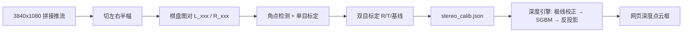

# 点云图标定教程（双目：内参 + 外参 + 基线）

日期：2026-10-31
适用：`rk/web/stereo_depth.py`（板端 SGBM 稀疏点云）+ 网页双目四宫格「深度点云」框
本文件里的**实测数据**都标了来源；没上板验证过的部分明确写「待上板验证」。

---

## 0. 先看这三行

1. 点云现在用的是**估算值**：焦距由水平视场角 FOV 反算、主点在画面正中、基线写死 45 mm。
   所以点云"看着像"，但**尺度不准**（拿尺子量 1 m 的纸板，HUD 可能显示 0.8~1.3 m 都有可能）。
2. 标定就是把这几个数**换成实测**：左/右目内参 `fx fy cx cy k1..k3`、两目相对位姿 `R/T`、
   基线 `|T|`。做完后引擎还会先做**极线校正**（去畸变 + 行列对齐）再匹配，视差会更干净。
3. 当前 bit 的**右半幅（cam0）每行多 2 个 32bit word**（相邻行水平偏移实测 −4.00 px/row，
   左半幅 0.00），这是 FPGA 行打包的问题，**软件修不了**。这种输入下标定出来的外参是错的。
   **先修 FPGA，再标定。** 引擎现在会检测并直接报「右目数据异常(每行 x px 斜移)」。

---

## 1. 原理（够用版）

视差 → 深度：

$$z = \frac{f \cdot B}{d}$$

- $f$：焦距（像素，**校正后**的值）
- $B$：两目光心距离（基线，本项目实测中心距 **45 mm**）
- $d$：同一物点在左右目图像上的列坐标差（视差，像素，与 $f$ 同一分辨率）

深度精度（1 像素视差引起的深度误差）：

$$\Delta z = \frac{z^2}{f \cdot B}$$

以 $f\approx1660$ px（1920 宽、约 60° 水平视场）、$B=0.045$ m 为例（**推算**，标定后会变）：

| 距离 z | 视差 d | 1 px 视差 = 深度误差 |
|---|---|---|
| 0.5 m | 74 px | ±6.7 mm |
| 1.0 m | 37 px | ±27 mm |
| 2.0 m | 18 px | ±107 mm |
| 3.0 m | 12 px | ±240 mm |

结论：**45 mm 基线只适合近距**（0.3~2 m 最好，>3 m 基本只能看轮廓）。这不是算法问题，
是 $B$ 决定的；想要远处准，只能加基线或加长焦。

引擎里的有效窗口是 `Z_MIN..Z_MAX = 0.15..4.0 m`、视差上限 128（512 宽处理时对应 ≈0.15 m）。

---

## 2. 准备

| 项 | 要求 | 备注 |
|---|---|---|
| 棋盘格 | **9×6 内角点**（即 10×7 个方格），方格 20~30 mm | A4 打印后**用卡尺量 10 个格子的总长 ÷ 10**，别信打印标称值 |
| 刚性 | 棋盘贴在硬板/铝板上，不能弯 | 纸弯了角点会系统性偏移 |
| 光照 | 均匀、无反光、不逆光 | 反光会让 SB 角点检测整片失败 |
| 姿态 | 15~20 对，覆盖画面四角 + 中心，左右各转 ±20°，上下 ±15°，远近两档 | 只拍正对的一组，解出来的 `fx/cx` 会很不稳 |
| 机位 | 两目**不动**，只动棋盘 | 标定的是"这一刻"的 R/T，模组一动就作废 |

---

## 3. 采集（板上跑，10 分钟）

工具：`tools/stereo_calib_capture.py`（已部署到 `/root/rk/web/`）

它**不读 `/dev/video22`**（会和 `mipi-webstream` 抢设备），而是拉推流
`http://127.0.0.1:9012/stream`（3840×1080 的拼接图），切成左右半幅存 PNG。

```bash
# 1) 确认在跑、且是双目
curl -s http://127.0.0.1:9012/api/status | grep -o '"width":[0-9]*,"height":[0-9]*'
#   3840x1080 = 双目拼接中；1920x1080 = 还是单目，先在网页点「双目」

# 2) 交互采集：回车存一对 / a 连拍 / q 退出
cd /root/rk/web
/opt/miniforge3/envs/mlk-ov/bin/python stereo_calib_capture.py -o calib_pairs

# 3) 或者无人值守连拍 20 对（每 1.2 s 一对，这期间你自己挪棋盘）
/opt/miniforge3/envs/mlk-ov/bin/python stereo_calib_capture.py -o calib_pairs -n 20 -i 1.2
```

工具会**主动拦掉**坏帧并说明原因：

- `画面接近全黑(左 x / 右 y)` → 那一路没图（没插模组 / 双目没开）
- `右目每行斜移 -4.0 px（FPGA 行打包问题，先修）` → 就是本文第 0 节那个 bug

采完把图对拉回本机备份（可选，标定可以在板上直接做）：

```powershell
scp -r afc03:/root/rk/web/calib_pairs .\calib_pairs
```

---

## 4. 解算（板上或 PC 都能跑）

工具：`tools/stereo_calib_solve.py`

```bash
cd /root/rk/web
/opt/miniforge3/envs/mlk-ov/bin/python stereo_calib_solve.py \
    --pairs calib_pairs --cols 9 --rows 6 --square 25 \
    --out /root/rk/web/stereo_calib.json
```

- `--cols/--rows` 是**内角点**数（10×7 格 → 9×6 点），填错一定找不到角点。
- `--square` 单位 **mm**（程序内部全用 mm，最后把基线换成 m 写进 JSON）。
- 张数多、想同时精修内参：加 `--refine`（张数 <12 时反而更抖，建议先不加）。

输出长这样（下面是**合成自检**的真实输出，见第 6 节）：

```
== 参与解算 12 对 ==
  左目 fx/fy    : 799.69 / 799.69 px     主点 (640.21, 359.95)
  基线 |T|      : 44.98 mm  (T=[-44984.08, 1.69, 62.24] mm)
  单目 RMS      : 左 0.020 px  右 0.022 px
  立体 RMS      : 0.021 px
```

**三个验收闸门**（工具会自己提示）：

| 指标 | 合格 | 不合格说明 |
|---|---|---|
| 单目 RMS | < 0.5 px | 图糊 / 棋盘不硬 / 姿态太单一 |
| 立体 RMS | < 1.0 px | 两目时间不同步（人动了）/ 有一路被斜移 bug 污染 |
| 基线 \|T\| | 45 mm ± 3 mm | **方格实际边长填错**（差几倍就是单位/边长问题） |

> 曾经踩过的坑：自检脚本里棋盘纹理用「40 px/格」渲染、解算却按「25 mm/格」，
> 结果 45 mm 基线解成 **28.11 mm**（正好 25/40）。所以基线明显偏小时，先查边长，别怀疑算法。

---

## 5. 落地：让引擎用上标定

```bash
ls -l /root/rk/web/stereo_calib.json     # 默认路径 = stereo_depth.py 同目录
```

引擎行为（`rk/web/stereo_depth.py`）：

1. **有 `stereo_calib.json`** → 用标定的 `K/D/R/T` 先做**极线校正**
   （`stereoRectify` + `initUndistortRectifyMap`，按处理分辨率生成并缓存），
   然后 SGBM，再按标定的 `fx/cx/cy` 反投影；基线用 `|T|`。
2. **没有它 / 解析失败** → 退回「FOV 估焦距 + 45 mm + 主点居中」，和以前一模一样，并打一行
   `[depth] 标定文件有问题, 退回 FOV 估算: ...` 到 stderr。
3. **文件按 mtime 热加载**：重新解算覆盖同名文件后，**不用重启服务**，下一帧就用新参数。
4. 输入分辨率必须与 `image_size` 一致；不一致时引擎直接报
   `标定按 1920x1080 做的, 当前输入 ...`，而不是拿错的内参硬算。
5. 想临时回到未标定：把文件改名（`mv stereo_calib.json stereo_calib.json.bak`）即可，同样是热的。
   也可以用环境变量指到别的文件：`DEPTH_CALIB=/root/rk/web/stereo_calib_4k.json`。

网页上怎么看出来：

- 点云框右上角 HUD：未标定显示 `60° / 55ms`（FOV 模式）；标定后 `/api/depth` 会带
  `calib:true` 与 `focal_px`，HUD 显示 `fx` 值。底部那行一直显示 `基线 45mm`（用的是标定值）。
- **标定后右键改 FOV 无效**（引擎不再读它）——这是刻意的，避免两套参数打架。

---

## 5.5 怎么知道 FOV（没标定之前）

网页上点云比例尺直接取决于 `depth_fov`：**填小了整个点云比视频大一圈，填大了就小一圈**
（HUD 里那个 `45°估` 的「估」就是提醒）。三条路，从准到快：

### 本项目镜头（已知参数，直接用这一条）

规格：焦距 **4.2 mm**、M12、标称 D82°/H72°/V56°、畸变 ≤1（基本无畸变）、
两镜头中心距 **45 mm**。

| 来源 | 水平 FOV | 说明 |
|---|---|---|
| 规格书 H:72° | 72° | 是 **1/2.3″、4:3** 口径；本机是 IMX415 1/2.8″ + **16:9** 裁剪，不能直接照抄 |
| 焦距 4.2 mm + IMX415 有效宽 5.603 mm | **67.4°** | $2\arctan(5.603/2/4.2)$ |
| 实测点云角度边界 | **≈67°** | 点上 ax 实测 ±0.66，$\arctan(0.66)\times2=66.9°$ |

三者对上，所以本机应填 **`depth_fov = 67`**（已写入板端参数，对应 `focal_px = 1450`）。
等效焦距自检：`4.2 mm / 1.45 µm / 2（1080p 输出宽 1920）= 1448 px`，与引擎报的 1450 一致。

畸变 ≤1 意味着标定时可以把畸变系数固定为 0（`--no-dist`），少估 5 个参数、结果更稳。

### A. 看镜头焦距（最快，误差 <2%，只要知道镜头 mm 数）IMX415 有效像素 3864×2192、像元 1.45 µm（`docs/IMX415_datasheet.txt`），传感器有效宽
**5.603 mm**，所以：

$$\text{FOV}_h = 2\arctan\frac{5.603}{2 f_{mm}}$$

```bash
python3 tools/fov_estimate.py --lens 3.6     # -> 75.8°
python3 tools/fov_estimate.py --lens 6       # -> 50.0°
```

| 镜头焦距 | 水平 FOV | 说明 |
|---|---|---|
| 2.8 mm | 90° | 广角，畸变明显 |
| 3.6 mm | 75.8° | 常见安防镜头 |
| 4 mm | 70.0° | |
| 6 mm | 50.0° | 视场偏窄、远处更准 |
| 8 mm | 38.6° | 长焦 |
| 12 mm | 26.3° | 远距 |

⚠ 规格书常标的是**对角** FOV，别直接填：`python3 tools/fov_estimate.py --diag 90` 会换算成水平。

### B. 量尺法（不用知道镜头，误差 1~3%，5 分钟）

把镜头对着墙，用卷尺量出**画面左右边缘正好对上**的两个点之间的实际宽度 $W$（墙到镜头
距离 $L$）：

$$\text{FOV}_h = 2\arctan\frac{W}{2L}$$

```bash
python3 tools/fov_estimate.py --ruler 1180 --dist 1000   # 1 m 处看到 1.18 m -> 61°
```

要点：量的是**画面左右边缘**（不是墙上的任意两点）；$L$ 从镜头前主面算，误差 2 cm 可忽略。

### C. 已知物体法（只有一张抓拍也行）

画面里放个已知宽度的东西（A4 纸宽 210 mm 最好，横放），量它在抓拍图里占多少像素：

$$f_{px} = \frac{p_{px}\cdot L}{W_{obj}},\qquad \text{FOV}_h = 2\arctan\frac{W_{img}}{2 f_{px}}$$

```bash
python3 tools/fov_estimate.py --obj 210 --dist 800 --px 520   # A4 纸 0.8m 处占 520px
```

### D. 目视对齐（30 秒，只保证“看起来一致”）

右键点云框改 FOV，让点云里某个物体的左右边缘和视频里同一物体对齐即可。快，但数值不可信，
事后还是建议按 A/B 定下来。

### E. 标定之后就不用猜了

`stereo_calib_solve.py` 现在会直接打印 `水平视场角 = 2*atan(W/2/fx)`；引擎读到标定文件后
用 `fx` 反算 FOV，`depth_fov` 被忽略（HUD 从 `45°估` 变成 `fx1663`）。

---

## 6. 先自证工具链（不连板也能跑）

```bash
cd /root/rk/web
/opt/miniforge3/envs/mlk-ov/bin/python stereo_calib_solve.py --selftest
```

它会合成 12 对「已知 f=800 px、B=45 mm」的棋盘图，走**完整流程**（角点检测 → 单目标定 →
双目标定 → 立体校正）。2026-10-31 板上实测（cv2 5.0.0）：

```
  左目 fx/fy    : 799.69 / 799.69 px     主点 (640.21, 359.95)
  基线 |T|      : 44.98 mm
  单目 RMS      : 左 0.020 px  右 0.022 px
  立体 RMS      : 0.021 px
  自检: f 误差 0.04%  基线误差 0.04%  => PASS
```

这条 PASS 只证明**解算+写文件这条链是对的**，不代表板上的真实标定做完了。

---

## 7. 验收：拿尺子量，不看图好看

1. 切双目，进「深度热力图」框（固定视角：近红远蓝，像素位置即视频位置；
   右键可改水平视场角，只影响深度数值不影响画面布局）。
2. 正对一块平板（打印纸/白板），用卷尺量 **0.5 / 1.0 / 1.5 m** 三个距离，各停 5 s。
3. 看 HUD 的「近 .. m 远 .. m」（取的是 z 的 8%/92% 分位），或直接在板上取数：

```bash
curl -s http://127.0.0.1:9012/api/depth | python3 -c "import sys,json;d=json.load(sys.stdin);print(d.get('calib'), d.get('focal_px'), d.get('baseline_m'), d.get('zmed'))"
```

容差建议：**±5% 或 ±3 cm（取大者）**。超过就先查：

| 现象 | 先查什么 |
|---|---|
| 所有距离都按同一比例偏大/偏小 | 基线（`|T|` 是否 45 mm）、方格边长是否填对 |
| 近处准、远处明显偏大 | 正常（$z^2$ 关系）；确认没超出有效窗口 |
| 点云左右歪 / 同一平面是斜坡 | 极线校正没生效（JSON 里 `rect` 为空？`calib:false`？） |
| 中间一大片无点 | 无纹理（白墙）：SGBM 需要纹理，铺张报纸再试 |
| 有效像素 < 2% 直接报"匹配失败" | 两目不同步（人在动）/ 曝光差异太大 / 右目那条斜移 bug |

---

## 8. 常见问题

**Q: 找不到角点（左× 右×）？**
A: 依次查：内角点数填错（9×6 不是 10×7）→ 棋盘没拍全 → 反光/过曝 → 方格小于 20 mm 在
512 宽下太少。工具会把跳过的文件名和原因打出来，别硬凑张数。

**Q: 标定后点云反而更差了？**
A: 多半是「标定分辨率 ≠ 当前输入」。引擎会报错而不是硬算；把输出格式切回标定时的分辨率
（1080p 标定的就用在 1080p），或按新分辨率重标。

**Q: 标定文件写哪？可以放本机吗？**
A: 引擎跑在板上，必须放板上（默认 `/root/rk/web/stereo_calib.json`）。本机只用来存档。

**Q: 换模组 / 拧过螺丝 / 摔过之后？**
A: 外参作废，**必须重标**（内参可以沿用，但重标一次最省事）。

**Q: 双目帧率 30，标定要 30fps 吗？**
A: 不要。采集工具读的是 30 fps 推流，但每次只用**一帧静止画面**；棋盘别动就行。
两目是 FPGA 交替出帧拼成的（同一对里帧号相邻），静止场景没有同步误差。

---

## 9. 文件清单

| 文件 | 作用 |
|---|---|
| `rk/web/stereo_depth.py` | 深度引擎；有 `stereo_calib.json` 就做极线校正 + 用标定内参 |
| `tools/stereo_calib_capture.py` | 采集成对棋盘图（`L_xxx.png` / `R_xxx.png`） |
| `tools/stereo_calib_solve.py` | 角点检测 + 单目/双目标定 → `stereo_calib.json`；`--selftest` 合成自证 |
| `docs/STEREO_CALIB_TUTORIAL.md` | 本文 |

数据流：


